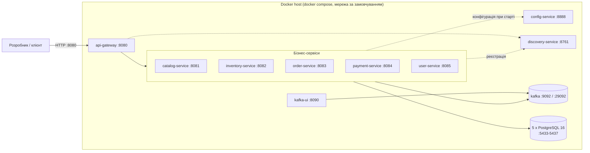
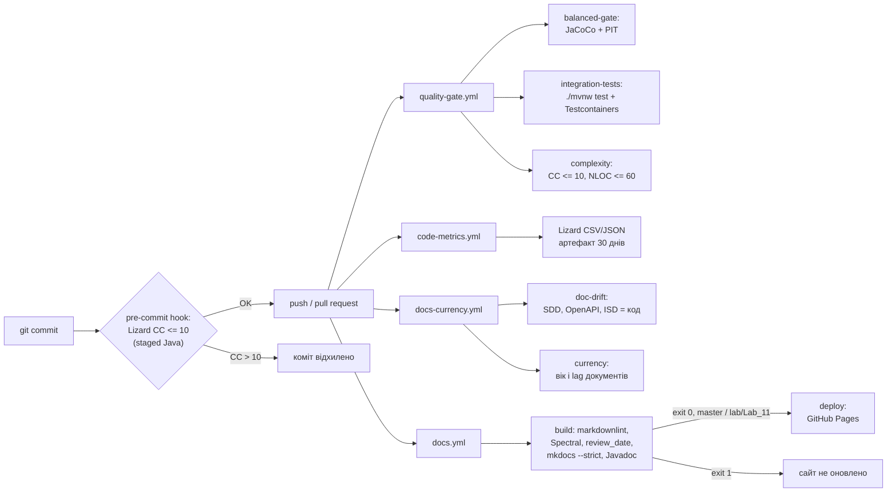

# ISD — Infrastructure Specification Document: Plant Shop

| Поле | Значення |
|---|---|
| Тип документа | документація продукту, експлуатаційна |
| Аудиторія | DevOps, розробники (локальний запуск), QA (тестове середовище) |
| Цикл перегляду | 90 днів або при кожній зміні `docker-compose.yml`, `Dockerfile`, `k8s/`, `helm/`, `.github/workflows/` (див. [`maintenance.md`](../developer/maintenance.md)) |
| Пов'язані документи | [`sdd.md`](sdd.md) — що саме розгортається; [`README.md`](../index.md) — швидкий старт |

> Документ описує **де і на чому система працює**: топологію, середовища, змінні оточення, CI/CD, моніторинг,
> резервне копіювання. Внутрішня будова компонентів — у [SDD](sdd.md). Таблицю порядку запуску (розділ 5)
> перевіряє `./scripts/doc-drift-check.sh` проти `docker compose config`.

## 1. Топологія розгортання

| Варіант | Для чого | Що піднімається | Статус |
|---|---|---|---|
| Локально з IDE | розробка, налагодження | у Docker лише БД + Kafka; Spring-сервіси — `java -jar` | підтримується |
| Docker Compose (`docker-compose.yml`) | основне середовище dev / демо | усі 15 контейнерів | **основний, повний** |
| Kubernetes (minikube): `k8s/` і Helm `helm/plantshop` | навчальне «production-like» середовище | 7 Spring-сервісів, 4 БД, Kafka, Ingress | **неповний: немає user-service і user-db** (див. розділ 3, ризик R1) |
| Хмара | — | — | не використовується |



## 2. Збірка образів

Один кореневий `Dockerfile` збирає будь-який модуль: `docker build --build-arg SERVICE=<module> .`
(етап `maven:3.9.9-eclipse-temurin-21`, кеш `~/.m2`; runtime `eclipse-temurin:21-jre`, користувач `spring`
без root). Для Kubernetes образи збираються прямо в Docker minikube з версійними тегами (`1.0.0`, `1.1.0`,
ніколи `latest`): `./scripts/build-images.sh`.

## 3. Компоненти та їх розгортання

Опис відповідальності кожного компонента — у [SDD, розділ 3](sdd.md#3-компоненти).

| Компонент | Compose: контейнер, порт хоста | Kubernetes / Helm | Репліки dev / prod (Helm) | Перевірка здоров'я |
|---|---|---|---|---|
| api-gateway | `plantshop-api-gateway`, 8080 | Deployment + NodePort (`k8s/`: 30080; Helm dev: призначає k8s) / LoadBalancer (Helm prod) + Ingress `plantshop.local` | 2 / 3 | k8s: startup, liveness, readiness (`/actuator/health/*`) |
| config-service | `plantshop-config-service`, 8888 | Deployment + ClusterIP | 1 / 1 | compose: TCP-порт; k8s: probes |
| discovery-service | `plantshop-discovery-service`, 8761 | Deployment + ClusterIP | 1 / 1 | compose: TCP-порт; k8s: probes |
| catalog-service | `plantshop-catalog-service`, 8081 | Deployment + ClusterIP | 2 / 3 | k8s: probes |
| inventory-service | `plantshop-inventory-service`, 8082 | Deployment + ClusterIP | 1 / 1 | k8s: probes |
| order-service | `plantshop-order-service`, 8083 | Deployment + ClusterIP | 1 / 1 | k8s: probes |
| payment-service | `plantshop-payment-service`, 8084 | Deployment + ClusterIP | 1 / 1 | compose: TCP-порт 8084 (на нього чекає order-service); k8s: probes |
| user-service | `plantshop-user-service`, 8085 | **не розгорнуто** | — | — |
| catalog / inventory / order / payment-db | `plantshop-<name>-db`, 5433–5436 | Deployment (`Recreate`) + Service + PVC 1Gi | 1 | `pg_isready` |
| user-db | `plantshop-user-db`, 5437 | **не розгорнуто** | — | `pg_isready` |
| kafka | `plantshop-kafka`, 9092 (хост), 29092 (мережа compose) | Deployment KRaft + Service + PVC 1Gi | 1 | `kafka-broker-api-versions.sh` |
| kafka-ui | `plantshop-kafka-ui`, 8090 | не розгортається | — | — |

Kubernetes: кожен Spring Deployment має requests/limits, init-контейнер `wait-for-dependencies` (Kubernetes не має
`depends_on`), `RollingUpdate` з `maxSurge: 1`, `maxUnavailable: 0`, `minReadySeconds: 15`.

## 4. Середовища та змінні оточення

| Середовище | Де | Конфігурація | Дані |
|---|---|---|---|
| **dev** | ноутбук розробника: Docker Compose або minikube з `values-dev.yaml` | YAML config-service + типові значення змінних | seed-міграції (10 рослин, 5 синтетичних користувачів) |
| **test** | GitHub Actions `ubuntu-24.04`; локально `./mvnw test` | `<service>/src/test/resources/application.yml`: без config server, Eureka і Kafka-слухачів, імпорт тих самих YAML config-service | PostgreSQL з Testcontainers, створюється на кожен прогін |
| **prod** (навчальний, production-like) | minikube, `helm install ... -f values-prod.yaml` | образи `1.1.0`, 3 репліки gateway/catalog, LoadBalancer, повний JIT | PVC; пароль БД лише через `--set database.password=...` |

Змінні оточення (значення секретів тут не наводяться; типові значення — лише для локальної розробки):

| Змінна | Хто читає | Типове значення / джерело | Секрет |
|---|---|---|---|
| `CONFIG_SERVER_URL` | усі Spring-сервіси | `http://localhost:8888` | ні |
| `EUREKA_URL` | усі Spring-сервіси | `http://localhost:8761/eureka` | ні |
| `KAFKA_BOOTSTRAP_SERVERS` | бізнес-сервіси | `localhost:9092` (compose: `kafka:29092`) | ні |
| `DB_HOST` / `DB_PORT` | бізнес-сервіси | `localhost` / 5433…5437 (у контейнерах 5432) | ні |
| `DB_USERNAME` / `DB_PASSWORD` | бізнес-сервіси, БД | k8s Secret `plantshop-db-secret`, Helm `database.password` | **так** |
| `INTERNAL_API_TOKEN` | order-service, user-service | лише змінна оточення; dev-значення в YAML не для prod | **так** |
| `PRIVACY_PSEUDONYMIZATION_KEY` | user-service | лише змінна оточення | **так** |
| `EMAIL_PROVIDER_API_KEY` | user-service | лише змінна оточення | **так** |
| `PAYMENT_MAX_AMOUNT` | payment-service | `10000` | ні |
| `SHOP_NAME` / `SHOP_CURRENCY` | catalog-service (`/api/catalog/info`) | `Plant Shop` / `UAH` | ні |
| `APP_VERSION` | catalog-service | `dev` (k8s: тег образу) | ні |
| `JAVA_TOOL_OPTIONS` | JVM усіх сервісів (k8s) | `-XX:MaxRAMPercentage=70 -XX:+UseSerialGC ...` | ні |
| `SONAR_TOKEN` | `scripts/sonar-*.sh` (аналітика, не runtime) | лише з оточення, ніколи у файлах | **так** |

## 5. Порядок запуску

Docker Compose стартує контейнери хвилями за `depends_on`; усі залежності мають умову `service_healthy`.
Стовпчик «Чекає на» — це рівно те, що повертає
`docker compose config` (залежності за алфавітом).

| Контейнер | Чекає на (depends_on) | Хвиля |
|---|---|---|
| `catalog-db` | - | 1 |
| `inventory-db` | - | 1 |
| `order-db` | - | 1 |
| `payment-db` | - | 1 |
| `user-db` | - | 1 |
| `kafka` | - | 1 |
| `config-service` | - | 1 |
| `kafka-ui` | kafka | 2 |
| `discovery-service` | config-service | 2 |
| `api-gateway` | config-service, discovery-service | 3 |
| `catalog-service` | catalog-db, config-service, discovery-service, kafka | 3 |
| `inventory-service` | config-service, discovery-service, inventory-db, kafka | 3 |
| `order-service` | config-service, discovery-service, kafka, order-db, payment-service | 4 |
| `payment-service` | config-service, discovery-service, kafka, payment-db | 3 |
| `user-service` | config-service, discovery-service, kafka, user-db | 3 |

Запуск з IDE: `docker compose up -d catalog-db inventory-db order-db payment-db user-db kafka kafka-ui`, потім
config-service → discovery-service → бізнес-сервіси (payment-service раніше за order-service) → api-gateway.
У Kubernetes init-контейнери order-service чекають лише config, discovery, Kafka і order-db: трекінг до старту
payment-service повертає 503 (див. ADR-0003).

## 6. CI/CD-конвеєр і Quality Gates



| Workflow / засіб | Тригер | Стадії (jobs) | Quality Gate | Блокує? |
|---|---|---|---|---|
| `scripts/git-hooks/pre-commit` | кожен `git commit` (після `./scripts/install-hooks.sh`) | Lizard у контейнері над staged-вмістом | CC ≤ 10 для кожного методу; без Docker — fail closed | так, локально |
| `.github/workflows/quality-gate.yml` | push у `master`, будь-який PR | `balanced-gate` | покриття ≥ 80 % **і** mutation score ≥ 65 % для `secure-logging`; інші модулі — звіт | так (secure-logging) |
| | | `integration-tests` | `./mvnw -B test`, усі тести зелені | так |
| | | `complexity` | CC ≤ 10 і ≤ 60 NLOC на функцію (`tools/lizard`, без мережі, 1 CPU / 256 MB) | так |
| `.github/workflows/code-metrics.yml` | кожен push і PR | `lizard-report` | лише вимірює, артефакт `lizard-report` | ні |
| `.github/workflows/docs-currency.yml` | кожен push і PR | `doc-drift` | кожен ендпоінт коду є в SDD, кожна операція `docs/api/openapi.yaml` є в коді, порядок запуску compose = ISD 5 (`scripts/doc-drift-check.sh`) | так |
| | | `currency` | звіт віку та lag документів (`scripts/doc-currency.sh`) у Step Summary | ні |
| `.github/workflows/docs.yml` | кожен push і PR | `build` | markdownlint 0 помилок; Spectral 0 errors для контракту API; `mkdocs build --strict` (мертві посилання, якорі, сторінки поза nav = exit 1); звіт `review_date` у Step Summary; Javadoc | так |
| | push у `master` або `lab/Lab_11` після зеленого `build` | `deploy` | публікація `site/` на GitHub Pages (`actions/deploy-pages`) | — |

Захист від «плаваючих» метрик: закріплені образ раннера (`ubuntu-24.04`), збірка JDK (`21.0.8+9`), версії
плагінів у `pom.xml` та образи аналізаторів у `tools/`.

**CD (доставка)** застосунку не автоматизована: реліз виконує людина командами розділу 7. Автоматично
доставляється лише сайт документації (`docs.yml` → GitHub Pages, <https://vladdhoryn.github.io/Plant_Shop/>).

**Фактичний стан CI на 2026-11-14:** workflows ще жодного разу не запускались на GitHub — GitHub API повертає
`"total_count": 0` запусків, а в `origin/master` каталогу `.github/` немає (гілки лабораторних 7–10 не запушені).
Конвеєр вище описує, що буде виконуватись після push; локально кроки перевірено в Linux-контейнері (ризик R5).

## 7. Реліз і відкат

| Середовище | Реліз | Відкат |
|---|---|---|
| Compose | `git checkout <tag>` → `docker compose up -d --build <service>` | попередній коміт/тег → `docker compose up -d --build <service>` |
| Kubernetes (`k8s/`) | `kubectl -n plantshop set image deploy/<svc> <svc>=plantshop/<svc>:<версія>`; `rollout status` | `kubectl -n plantshop rollout undo deploy/<svc>` |
| Helm | `helm upgrade plantshop helm/plantshop -n <ns> -f values-<env>.yaml` (hook `pre-upgrade-check` перевіряє 4 БД і версії Flyway; при помилці реліз не змінюється) | `helm rollback plantshop <revision> -n <ns>` (той самий hook `pre-rollback`) |

Схема БД лише «вперед»: Flyway-міграції не відкочуються, тому відкат коду можливий, доки нова міграція
сумісна зі старим кодом (додавання стовпців/таблиць, без перейменувань).

## 8. Сховища даних

| Сховище | Compose | Kubernetes | Що втрачається при `down -v` / видаленні PVC |
|---|---|---|---|
| 5 × PostgreSQL 16 | іменовані томи `catalog-db-data` … `user-db-data` | PVC 1Gi на кожну з 4 БД | усі бізнес-дані; Flyway відтворить порожню схему + seed |
| Kafka (KRaft) | **без тому** (лог у файловій системі контейнера) | PVC 1Gi | події в дорозі; стан саги в БД сервісів залишається |

## 9. Моніторинг і журнали

| Що | Як зараз | Ціль / прогалина |
|---|---|---|
| Живість і готовність | Actuator `health`, `info` (лише ці endpoints відкриті); k8s probes; compose healthchecks | — |
| Журнали | stdout контейнерів, `docker compose logs -f <svc>` / `kubectl logs`; PII замасковані `secure-logging`; `X-Correlation-Id` у кожному запиті | централізований збір (Loki/ELK) — не налаштовано |
| Kafka | Kafka UI `http://localhost:8090` (лише compose) | lag споживачів не алертиться |
| Реєстр сервісів | Eureka dashboard `http://localhost:8761` | — |
| Метрики й алерти | **відсутні** (немає Prometheus/Grafana) | прогалина R3: виявлення збою — вручну |
| Продуктивність | k6-сценарій `perf/k6/catalog-search.js`, `scripts/perf-gate.sh` (p95) | запускається вручну |

## 10. Резервне копіювання і відновлення (RTO / RPO)

**RPO** (Recovery Point Objective) — яку максимальну частину даних за часом допустимо втратити.
**RTO** (Recovery Time Objective) — за який час система має знову працювати після збою.

| Сховище | Критичність | Метод | Частота | Цільовий RPO | Цільовий RTO |
|---|---|---|---|---|---|
| `order-db`, `payment-db` | висока (гроші, замовлення) | `pg_dump -Fc` | щоденно + перед кожним релізом | 24 год | 1 год |
| `user-db` | висока (персональні дані; копія шифрується, зберігається не довше політики приватності) | `pg_dump -Fc` | щоденно | 24 год | 1 год |
| `catalog-db`, `inventory-db` | середня | `pg_dump -Fc` | щоденно | 24 год | 2 год |
| Kafka | низька: події — транспорт, стан у БД | не копіюється | — | події в дорозі | перестворення брокера, 15 хв |
| Конфігурація, схема, інфраструктура | — | Git (config-service YAML, Flyway, `k8s/`, `helm/`) | кожен коміт | 0 | час `docker compose up` (~2–3 хв) |

Чесний статус: **цільові значення визначені, автоматичного розкладу копіювання ще немає** — копії знімаються
вручну командами нижче (ризик R2 у handover-пакеті). Процедуру перевірено тренуванням на тимчасовому
контейнері PostgreSQL 16 з міграціями catalog-service: dump 0,49 с, restore 0,42 с, 10 з 10 рослин відновлено
(`docs/lab-10/backup-drill.txt`). RTO 1 год містить запас на діагностику і перевірку, а не лише на restore.

```bash
# Резервна копія однієї БД (compose); повторити для catalog/inventory/order/payment/user
docker exec plantshop-order-db pg_dump -U plantshop -d order_db -Fc -f /tmp/order_db.dump
docker cp plantshop-order-db:/tmp/order_db.dump ./backups/order_db-$(date +%F).dump
```

```bash
# Відновлення: зупинити сервіс, відновити, запустити (Flyway побачить уже застосовані міграції)
docker compose stop order-service
docker cp ./backups/order_db-2026-11-14.dump plantshop-order-db:/tmp/restore.dump
docker exec plantshop-order-db pg_restore -U plantshop -d order_db --clean --if-exists /tmp/restore.dump
docker compose start order-service
```

У Kubernetes ті самі команди виконуються через `kubectl -n plantshop exec deploy/order-db -- ...`.
Після відновлення однієї БД можливий розсинхрон із сусідніми сервісами (наприклад, замовлення `PENDING` без
платежу): такі замовлення знаходяться запитом `status = 'PENDING'` і скасовуються вручну.

## 11. Відомі ризики інфраструктури

| ID | Ризик | Наслідок | План |
|---|---|---|---|
| R1 | user-service і user-db відсутні в `k8s/` і Helm (додані 2026-10-25, після Kubernetes-лабораторної 2026-10-15) | у k8s маршрути `/api/users/**`, `/api/marketing/**`, `/api/analytics/**` повертають помилку; анонімізація замовлень недоступна | додати Deployment/Service/PVC за зразком order-service |
| R2 | немає автоматичного резервного копіювання | фактичний RPO = час від останньої ручної копії | CronJob / планувальник з `pg_dump`, перевірка відновлення раз на місяць |
| R3 | немає метрик і алертів | збій помічає користувач | Actuator `prometheus` + Prometheus/Grafana |
| R4 | Kafka в compose без тому | після `docker compose rm kafka` втрачаються непрочитані події | іменований том для `/var/lib/kafka/data` |
| R5 | ~~`scripts/quality-gate.sh` без біта виконання~~ — **закрито** 2026-11-14: 14 скриптів `scripts/*.sh` і Maven Wrapper `mvnw` мали режим `100644`, а `quality-gate.yml` викликає `./mvnw` (jobs balanced-gate, integration-tests) і `./scripts/quality-gate.sh`; у Linux-контейнері це давало `Permission denied`, exit 126 (`docs/lab-10/ci-exec-bit-before.txt`) | gate не виконувався б узагалі | `git update-index --chmod=+x` для `mvnw` і всіх `scripts/*.sh`; перевірка після виправлення — `docs/lab-10/ci-exec-bit-after.txt` |
