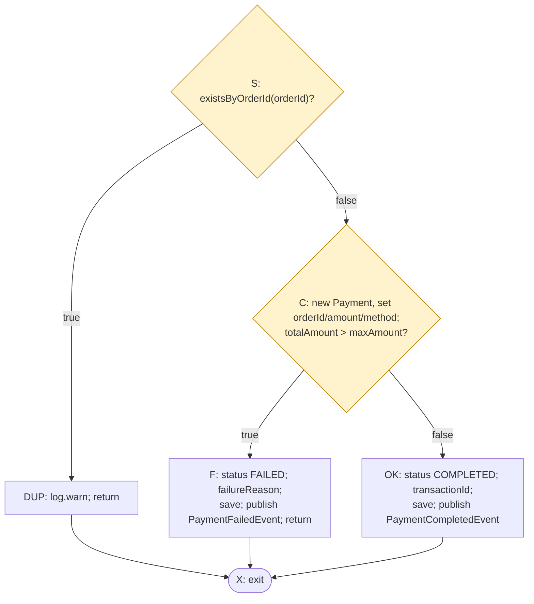
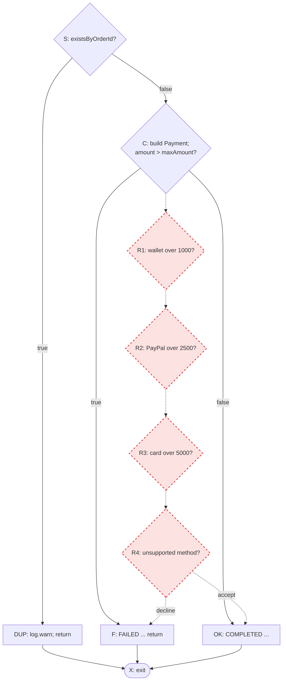
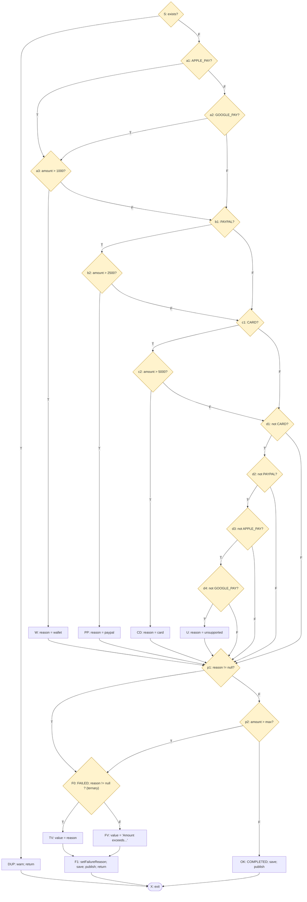
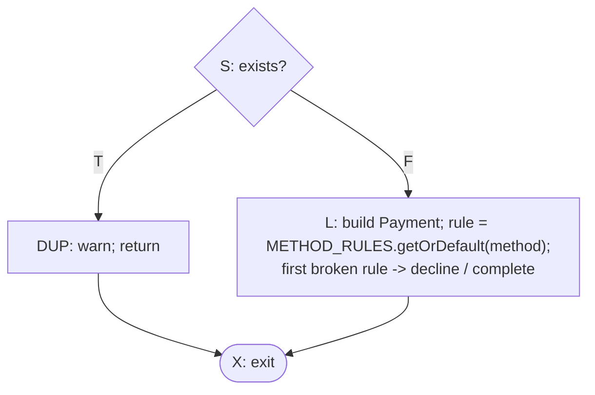

# Аудит складності Plant Shop: Холстед, графи CFG, lookup tables і pre-commit hook

Усі числа нижче — це виводи інструментів, збережені в [`docs/complexity/`](complexity) (текстові «скріншоти»
консолі). Кожен крок відтворюється командою з розділу «Відтворення». Git-історія в гілці `lab/Lab_6`.

---

## Завдання 1. Первинний скринінг репозиторію за Холстедом

### 1.1. Декларація інструментального стеку

| | |
|---|---|
| Сканер Холстеда | **`tools/halstead/halstead.py` 1.0** — CLI на лексері **Pygments 2.21.0** (`JavaLexer`), Python 3.13.17 |
| Контрольний сканер | **multimetric 2.4.5** (той самий образ) |
| Сканер цикломатичної складності | **Lizard 1.24.3** (`tools/lizard/Dockerfile`, з попередньої лабораторної) |
| Інсталяція | `docker build -t plantshop/halstead:1.0-py3.13.17 tools/halstead` (образ збирається лише якщо проходять ручні тести `test_halstead.py`); без Docker: `pip install pygments==2.21.0 multimetric==2.4.5` |
| Запуск (глобальне сканування) | `docker run --rm -v "$PWD:/src:ro" plantshop/halstead:1.0-py3.13.17 $(git ls-files '*/src/main/java/*.java')`, або `./scripts/halstead-report.sh` |
| Конфігурація | правила класифікації токенів: `tools/halstead/halstead.py` (`classify`, `JAVA_OPERATORS`); середовище: `tools/halstead/Dockerfile`, `tools/lizard/Dockerfile` |

**Класифікація токенів (за умовою):**
- **оператори (η₁, N₁)** — ключові слова (`if`, `return`, `new`, `public`, `class`, `int`…), знаки операцій (`=`, `==`, `&&`, `->`, `::`…), роздільники (`( ) { } [ ] ; , .`) та анотації (`@Transactional` — модифікатор, як ключове слово);
- **операнди (η₂, N₂)** — ідентифікатори (змінні, поля, методи, типи, аргументи), константи `true`/`false`/`null`, рядкові, символьні й числові літерали;
- **не рахуються** — коментарі, пробіли, оголошення `package`/`import`.

**Чому власний CLI, а не готовий `multimetric`.** Аналіз вихідного коду `multimetric` 2.4.5 показав дві вади, через
які його числа для Java не відповідають визначенню Холстеда:
1. **ключові слова Java не рахуються взагалі** (ні як оператори, ні як операнди), а імена класів і методів
   рахуються як оператори; через це глобальний словник давав η₁ = 437;
2. сам Pygments розбиває багатосимвольні оператори на символи (`&&` → `&`, `&`; `->` → `-`, `>`), а рядковий
   літерал — на лапки й вміст.

`halstead.py` склеює оператори назад (`==`, `!=`, `<=`, `>=`, `&&`, `||`, `->`, `::`, `++`, `+=`…) і об'єднує
літерал в один операнд. Правильність перевірено тестами з ручним підрахунком: `int f(int a) { return a + 1; }` →
η₁ = 8, N₁ = 9, η₂ = 3, N₂ = 4. Вади видно й на результатах: `multimetric` ставить DTO вище за платіжний сервіс
(E 54 021 проти 44 212), а за коректним підрахунком навпаки (35 888 проти 49 615). Від визначення токенів залежить
навіть ранжування.

### 1.2. Глобальна базова лінія (Global Baseline Scan)

Вивід консолі: [`complexity/halstead-baseline.txt`](complexity/halstead-baseline.txt) (коміт `76989e6`,
189 production-файлів `*/src/main/java`).

| Міра | Значення |
|---|---|
| η₁ — унікальні оператори | **127** |
| η₂ — унікальні операнди | **1 508** |
| N₁ — усі оператори | **13 019** |
| N₂ — усі операнди | **7 889** |
| η = η₁ + η₂ — словник | **1 635** |
| N = N₁ + N₂ — довжина | **20 908** |
| V = N · log₂η | 223 194.5 біт |
| LOC / SLOC | 5 657 / 3 111 |

η₁ = 127 — це майже весь «алфавіт» мови Java, який використовує проєкт. η₂ = 1 508 — це словник предметної
області: імена, рядки, константи.

### 1.3. Матриця архітектурного поштучного аналізу

| Шар | Файл | LOC | η₁ | η₂ | N₁ | N₂ | η | N | V, біт | D | E |
|---|---|---|---|---|---|---|---|---|---|---|---|
| Core Domain | `payment-service/.../PaymentService.java` — платіжний модуль: ідемпотентність, ліміти, результат оплати | 70 | 24 | 58 | 213 | 115 | 82 | 328 | 2 085.3 | 23.79 | **49 615** |
| Integration | `user-service/.../PersonalDataExportService.java` — агрегує 9 джерел БД і зовнішній API order-service (Feign) | 237 | 35 | 202 | 911 | 563 | 237 | 1 474 | 11 628.0 | 48.77 | **567 153** |
| Utility / DTO | `user-service/.../dto/PersonalDataExport.java` — контракт експорту (17 record-типів) | 88 | 15 | 103 | 199 | 186 | 118 | 385 | 2 649.8 | 13.54 | **35 888** |

**Ручна перевірка (Core):** η = 24 + 58 = 82; N = 213 + 115 = 328; V = 328 · log₂82 = 328 · 6.3576 = 2 085.3;
D = 24/2 · 115/58 = 12 · 1.9828 = 23.79; E = 2 085.3 · 23.79 = 49 615. Збігається з виводом сканера.

**Повний словник** кожного з трьох файлів (усі оператори й операнди з частотами) наведено в розділі 2
файла `halstead-baseline.txt`.

### 1.4. Локалізація аномалій (Hotspots) за зусиллями E

| # за E | Файл | LOC | # за LOC | E | V | D |
|---|---|---|---|---|---|---|
| 1 | user / `PersonalDataExportService` | 237 | 1 | 567 153 | 11 628 | 48.77 |
| 2 | inventory / `InventoryService` | 141 | 3 | 303 626 | 5 854 | 51.87 |
| 3 | user / `ErasureService` | 154 | 2 | 259 512 | 6 197 | 41.88 |
| 4 | secure-logging / `PiiMasker` | 123 | 6 | 235 534 | 5 344 | 44.07 |
| 5 | user / `ConsentService` | 132 | 4 | 223 300 | 5 016 | 44.51 |
| 6 | order / `OrderService` | 124 | 5 | 145 039 | 4 450 | 32.59 |
| 7 | user / `User` (entity) | 122 | 7 | 85 095 | 2 700 | 31.51 |
| 13 | payment / `PaymentService` | 70 | — | 49 615 | 2 085 | 23.79 |
| 21 | user / `PersonalDataExport` (DTO) | 88 | — | 35 888 | 2 650 | 13.54 |

**Математичний доказ: менше рядків, але більше зусиль.** Позначимо щільність токенів ρ = N / SLOC. Тоді
N = ρ · SLOC, і

E = V · D = ρ · SLOC · log₂η · (η₁ / 2) · (N₂ / η₂).

Отже E пропорційне кількості рядків лише за однакових ρ, η і D. Порівняємо `PiiMasker` (A) з `OrderService` (B):

| | SLOC | ρ = N/SLOC | log₂η | D | E |
|---|---|---|---|---|---|
| A `PiiMasker` | 75 | 761/75 = **10.15** | 7.022 | **44.07** | 235 534 |
| B `OrderService` | 79 | 626/79 = 7.92 | 7.108 | 32.59 | 145 039 |
| A / B | 0.949 | 1.281 | 0.988 | 1.352 | **1.624** |

E_A / E_B = 0.949 · 1.281 · 0.988 · 1.352 = 1.624. У файлі A на 5 % менше рядків, але на 28 % вища щільність
токенів (регулярні вирази, складні вирази в одному рядку) і на 35 % вища складність D. Звідси на 62 % більше
ментальних зусиль. LOC входить у формулу лише одним множником, і два інші множники перекривають його з запасом.

Те саме з DTO і Core: DTO має **більше** рядків (88 проти 70), але **менше** зусиль (35 888 проти 49 615). Причина:
η₁ = 15 (лише `record`, `(`, `)`, `,`, `;`, `{`, `}`), тож D = 13.54 — опис даних без алгоритму.

### 1.5. Висновок (Code Review)

- **Інтеграційний шар — головний hotspot.** `PersonalDataExportService` має в 3.4 раза більше LOC, ніж Core, але
  в 11.4 раза більше E. V зростає з N (кожне джерело даних додає виклики, лямбди, маппінг), а D росте, бо той
  самий набір операндів (`subjectId`, `local`, `omissions`, репозиторії) використовується багато разів
  (N₂/η₂ = 2.79). Розробник мусить тримати в голові всі 9 джерел одночасно.
- **Core Domain** невеликий, але щільний (D = 23.79 на 43 SLOC).
- **DTO** має найнижчий D з трьох: великий словник імен (η₂ = 103), кожне використане ≈ 1.8 раза, і майже немає
  операторів. Його рядки «дешеві».
- **Чому LOC вводить в оману.** Сортування за LOC поставило б `ErasureService` вище за `InventoryService`, а
  `PiiMasker` лише на 6-те місце. Сліпе вимірювання рядків приховало б саме найщільніші модулі:
  механізм маскування PII (безпековий інтеграційний шар) і двигун резервування товарів (ядро). Будь-яка помилка в
  них дорога, і саме там рев'ю й тести потрібні найбільше. Обсяг коду не дорівнює складності його розуміння.

---

## Завдання 2. Граф CFG, верифікація Мак-Кейба і Data-Driven рефакторинг

Метод: **`PaymentService.process(InventoryReservedEvent)`** — Core Domain-файл із завдання 1.

### 2.1. Baseline (коміт `76989e6`)

```java
public void process(InventoryReservedEvent event) {
    if (paymentRepository.existsByOrderId(event.orderId())) {           // S
        log.warn(...); return;                                          // DUP
    }
    Payment payment = new Payment(); ...                                // C (блок)
    if (event.totalAmount().compareTo(properties.maxAmount()) > 0) {    // C (предикат)
        FAILED; save; publish PaymentFailedEvent; return;               // F
    }
    COMPLETED; transactionId; save; publish PaymentCompletedEvent;      // OK
}
```



| Вузли V | Ребра E | Предикатні вузли P |
|---|---|---|
| 6 (S, DUP, C, F, OK, X) | 7 | 2 (S, C) |

**CC = E − V + 2 = 7 − 6 + 2 = 3** (перевірка: P + 1 = 3). Lizard: `PaymentService::process … CCN 3` —
[`complexity/cc-baseline.txt`](complexity/cc-baseline.txt). **Збіг 100 %.**

### 2.2. Модель теоретичного розширення (на папері)

Нові бізнес-правила провайдера: ліміти за способом оплати. Гаманці (Apple/Google Pay) — до 1000, PayPal — до 2500,
картка — до 5000, інші способи не підтримуються. На кресленні додано **4 предикатні вузли R1–R4 і 6 ребер**
(пунктиром):



**Паперовий прогноз:** V = 6 + 4 = 10, E = 7 + 6 = 13 → **CC = 13 − 10 + 2 = 5**.

### 2.3. Експеримент FAIL: код строго за кресленням (коміт `53c18ab`)

```java
String method = event.paymentMethod();
BigDecimal amount = event.totalAmount();
String declineReason = null;
if ((method.equals("APPLE_PAY") || method.equals("GOOGLE_PAY")) && amount.compareTo(WALLET_LIMIT) > 0) {  // R1
    declineReason = "Wallet payments are limited to " + WALLET_LIMIT;
} else if (method.equals("PAYPAL") && amount.compareTo(PAYPAL_LIMIT) > 0) {                             // R2
    declineReason = "PayPal payments are limited to " + PAYPAL_LIMIT;
} else if (method.equals("CARD") && amount.compareTo(CARD_LIMIT) > 0) {                                 // R3
    declineReason = "Card payments are limited to " + CARD_LIMIT;
} else if (!method.equals("CARD") && !method.equals("PAYPAL")
        && !method.equals("APPLE_PAY") && !method.equals("GOOGLE_PAY")) {                              // R4
    declineReason = "Unsupported payment method " + method;
}
if (declineReason != null || amount.compareTo(properties.maxAmount()) > 0) {                             // C
    payment.setStatus(PaymentStatus.FAILED);
    payment.setFailureReason(declineReason != null
            ? declineReason
            : "Amount exceeds the limit of " + properties.maxAmount());
    ... save; publish PaymentFailedEvent; return;
}
```

Lizard ([`complexity/cc-fail.txt`](complexity/cc-fail.txt)):

```text
      37     16    373      1      41 PaymentService::process@40-80@.../PaymentService.java
FAIL: cyclomatic complexity limit CC <= 15 exceeded
  .../PaymentService.java:40: warning: PaymentService::process has 37 NLOC, 16 CCN, 373 token, 1 PARAM, 41 length
[exit code 1]
```

**Прогноз 5, сканер 16: модель розійшлася з кодом на 11.**

### 2.4. Пошук помилки в математичній моделі

Lizard рахує CCN = 1 + кількість точок рішення, де точка — кожен `if`, `else if`, `for`, `while`, `case`, `catch`,
**кожен** `&&` і `||` та **кожен** тернарний `?`. `else` і `!` точок не додають. Так виходить тому, що Java
обчислює `&&`/`||` скорочено: `a && b` компілюється у два умовні переходи, тож у реальному графі це два
предикатні вузли.

Три помилки паперової моделі:

1. **Топологічна.** Бінарний предикат завжди має два вихідні ребра. На кресленні R1–R3 мають по одному виходу,
   тобто це не рішення, а лінійні блоки. Правильне вставлення чотирьох бінарних рішень дає +4, а не +2.
2. **Складені умови.** R1 = `(A ∨ G) ∧ amount>1000` — це 3 атомарні предикати; R2 і R3 — по 2; R4 = 4 заперечення
   через `&&` — 4. Разом 11 атомарних предикатів замість 4.
3. **Зміна наявного вузла.** Предикат C став `declineReason != null || amount > max` (2 атомарні), і з'явився
   тернарний оператор `?:` для тексту причини (+1).

Підрахунок предикатів: S (1) + R1 (3) + R2 (2) + R3 (2) + R4 (4) + C (2) + `?:` (1) = 15 → CC = 15 + 1 = **16**.

**Скоригований атомарний CFG** (кожен вузол-предикат — одна атомарна умова):



V = 25 (15 предикатів + 9 лінійних блоків + exit), E = 39 → **CC = 39 − 25 + 2 = 16**. Скоригована модель і Lizard
збігаються на 100 %. Висновок: формула Мак-Кейба точна, але лише на графі з атомарними предикатами. Креслення
«по бізнес-правилах» систематично недооцінює складність кожного `&&`, `||` і `?:`.

### 2.5. Data-Driven Refactoring: «видавлювання розгалужень» (коміт `47306c9`)

Повний diff: [`complexity/lookup-table-refactoring.diff`](complexity/lookup-table-refactoring.diff).

**До** (ланцюжок умов, CC 16) → **Після** (таблиця правил, CC 2):

```java
/** A limit and the text used when an amount is above it. */
record LimitRule(BigDecimal limit, String declineReason) {
    boolean declines(BigDecimal amount) { return amount.compareTo(limit) > 0; }
}

/** The business rules of the payment provider as data: one entry per supported payment method. */
static final Map<String, LimitRule> METHOD_RULES = Map.of(
        "CARD", new LimitRule(new BigDecimal("5000"), "Card payments are limited to 5000"),
        "PAYPAL", new LimitRule(new BigDecimal("2500"), "PayPal payments are limited to 2500"),
        "APPLE_PAY", new LimitRule(WALLET_LIMIT, "Wallet payments are limited to 1000"),
        "GOOGLE_PAY", new LimitRule(WALLET_LIMIT, "Wallet payments are limited to 1000"));

public void process(InventoryReservedEvent event) {
    if (paymentRepository.existsByOrderId(event.orderId())) { ...; return; }   // ідемпотентність (baseline)
    Payment payment = ...;
    LimitRule methodRule = METHOD_RULES.getOrDefault(event.paymentMethod(),
            new LimitRule(DECLINE_ALL, "Unsupported payment method " + event.paymentMethod()));
    LimitRule globalRule = new LimitRule(properties.maxAmount(), "Amount exceeds the limit of " + properties.maxAmount());
    Stream.of(methodRule, globalRule)                       // перше порушене правило визначає відмову
            .filter(rule -> rule.declines(event.totalAmount()))
            .map(LimitRule::declineReason)
            .findFirst()
            .ifPresentOrElse(reason -> decline(payment, reason), () -> complete(payment));
}
```

Ключ таблиці — умова (спосіб оплати), значення — результат (ліміт і текст відмови). Невідомий спосіб отримує правило
з лімітом −1, тобто відмову для будь-якої суми. Вибір між відмовою й успіхом теж відбувається без `if`: через
`Optional`. Новий спосіб оплати додається рядком даних, а не гілкою коду.

Lizard ([`complexity/cc-pass.txt`](complexity/cc-pass.txt)):

```text
      18      2    183      1      20 PaymentService::process@57-76@.../PaymentService.java
       6      1     50      2       6 PaymentService::decline@78-83@...
       7      1     68      1       7 PaymentService::complete@85-91@...
PASS: 1 file(s), highest CCN 2 <= 10
```

Граф після рефакторингу: S → (DUP | лінійний блок L) → X; V = 4, E = 4 → **CC = 4 − 4 + 2 = 2**. Єдине рішення,
що лишилося, — перевірка ідемпотентності з baseline, яка не належить до бізнес-правил.



**Поведінку збережено.** `PaymentMethodRulesTest` (12 сценаріїв: межі кожного ліміту, непідтримуваний спосіб,
пріоритет глобального ліміту) з'явився разом із FAIL-версією і без змін проходить на PASS-версії.

**Холстед трьох станів методу** ([`complexity/halstead-payment-states.txt`](complexity/halstead-payment-states.txt)):

| Стан | LOC | η₁ | η₂ | V | D | E | CC `process` |
|---|---|---|---|---|---|---|---|
| Baseline | 70 | 24 | 58 | 2 085.3 | 23.79 | 49 615 | 3 |
| FAIL (if/else) | 95 | 32 | 79 | 3 546.7 | 38.48 | 136 480 | 16 |
| PASS (lookup table) | 106 | 28 | 94 | 3 735.7 | 29.64 | **110 719** | **2** |

Lookup table **довша** за if/else-версію (106 проти 95 LOC, V навіть більший), але зусилля E на 19 % менші.
Зникли «дорогі» оператори (`&&`, `||`, `!`, `?:`, `else`: η₁ 32 → 28), а правила переїхали в операнди-дані
(η₂ 79 → 94), які читаються як таблиця. Відносно baseline E усе одно вища, бо 4 нові правила — це нова
функціональність, а не шум.

### 2.6. Доказ лінійності Git-історії

[`complexity/git-graph.txt`](complexity/git-graph.txt):

```text
* 1b0218f feat(catalog): watering interval as a lookup table                          <- завдання 3, PASS через hook
* 875376d build(audit): versioned pre-commit hook that blocks methods with CC > 10
* 47306c9 refactor(audit): eliminate conditional branches using lookup table, PASS     <- PASS
* 53c18ab feat(audit): simulate topological CC failure, FAIL                           <- FAIL
* 76989e6 chore(audit): baseline for the complexity audit, PaymentService.process CC=3 <- Baseline
* 8c6a605 Finish Testting Qual Lab_5
```

---

## Завдання 3. Pre-commit hook як локальний «воротар якості»

### 3.1. Декларація скрипту автоматизації

Вихідний код хука версіонується в [`scripts/git-hooks/pre-commit`](../scripts/git-hooks/pre-commit), бо `.git/hooks/`
не потрапляє в репозиторій. Встановлення: `./scripts/install-hooks.sh` копіює файл у `.git/hooks/pre-commit` і
виконує `chmod +x`. Перевірку CC виконує [`scripts/cc-check.sh`](../scripts/cc-check.sh): Lizard 1.24.3 у контейнері
без мережі, з `-C <ліміт> -w`.

```bash
#!/usr/bin/env bash
# Git pre-commit hook: blocks a commit when any method of a staged Java file has cyclomatic complexity > 10.
set -uo pipefail

CC_LIMIT=${CC_LIMIT:-10}
SNAPSHOT=target/precommit
RED=$'\e[1;31m'; GREEN=$'\e[1;32m'; YELLOW=$'\e[1;33m'; RESET=$'\e[0m'

cd "$(git rev-parse --show-toplevel)" || exit 1
mapfile -t FILES < <(git diff --cached --name-only --diff-filter=ACMR -- '*.java')     # 1. staged files
if [ ${#FILES[@]} -eq 0 ]; then
  echo "${GREEN}[pre-commit] no Java files staged, complexity check skipped${RESET}"
  exit 0
fi

echo "${YELLOW}[pre-commit] cyclomatic complexity check (limit CC <= $CC_LIMIT) of ${#FILES[@]} staged Java file(s):${RESET}"
printf '  %s\n' "${FILES[@]}"
rm -rf "$SNAPSHOT"
git checkout-index --prefix="$SNAPSHOT/" -- "${FILES[@]}"   # 2. the STAGED content, not the working copy

CC_LIMIT=$CC_LIMIT ./scripts/cc-check.sh --root "$SNAPSHOT" "${FILES[@]}"                # 3. scan only these files
status=$?                                                                                 # 4. read the exit code
rm -rf "$SNAPSHOT"

case $status in
  0) echo "${GREEN}[pre-commit] PASS: complexity within the limit, commit allowed${RESET}"; exit 0 ;;
  1) echo "${RED}[pre-commit] COMMIT BLOCKED: a method exceeds CC $CC_LIMIT (see the warning above).${RESET}"
     echo "${RED}             Split the decision logic or replace the conditions with a lookup table, then commit again.${RESET}"
     exit 1 ;;
  *) echo "${RED}[pre-commit] COMMIT BLOCKED: the complexity scanner could not run (is Docker running?)${RESET}"
     exit 1 ;;   # fail closed
esac
```

Інженерні рішення:
- хук перевіряє саме **staged-вміст** (`git checkout-index`), тож частковий `git add` не обійде перевірку;
- перевіряються лише файли коміту, тому хук швидкий навіть у великому репозиторії;
- хук **fail closed**: якщо сканер не запустився, коміт блокується;
- кольоровий вивід (жовтий — перевірка, червоний — блокування, зелений — дозвіл).

### 3.2. Демонстрація перехоплення та блокування (FAIL)

Функція `WateringPlanner.wateringIntervalDays` з вкладеними `if/else`, CC = 12
([`complexity/hook-fail.txt`](complexity/hook-fail.txt)):

```text
$ git commit -m "feat: add messy code"
[pre-commit] cyclomatic complexity check (limit CC <= 10) of 2 staged Java file(s):
  catalog-service/src/main/java/com/plantshop/catalog/service/WateringPlanner.java
  catalog-service/src/test/java/com/plantshop/catalog/service/WateringPlannerTest.java
      33     12    175      2      33 WateringPlanner::wateringIntervalDays@11-43@...
FAIL: cyclomatic complexity limit CC <= 10 exceeded
  .../WateringPlanner.java:11: warning: WateringPlanner::wateringIntervalDays has 33 NLOC, 12 CCN, 175 token, 2 PARAM, 33 length
[pre-commit] COMMIT BLOCKED: a method exceeds CC 10 (see the warning above).
[git commit exit code 1]

$ git log --oneline -1
875376d build(audit): versioned pre-commit hook that blocks methods with CC > 10     <- commit not created
```

### 3.3. Демонстрація успішного проходження (PASS)

Та сама функція через довідник `EnumMap<CareLevel, Map<LightRequirement, Integer>>`; тест із 12 комбінаціями не
змінювався ([`complexity/hook-pass.txt`](complexity/hook-pass.txt)):

```java
public int wateringIntervalDays(CareLevel care, LightRequirement light) {
    return INTERVAL_DAYS.get(care).get(light);
}
```

```text
$ git commit -m "feat(catalog): watering interval as a lookup table"
[pre-commit] cyclomatic complexity check (limit CC <= 10) of 2 staged Java file(s):
       3      1     23      2       3 WateringPlanner::wateringIntervalDays@25-27@...
PASS: 2 file(s), highest CCN 1 <= 10
[pre-commit] PASS: complexity within the limit, commit allowed
[lab/Lab_6 1b0218f] feat(catalog): watering interval as a lookup table
[git commit exit code 0]
```

**Жива демонстрація на захисті:** `./scripts/hook-demo.sh` повторює цикл FAIL → PASS на тимчасовій гілці
(функція `ShippingPlanner.deliveryDays`, CC 12 → 1) з паузами перед кожним `git commit`, а потім видаляє гілку.
Тож демонстрацію можна запускати скільки завгодно разів, не засмічуючи історію.

---

## Відтворення

```bash
./scripts/install-hooks.sh                      # встановити pre-commit hook
./scripts/halstead-report.sh                    # завдання 1: глобальне сканування + матриця трьох файлів
CC_LIMIT=10 ./scripts/cc-check.sh payment-service/src/main/java/com/plantshop/payment/service/PaymentService.java
git log --oneline --graph -7                    # завдання 2: Baseline -> FAIL -> PASS
./scripts/hook-demo.sh                          # завдання 3: FAIL -> PASS, наживо
```

Потрібен запущений Docker: сканери працюють у контейнерах із зафіксованими версіями.
