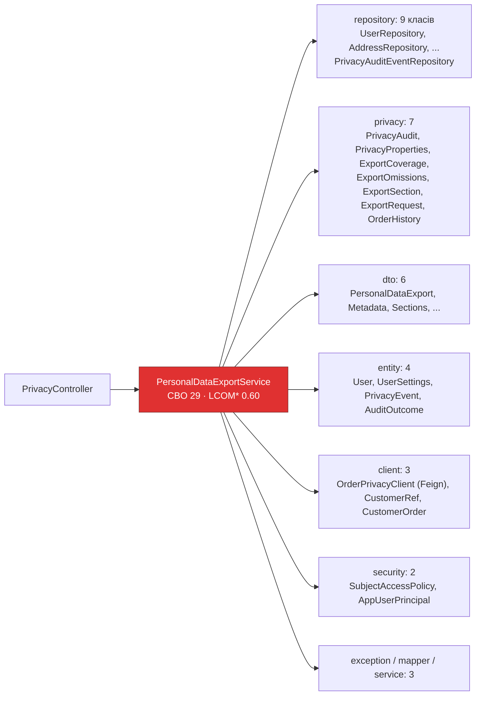
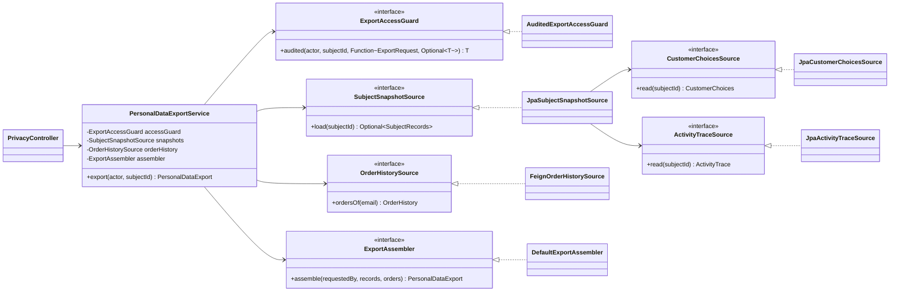

# Лабораторна робота №8. ОО-аудит системного дизайну (CK & MOOD), декомпозиція God Object, Inheritance → Composition

**Проєкт:** Plant Shop — мікросервісний інтернет-магазин рослин (Java 21, Spring Boot 3.5, 9 Maven-модулів).
**Гілка:** `lab/Lab_8`. **Сирі дані:** `docs/lab-08/` (кожне число у звіті має там файл-джерело).

## 0. Вступ: інструменти, джерела метрик і прийняті інтерпретації

### 0.1. Інструментарій (усі версії закріплені)

| Інструмент | Версія | Де | Для чого |
|---|---|---|---|
| SonarQube Community | `26.10.0.133078-community` | `tools/sonar/docker-compose.yml` (Docker, порт 9000) | AST-скан, Web API `api/measures/component` |
| SonarScanner CLI | `sonarsource/sonar-scanner-cli:12.2.0.4256_8.1.0` | `scripts/sonar-scan.sh` | відправка аналізу на сервер |
| curl | Git Bash | `scripts/sonar-fetch.sh` | REST-запити, збереження сирого JSON |
| CK (Chidamber & Kemerer) | `com.github.mauricioaniche:ck:0.7.0`, SHA-1 перевіряється | `tools/ck/Dockerfile` → `scripts/ck-run.sh` | WMC, CBO, LCOM*, RFC, DIT, NOC, видимість методів і полів |
| jdeps | JDK 21 (Corretto 21.0.12) | `scripts/ck-run.sh` | граф залежностей класів (байткод), COF |
| Python 3.13.17 | образ `plantshop/lizard` | `scripts/ck_to_json.py`, `ck_mood.py`, `coupling_graph.py`, `sonar_to_table.py`, `lorenz_kidd.py` | CSV → JSON, MOOD, матриця зв'язності, Лоренц–Кідд |

`sonar-project.properties` у корені задає `sonar.sources`, `sonar.tests` та `sonar.java.binaries` для **кожного**
модуля. Токена у файлі немає: сканер і скрипти читають його лише зі змінної оточення `SONAR_TOKEN`.

### 0.2. Що SonarQube насправді віддає (головне застереження звіту)

Сучасний SonarQube для Java **не обчислює** метрик `coupling_between_objects`, `cohesion_in_methods` (`lcom4`),
`class_complexity` і DIT, а MOOD (MHF/AHF/COF) він не рахував ніколи. Це доведено двома способами:

1. `api/metrics/search?ps=500` повертає повний список із 159 метрик сервера
   (`docs/lab-08/baseline/sonar/sonar-metrics-available.json`). Серед ключів, пов'язаних зі складністю й класами,
   є лише `complexity`, `cognitive_complexity`, `classes` і `functions`.
2. Запит саме з ключами, які вимагає завдання, сервер відхиляє з HTTP 404 (див. розділ 2).

Тому я збираю дані у два шари й у кожній таблиці позначаю джерело:

- **Sonar API**: `complexity` (сума CC = WMC за McCabe), `cognitive_complexity`, `ncloc`, `functions`, `classes`.
- **CK**: WMC, CBO, LCOM*, RFC, DIT, NOC, кількість public/private методів і полів. CSV перетворюється на JSON
  (`ck-class.json`), тож звіт так само спирається на JSON-пакет.
- **jdeps**: ребра «клас → клас» з байткоду, потрібні для COF і графа зв'язності.

### 0.3. Інтерпретації, які я захищаю

- **«LCOM1» в умові** («LCOMà1», зіпсований символ) читаю як «LCOM наближається до 1». Використовую
  **LCOM\*** з CK, тобто нормалізовану метрику Henderson-Sellers у діапазоні 0..1, де 0 означає ідеальну
  згуртованість. Ціль PASS ≤ 0.2 сформульована саме в цій шкалі:
  `LCOM* = ((1/a)·Σμ(Aⱼ) − m) / (1 − m)`, де a — кількість полів, m — кількість методів, μ(Aⱼ) — кількість
  методів, що звертаються до поля Aⱼ.
- **DIT у CK враховує `java.lang.Object`**, тому клас без `extends` має DIT = 1, його нащадок 2 і так далі.
- **CK 0.7.0 не бачить Java `record`.** Такі класи відсутні в `class.csv`. Для DTO-файлу (record із 17 вкладеними
  record) зачеплення беру з jdeps, а WMC зі Sonar.
- **CK рахує анотації як зв'язки.** Пробні запуски показали, що `@Component`, `@Transactional` і `@Slf4j` кожна
  додає +1 до CBO, а статичні виклики й доступ до статичних полів CK не рахує. Це вплинуло на дизайн у завданні 2.
- **MOOD** рахую скриптом `scripts/ck_mood.py`. Видимість спрощено до бінарної: public = видимий, усе інше =
  прихований. Абреу зважує protected і package-private члени часткою класів, які їх бачать, але в проєкті таких
  членів майже немає. Методи інтерфейсів без модифікатора CK позначає як default; скрипт вважає їх public.

---

## 1. Декларація API-запитів

Токен генерується на сервері перед запуском і відкликається відразу після. У файли, скрипти та звіт він не
потрапляє, у командах фігурує лише як `$SONAR_TOKEN`. `SONAR_URL=http://localhost:9000`.

**Скан (зріз AST):**

```bash
docker compose -f tools/sonar/docker-compose.yml up -d
./mvnw -DskipTests package                 # sonar.java.binaries потребують байткоду
SONAR_TOKEN=... ./scripts/sonar-scan.sh    # сканер у контейнері + очікування api/ce/task до SUCCESS
```

Результат: `EXECUTION SUCCESS`, `Analysis processed: "status":"SUCCESS"` (`docs/lab-08/baseline/sonar-scan.log`).

**Запити до Web API** (журнал із кодами відповіді: `docs/lab-08/baseline/sonar/api-calls.txt`):

```bash
# 1) які метрики взагалі існують на сервері
curl -s -G -u "$SONAR_TOKEN:" "$SONAR_URL/api/metrics/search" --data-urlencode "ps=500"

# 2) точний ключ файлу в мультимодульному проєкті (ключ містить шлях модуля)
curl -s -G -u "$SONAR_TOKEN:" "$SONAR_URL/api/components/tree" \
  --data-urlencode "component=plantshop" --data-urlencode "qualifiers=FIL" --data-urlencode "q=PersonalDataExportService"

# 3) запит за умовою завдання: ключі ООП-метрик + стандартні
curl -s -G -u "$SONAR_TOKEN:" "$SONAR_URL/api/measures/component" \
  --data-urlencode "component=plantshop:user-service/src/main/java/com/plantshop/user/service/PersonalDataExportService.java" \
  --data-urlencode "metricKeys=class_complexity,coupling_between_objects,cohesion_in_methods,lcom4,complexity,cognitive_complexity,ncloc,functions"

# 4) той самий файл із ключами, які сервер має
curl -s -G -u "$SONAR_TOKEN:" "$SONAR_URL/api/measures/component" \
  --data-urlencode "component=plantshop:user-service/src/main/java/com/plantshop/user/service/PersonalDataExportService.java" \
  --data-urlencode "metricKeys=complexity,cognitive_complexity,ncloc,functions,classes,statements,code_smells,sqale_index"

# 5) глобальний рівень проєкту
curl -s -G -u "$SONAR_TOKEN:" "$SONAR_URL/api/measures/component" \
  --data-urlencode "component=plantshop" \
  --data-urlencode "metricKeys=complexity,cognitive_complexity,ncloc,functions,classes,statements,code_smells,sqale_index,files"
```

Запити 2–4 виконано для трьох файлів із ЛР6 (`docs/complexity-report.md`, матриця 1.3):

| Роль (ЛР6) | Файл | Ключ компонента Sonar |
|---|---|---|
| Core Domain | `PaymentService.java` | `plantshop:payment-service/src/main/java/com/plantshop/payment/service/PaymentService.java` |
| Infrastructure (Integration) | `PersonalDataExportService.java` | `plantshop:user-service/src/main/java/com/plantshop/user/service/PersonalDataExportService.java` |
| Utility / DTO | `PersonalDataExport.java` | `plantshop:user-service/src/main/java/com/plantshop/user/dto/PersonalDataExport.java` |

Усе це автоматизовано в `scripts/sonar-fetch.sh <out> core=PaymentService infra=PersonalDataExportService dto=PersonalDataExport`.

> 📸 SCREENSHOT: Postman або термінал із запитом 3 (URL `api/measures/component`, Basic Auth = токен) і відповіддю 404 «metric keys are not found»

> 📸 SCREENSHOT: Postman або термінал із запитом 4 і JSON-відповіддю 200 (видно `complexity`, `ncloc`, `functions`)

---

## 2. Аналітичний JSON-пакет

### 2.1. Сира відповідь на ключі ООП-метрик (HTTP 404)

`docs/lab-08/baseline/sonar/measures-infra-lab-keys.json` (ідентичні відповіді для core і dto):

```json
{"errors":[{"msg":"The following metric keys are not found: coupling_between_objects, cohesion_in_methods, class_complexity, lcom4"}]}
```

Отже, `class_complexity`, `coupling_between_objects` та `lcom4` сервер **не повертає**. Відповідь не обрізана:
сервер відхиляє запит цілком, якщо хоча б одного ключа не існує.

### 2.2. Сирі відповіді з наявними ключами (HTTP 200)

`docs/lab-08/baseline/sonar/measures-infra.json`:

```json
{"component":{"key":"plantshop:user-service/src/main/java/com/plantshop/user/service/PersonalDataExportService.java","name":"PersonalDataExportService.java","qualifier":"FIL","path":"user-service/src/main/java/com/plantshop/user/service/PersonalDataExportService.java","language":"java","measures":[{"metric":"complexity","value":"9"},{"metric":"code_smells","value":"0","bestValue":true},{"metric":"functions","value":"5"},{"metric":"cognitive_complexity","value":"4","bestValue":false},{"metric":"classes","value":"1"},{"metric":"ncloc","value":"136"},{"metric":"statements","value":"38"},{"metric":"sqale_index","value":"0","bestValue":true}]}}
```

`docs/lab-08/baseline/sonar/measures-core.json` (фрагмент):

```json
{"component":{"key":"plantshop:payment-service/src/main/java/com/plantshop/payment/service/PaymentService.java", "measures":[{"metric":"complexity","value":"12"},{"metric":"functions","value":"6"},{"metric":"cognitive_complexity","value":"1"},{"metric":"classes","value":"2"},{"metric":"ncloc","value":"83"}]}}
```

### 2.3. JSON-пакет CK (метрики, яких немає в Sonar)

`docs/lab-08/baseline/ck-class.json` (отримано з `class.csv` скриптом `scripts/ck_to_json.py`), фрагмент:

```json
{
  "module": "user-service",
  "file": "user-service/com/plantshop/user/service/PersonalDataExportService.java",
  "class": "com.plantshop.user.service.PersonalDataExportService",
  "type": "class",
  "cbo": 29,
  "wmc": 9,
  "dit": 1,
  "noc": 0,
  "rfc": 43,
  "lcom*": 0.6,
  "totalMethodsQty": 5,
  "publicMethodsQty": 2,
  "totalFieldsQty": 15
}
```

### 2.4. Парсинг JSON у таблицю

`scripts/sonar_to_table.py` читає сирі файли й будує таблицю (`docs/lab-08/baseline/sonar-table.md`). Помилку
404 скрипт не ховає, а показує окремим рядком:

| Компонент | complexity | functions | cognitive_complexity | classes | ncloc | statements | code_smells |
|---|---|---|---|---|---|---|---|
| ERROR (lab keys) | The following metric keys are not found: coupling_between_objects, cohesion_in_methods, class_complexity, lcom4 | | | | | | |
| `PaymentService.java` | 12 | 6 | 1 | 2 | 83 | 25 | 0 |
| `PersonalDataExportService.java` | 9 | 5 | 4 | 1 | 136 | 38 | 0 |
| `PersonalDataExport.java` | 1 | 1 | 0 | 17 | 67 | 79 | 0 |
| `plantshop` (проєкт) | 442 | 324 | 100 | 227 | 4 556 | 1 118 | 0 |

---

## 3. Зведена таблиця CK & MOOD та первинний вердикт

### 3.1. Три файли різних ролей (baseline)

| Файл | Роль | WMC | CBO | LCOM* | RFC | DIT | Джерело |
|---|---|---|---|---|---|---|---|
| `PaymentService` | Core Domain | 7 (CK) / 12 (Sonar `complexity`) | 15 | 0.56 | 34 | 1 | CK; Sonar API |
| `PersonalDataExportService` | Infrastructure | 9 (CK) = 9 (Sonar) | **29** | **0.60** | **43** | 1 | CK; Sonar API |
| `PersonalDataExport` | Utility / DTO | 1 (Sonar) | 17 (jdeps) | н/д | н/д | н/д | Sonar API; jdeps (CK не бачить record) |

Джерела: `docs/lab-08/baseline/class.csv`, `ck-class.json`, `sonar/measures-*.json`, `coupling-matrix.md`.

**Чому WMC у CK і Sonar для PaymentService різні (7 і 12).** Sonar рахує `complexity` по **файлу**, куди входить
вкладений `record LimitRule` (`classes = 2`). CK record пропускає і рахує лише клас `PaymentService`. Для
PersonalDataExportService, де клас у файлі один, обидва інструменти дають 9.

**DTO.** `PersonalDataExport` має 17 типів (`classes = 17`), складність 1 і майже нуль логіки. 17 зв'язків за jdeps
припадають на 16 власних вкладених record і `DataCategory`. Це очікуване «широке» зачеплення контракту
даних, а не ознака мутанта.

### 3.2. Глобальні коефіцієнти MOOD (baseline)

Скрипт `scripts/ck_mood.py` (`docs/lab-08/baseline/mood.txt`, `mood-user-service.txt`):

| Коефіцієнт | Формула | Підстановка (усі модулі) | Значення | user-service окремо | Джерело |
|---|---|---|---|---|---|
| MHF | приховані методи / усі методи | 42 / 308 | **13.6 %** | 21 / 139 = 15.1 % | CK |
| AHF | приховані поля / усі поля | 265 / 288 | **92.0 %** | 158 / 161 = 98.1 % | CK |
| COF | Σ зв'язків між класами / (TC² − TC) | 578 / (227² − 227) = 578 / 51 302 | **1.13 %** | 384 / (111² − 111) = 384 / 12 210 = 3.14 % | jdeps |

Перевірка TC: jdeps знайшов 227 класів проєкту; Sonar API для проєкту повертає `classes = 227`. Збіг.

Як читати ці числа:
- **AHF 92 %** означає майже ідеальну інкапсуляцію даних. Поля приватні, Lombok генерує доступ.
- **MHF 13.6 %** низький, але це не вада. У Spring-сервісі більшість методів становлять публічний API (контролери,
  сервіси, репозиторії-інтерфейси), а приватних допоміжних мало. Методи, згенеровані Lombok, CK не бачить.
- **COF 1.13 %** по всьому репозиторію штучно занижений: у знаменнику TC² − TC стоять і пари класів із **різних
  сервісів**, які за архітектурою ніколи не зв'язані. Тому я окремо рахую user-service, де COF = 3.14 %. Це все
  одно далеко від небезпечних значень, які в літературі починаються десь із 12–15 %.

### 3.3. Первинний архітектурний вердикт

1. Глобально дизайн зрілий. Спагеті-коду немає: COF низький навіть усередині модуля, AHF високий, власних
   ієрархій немає. Із 144 класів CK лише 17 мають DIT > 1, і всі вони успадковують JDK або фреймворк:
   13 винятків мають DIT 4 (`RuntimeException → Exception → Throwable → Object`), 4 класи мають DIT 2
   (фільтри `OncePerRequestFilter`, `MaskingEncoder`, `GlobalExceptionHandler`). Див. `docs/lab-08/baseline/class.csv`.
2. Проблема **локальна**: класи-агрегатори в `user-service/service`. Топ CK за CBO:
   `PersonalDataExportService` 29, `ConsentService` 27, `ErasureService` 26, решта ≤ 20
   (`docs/lab-08/baseline/ck.txt`).
3. **`PersonalDataExportService` — кандидат у God Object.** CBO = 29 майже вдвічі перевищує поріг 15. LCOM* = 0.60:
   більше половини пар «метод–поле» не перетинаються, і клас тримає 15 полів, з яких кожен метод використовує
   свою підмножину (9 репозиторіїв в одному методі, Feign-клієнт в іншому, `properties` у третьому). RFC = 43.
   LCOM* не дорівнює 1, але разом із CBO 29 це явна ознака класу, який виконує кілька обов'язків.
4. Core Domain (`PaymentService`, CBO 15, LCOM* 0.56) стоїть на межі, проте після ЛР6 його логіка лінійна. DTO в
   нормі.

---

## 4. Візуалізація початкового хаосу (Baseline Coupling Matrix)

SonarQube Community не має вкладки Dependency/Coupling Matrix, її прибрали в нових версіях. Граф класів я
побудував із байткоду: `jdeps -verbose:class -filter:none */target/classes` → `scripts/coupling_graph.py`
(`docs/lab-08/baseline/coupling.dot`, `coupling.mmd`, `coupling-matrix.md`). Graphviz локально не встановлено,
тому SVG не рендерився. DOT відкривається у будь-якому Graphviz-переглядачі, Mermaid рендериться в Obsidian і
Notion.

### 4.1. Матриця зв'язності user-service (клас × пакет залежності, кількість різних класів)

| Клас \ пакет | client | dto | entity | exception | mapper | notification | privacy | repository | security | service | Σ |
|---|---|---|---|---|---|---|---|---|---|---|---|
| **PersonalDataExportService** | **3** | **6** | **4** | **1** | **1** | · | **7** | **9** | **2** | **1** | **34** |
| SubjectRecords | · | 13 | 11 | · | 2 | · | 2 | · | · | · | 28 |
| ConsentService | · | 5 | 9 | 3 | 1 | · | 2 | 3 | 2 | · | 26 (+1 logging) |
| PersonalDataMapper | 3 | 11 | 11 | · | · | · | · | · | · | · | 25 |
| ErasureService | 3 | 2 | 3 | 2 | · | · | 2 | 9 | 2 | 1 | 25 (+1 logging) |
| RegistrationService | · | 2 | 8 | 1 | 1 | 1 | 2 | 3 | · | 1 | 19 |

Епіцентр видно і в рядку, і в стовпцях: **PersonalDataExportService — єдиний клас, що торкається 9 з 10 пакетів
модуля**. Він тягне всі 9 репозиторіїв, Feign-клієнт, політику доступу, аудит і 7 класів пакета `privacy`.

### 4.2. Граф епіцентру (згорнутий за пакетами; повний граф із 34 ребрами: `docs/lab-08/baseline/coupling.mmd`)



> 📸 SCREENSHOT: граф залежностей PersonalDataExportService з IDE (IntelliJ: Diagrams → Show Dependencies або MetricsReloaded → Dependency metrics) з видимою «зіркою» стрілок

> 📸 SCREENSHOT: MetricsReloaded (Chidamber-Kemerer metrics) для user-service, рядок PersonalDataExportService з CBO/LCOM/RFC

**Базовий коміт:** `fa551f8 chore(audit): capture OO design baseline`.

---

## 5. Протокол симуляції збоїв (FAIL)

### 5.1. Завдання 2: Shotgun Surgery через зачеплення God Object

**Експеримент.** Одна невелика зміна в чужому класі, від якого залежить God Object. Метод `PrivacyAudit.record`
тепер отримує суб'єкта вже псевдонімізованим (`String subjectRef`) замість сирого `Long subjectId`. Для
privacy-сервісу це реалістична вимога.

```diff
-    public void record(PrivacyEvent event, Long actorId, Long subjectId, AuditOutcome outcome) {
-        PrivacyAuditEvent entry = new PrivacyAuditEvent(event, pseudonymizer.ref(actorId), pseudonymizer.ref(subjectId),
+    public void record(PrivacyEvent event, Long actorId, String subjectRef, AuditOutcome outcome) {
+        PrivacyAuditEvent entry = new PrivacyAuditEvent(event, pseudonymizer.ref(actorId), subjectRef,
```

**Наслідок усередині God Object.** Метод `export()` ламається у трьох місцях, бо клас сам перевіряє доступ, сам
пише всі три результати аудиту і сам оркеструє:

```java
// PersonalDataExportService.java @ fa551f8
if (!accessPolicy.canHandleDataRequest(actor, subjectId)) {
    audit.record(PrivacyEvent.PERSONAL_DATA_EXPORT, actor.getId(), subjectId, AuditOutcome.DENIED);    // рядок 105
    ...
if (records == null) {
    audit.record(PrivacyEvent.PERSONAL_DATA_EXPORT, actor.getId(), subjectId, AuditOutcome.NOT_FOUND); // рядок 111
    ...
audit.record(PrivacyEvent.PERSONAL_DATA_EXPORT, actor.getId(), subjectId, AuditOutcome.SUCCESS);       // рядок 118
```

Вивід компілятора (`docs/lab-08/shotgun-surgery.log`):

```text
[ERROR] .../user/service/PersonalDataExportService.java:[105,76] incompatible types: java.lang.Long cannot be converted to java.lang.String
[ERROR] .../user/service/PersonalDataExportService.java:[111,76] incompatible types: java.lang.Long cannot be converted to java.lang.String
[ERROR] .../user/service/PersonalDataExportService.java:[118,72] incompatible types: java.lang.Long cannot be converted to java.lang.String
[ERROR] .../user/service/ConsentService.java:[83,71] ...      (+2 у ConsentService)
[ERROR] .../user/service/ErasureService.java:[90,63] ...      (+5 у ErasureService)
[ERROR] .../user/service/RegistrationService.java:[64,68] ...
[ERROR] .../user/service/PasswordResetService.java:[54,77] ...
[INFO] BUILD FAILURE
```

Підсумок: **14 помилок компіляції у 5 файлах, із них 3 всередині God Object**. Збірка «червона». Цей стан
зафіксовано окремим комітом `831041d arch(audit): capture god object coupling failure, FAIL`. Pre-commit hook
перевіряє лише CC, тож коміт пройшов, а червоний CI на ньому очікуваний.

> 📸 SCREENSHOT: IntelliJ з відкритим PersonalDataExportService на коміті 831041d, три червоні підкреслення `audit.record(...)` і панель Problems

### 5.2. Завдання 3: каскадний злам ієрархії

**Експеримент.** У базовому класі `PlantCareGuide` інтервал поливу став `java.time.Duration`, а старий
`int wateringIntervalDays()` замінено на `Duration wateringInterval()`. Нащадків ніхто не чіпав.

```diff
-    public int wateringIntervalDays() {
-        return 7;
+    public Duration wateringInterval() {
+        return Duration.ofDays(7);
     }
     public boolean needsWater(final int daysSinceWatering) {
-        return daysSinceWatering >= wateringIntervalDays();
+        return daysSinceWatering >= wateringInterval().toDays();
```

Вивід компілятора (`docs/lab-08/inheritance-crash.log`):

```text
[ERROR] .../catalog/care/OrchidCareGuide.java:[10,5] method does not override or implement a method from a supertype
[ERROR] .../catalog/care/TropicalCareGuide.java:[19,37] cannot find symbol
[INFO] BUILD FAILURE
```

Зміна «прострілила» обидва рівні вниз:
- **рівень 2** `TropicalCareGuide` викликав успадкований `wateringIntervalDays()` у своєму `needsWater`, а цього
  методу більше немає (`cannot find symbol`);
- **рівень 3** `OrchidCareGuide` мав `@Override int wateringIntervalDays()`, і тепер цей метод нічого не
  перевизначає.

Небезпечніший наслідок видно, якщо розробник «полагодить» помилку, просто прибравши `@Override`. Код
скомпілюється, але орхідея мовчки почне поливатися раз на 7 днів замість 10: базовий `needsWater` уже викликає
`wateringInterval()`, якого `OrchidCareGuide` не перевизначає. Це класична **проблема крихкого базового класу**.
Коміт: `92d52c2 arch(audit): capture inheritance fragility crash, FAIL`.

> 📸 SCREENSHOT: IntelliJ на коміті 92d52c2, червоні помилки в TropicalCareGuide (рядок 19) та OrchidCareGuide (рядок 10)

---

## 6. Специфікація декомпозиції (архітектурний Blueprint)

### 6.1. Обов'язки God Object → порти

| Обов'язок у старому `export()` | Порт (інтерфейс) | Реалізація | Що вона знає |
|---|---|---|---|
| перевірка доступу + аудит DENIED/NOT_FOUND/SUCCESS | `ExportAccessGuard` | `AuditedExportAccessGuard` | `SubjectAccessPolicy`, `PrivacyAudit` |
| консистентний знімок локальних даних (1 read-only транзакція) | `SubjectSnapshotSource` | `JpaSubjectSnapshotSource` | `UserRepository`, `AddressRepository` + 2 порти нижче |
| ↳ налаштування й згоди (3 таблиці) | `CustomerChoicesSource` | `JpaCustomerChoicesSource` | 3 репозиторії |
| ↳ журнал активності, листи, аналітика, privacy-запити (4 таблиці) | `ActivityTraceSource` | `JpaActivityTraceSource` | 4 репозиторії + псевдонім від `PrivacyAudit` |
| історія замовлень з order-service (Feign) | `OrderHistorySource` | `FeignOrderHistorySource` | `OrderPrivacyClient` |
| збирання документа експорту (чиста функція) | `ExportAssembler` | `DefaultExportAssembler` | `PrivacyProperties` + Value Objects ЛР7 |
| координація (публічний API для контролера) | — | `PersonalDataExportService` | **лише 4 інтерфейси** |

Бізнес-обов'язків чотири: доступ, локальні дані, віддалені замовлення, збирання документа. Локальні дані
реалізовано **трьома** класами, а не одним. Причина в числах: знімок читає 9 таблиць, а CK рахує ще й
`@Component` та `@Transactional`. Один клас із 9 репозиторіями мав би CBO ≥ 12. Перший варіант із двома
читачами дав `JpaSubjectSnapshotSource` CBO = 10, тому довелося виділити третій. Це **відхилення від «3–4
класів»** в умові, і я свідомо обрав межу CBO ≤ 8 замість кількості класів.

Додаткові Value Objects (immutable `record`, захисні копії списків): `CustomerChoices`, `ActivityTrace`.
`SubjectRecords` — record із ЛР7, перенесений у пакет `service.export` і перебудований із цих двох частин.
`EXCLUDED_FIELDS` переїхав у `ExportOmissions` (усе, чого в експорті немає).

### 6.2. Blueprint (діаграма класів)



Правила, які виконано:
- усі колаборатори є **інтерфейсами** й передаються **через конструктор**: поля `final`, жодного `@Autowired` на
  полі, жодного `new` для колабораторів (`new` створюють лише Value Objects);
- **конкретні класи не викликають один одного напряму.** jdeps показує афферентне зачеплення 0 для кожної
  реалізації (`docs/lab-08/task2-pass/coupling.txt`), тобто на конкретні класи посилається лише Spring під час
  збирання контексту. `JpaSubjectSnapshotSource` знає `CustomerChoicesSource` і `ActivityTraceSource` тільки як
  інтерфейси.

### 6.3. Приклади контрактів

```java
/** Port: who may export whose data, and the security audit of every attempt. */
public interface ExportAccessGuard {
    <T> T audited(AppUserPrincipal actor, Long subjectId, Function<ExportRequest, Optional<T>> operation);
}

/** Port: one consistent snapshot of the customer's data stored in user-service. */
public interface SubjectSnapshotSource {
    Optional<SubjectRecords> load(Long subjectId);
}
```

Координатор після рефакторингу:

```java
public PersonalDataExport export(final AppUserPrincipal actor, final Long subjectId) {
    final PersonalDataExport export = accessGuard.audited(actor, subjectId, request ->
            snapshots.load(request.subjectId()).map(records -> assembler.assemble(request.requestedBy(), records,
                    orderHistory.ordersOf(records.email()))));
    log.info("Personal data export generated exportId={} categories={} complete={}", ...);
    return export;
}
```

Поведінку збережено, і це підтверджують незмінені інтеграційні тести `PersonalDataExportIntegrationTest`:
- доступ перевіряється до читання;
- знімок читається в одній read-only транзакції (`@Transactional(readOnly = true)` на
  `JpaSubjectSnapshotSource.load`);
- Feign-виклик іде **після** транзакції;
- чужий і неіснуючий id дають однаковий 404;
- у лог потрапляє лише факт експорту.

`ExportRequest` створює guard **після** перевірки. Це точно відповідає його javadoc ще з ЛР7: «Access has already
been checked when this is created».

### 6.4. Оновлена таблиця CK (після рефакторингу)

Джерело: `docs/lab-08/task2-pass/class.csv`, `ck-export-classes.txt`; повторний скан Sonar:
`docs/lab-08/task2-pass/sonar/`.

| Клас | Роль | WMC (CK) | complexity (Sonar) | CBO (CK) | LCOM* (CK) | RFC (CK) | DIT |
|---|---|---|---|---|---|---|---|
| `PersonalDataExportService` **до** | God Object | 9 | 9 | **29** | **0.60** | 43 | 1 |
| `PersonalDataExportService` після | координатор | 2 | 4 | **8** | **0.0** | 14 | 1 |
| `AuditedExportAccessGuard` | доступ + аудит | 3 | 4 | 8 | 0.0 | 6 | 1 |
| `JpaSubjectSnapshotSource` | межа транзакції знімка | 2 | 3 | 8 | 0.0 | 5 | 1 |
| `JpaCustomerChoicesSource` | налаштування + згоди | 2 | 2 | 6 | 0.0 | 4 | 1 |
| `JpaActivityTraceSource` | слід активності | 2 | 2 | 8 | 0.0 | 5 | 1 |
| `FeignOrderHistorySource` | order-service | 3 | 2 | 6 | 0.0 | 9 | 1 |
| `DefaultExportAssembler` | збирання документа | 2 | 2 | 8 | 0.0 | 7 | 1 |
| 6 інтерфейсів-портів | контракти | 1 | — | 1–3 | 0.0 | 0 | 1 |

**Математичне підтвердження цілей:**
- max CBO нового класу = max(8, 8, 8, 6, 8, 6, 8) = **8 ≤ 8** ✔. Для God Object: 29 → 8, тобто −21 (−72 %).
- LCOM* кожного нового класу = **0.0 ≤ 0.2** ✔. Приклад для `AuditedExportAccessGuard`: a = 2 поля
  (`accessPolicy`, `audit`), m = 2 методи (конструктор, `audited`), обидва звертаються до обох полів,
  тож μ = 2 для кожного поля. LCOM* = ((1/2)·(2 + 2) − 2) / (1 − 2) = (2 − 2) / (−1) = **0**. Так само для решти:
  кожен метод використовує кожне поле, тому результат 0, навіть якщо CK не рахує конструктор.
- RFC God Object: 43 → 14.

**Повторний експеримент Shotgun Surgery на новій структурі** (не комітився, лише лог
`docs/lab-08/task2-pass/shotgun-surgery-after.log`):

| | До (God Object) | Після (порти) |
|---|---|---|
| Помилок у `PersonalDataExportService` | 3 | **0** |
| Де ламається потік експорту | у класі з CBO 29, що робить усе | лише `AuditedExportAccessGuard` (CBO 8, єдиний обов'язок — аудит) |
| Скільки класів експорту треба правити | 1 «моноліт» (і перетестувати весь експорт) | 1 маленький клас; координатор та інші 5 реалізацій компілюються без змін |
| Помилок у модулі загалом | 14 | 14 |

Чесний висновок: кількість рядків, які треба виправити в потоці експорту, лишилася 3. Але зміна тепер
**ізольована** в одному класі з одним обов'язком, а не розмазана по класу, який робить усе. Решта 11 помилок
сидять у `ConsentService`, `ErasureService` та інших. Це той самий антипатерн у сусідніх класах (CBO 27 і 26),
і він іде першим пунктом у план наступного спринту (розділ 7.5).

**MOOD після рефакторингу** (`docs/lab-08/task2-pass/mood.txt`): MHF 39/324 = 12.0 %, AHF 270/293 = 92.2 %,
COF 622/(241² − 241) = 622/57 840 = 1.08 %. У user-service COF 3.14 % → 2.76 %, а MHF 15.1 % → 11.6 %. MHF
впав, бо порти додали публічні методи інтерфейсів. Це ціна DIP, а не погіршення інкапсуляції.

**Тести** (`docs/lab-08/task2-pass/tests.txt`): `user-service` 43 тести, 0 failures. Серед них нові юніт-тести з
Mockito та фейками проти інтерфейсів, без Spring і без БД:
- `PersonalDataExportServiceTest` (фейковий guard + моки трьох портів, порядок «знімок → замовлення → збирання»);
- `AuditedExportAccessGuardTest` (DENIED / NOT_FOUND / SUCCESS);
- `DefaultExportAssemblerTest` (регресійний тест ЛР7 про категорії тепер без жодного моку);
- `LocalSourcesTest` (порти як лямбди);
- `FeignOrderHistorySourceTest`.

Інтеграційні тести на Testcontainers (`PersonalDataExportIntegrationTest`, `ErasureIntegrationTest`,
`ConsentIntegrationTest`) теж зелені.

Чесно про межі вимірювання:
- jdeps рахує інакше, ніж CK: байткод включає статичні виклики й вкладені record. За jdeps
  `DefaultExportAssembler` посилається на 11 класів проєкту, координатор на 10. Норматив ЛР (CBO ≤ 8) перевірено
  за CK.
- `SubjectRecords` — record, тому CK його не міряє. За jdeps він зачеплений із 30 класами, бо мапить 9 типів
  сутностей у секції DTO. Це наступний кандидат на рефакторинг (розділ 7.5).

> 📸 SCREENSHOT: SonarQube → Projects → plantshop → Overview після другого скану (Quality Gate Passed / зелений)

> 📸 SCREENSHOT: MetricsReloaded для пакета `com.plantshop.user.service.export` (CBO ≤ 8 у всіх класах)

> 📸 SCREENSHOT: IntelliJ → запуск тестів user-service, 43 tests passed (зелений)

**Коміт PASS:** `bdf7a47 refactor(audit): eliminate god object via interface decomposition, PASS`.

---

## 7. Архітектурний кейс «Успадкування проти Композиції»

### 7.1. Baseline: вертикальна ієрархія за Лоренцом–Кідом

Власного ланцюжка `extends` у проєкті не знайшлося. Усі 18 випадків `extends` у `src/main` ведуть до JDK або
фреймворку: `RuntimeException`, `OncePerRequestFilter`, `EncoderBase`, `ResponseEntityExceptionHandler`
(`docs/lab-08/task3/extends-scan.txt`). Тому за приміткою до завдання в `catalog-service` створено штучну
трирівневу ієрархію порад із догляду: `PlantCareGuide → TropicalCareGuide → OrchidCareGuide`
(коміт `68dfd8d chore(audit): add inheritance hierarchy baseline`).

Метрики: `scripts/lorenz_kidd.py --ck` (`docs/lab-08/task3/baseline/lorenz-kidd.txt`); DIT і NOC взято з CK.

| Клас | DIT (CK) | NOC (CK) | Оголошено public (NOM) | Перевизначено (NMO) | Додано (NMA) | PIM |
|---|---|---|---|---|---|---|
| `PlantCareGuide` | 1 | 1 | 9 | 0 | 9 | 9 |
| `TropicalCareGuide` | 2 | 1 | 5 | 4 | 1 | 10 |
| `OrchidCareGuide` | **3** | 0 | 6 | **5** | 1 | **11** |

Як рахується PIM для `OrchidCareGuide`: 9 публічних методів бази + `mistingPerWeek` (додав Tropical) +
`bloomRestWeeks` (додав Orchid) = **11**. Методи `java.lang.Object` не враховано; з ними (`equals`, `hashCode`,
`toString`, `getClass`, `notify`, `notifyAll`, 3 × `wait`) вийшло б 20.

Перевизначені методи `OrchidCareGuide`: `wateringIntervalDays`, `lightAdvice`, `fertilizeEveryWeeks`,
`repotEveryYears`, `mistingPerWeek`. Це 5 з 10 публічних методів, які він успадковує, тобто **50 %**. Tropical
перевизначає 4 з 9 (44 %).

Оцінка за орієнтирами умови: DIT 3 ≥ 3 є ознакою аномалії; масове перевизначення (половина) теж є. PIM 11 < 20,
тобто інтерфейс не роздутий. Головна крихкість якісна: `needsWater` і `summary` — **шаблонні методи** бази й
Tropical, що викликають перевизначені методи. Результат `orchid.summary()` складається з коду трьох класів
(`PlantCareGuide.describe` + `TropicalCareGuide.summary` + значення `OrchidCareGuide`), і жоден файл окремо цього
не показує.

### 7.2. FAIL

Див. розділ 5.2: одна зміна сигнатури в корені зламала компіляцію на рівнях 2 і 3.

### 7.3. Лістинги «До» і «Після»

**До (успадкування, коміт `68dfd8d`):**

```java
public class TropicalCareGuide extends PlantCareGuide {
    @Override public String humidityAdvice() { return "High humidity, mist daily"; }
    @Override public int minTemperatureCelsius() { return 18; }
    @Override public boolean needsWater(final int daysSinceWatering) {
        return daysSinceWatering >= wateringIntervalDays() - 2;     // неявно: чий wateringIntervalDays()?
    }
    @Override public String summary() { return super.summary() + "; " + humidityAdvice(); }
    public int mistingPerWeek() { return 5; }
}

public class OrchidCareGuide extends TropicalCareGuide {
    @Override public int wateringIntervalDays() { return 10; }      // змінює поведінку коду батьків
    @Override public String lightAdvice() { return "Bright light, no direct midday sun"; }
    @Override public int fertilizeEveryWeeks() { return 2; }
    @Override public int repotEveryYears() { return 3; }
    @Override public int mistingPerWeek() { return 3; }
    public int bloomRestWeeks() { return 6; }
}
```

**Після (композиція + DI через конструктор, коміт PASS):**

```java
public class TropicalCareGuide {
    private final PlantCareGuide base;                               // колишній батько = приватне поле

    public TropicalCareGuide(final PlantCareGuide base) { this.base = base; }

    public Duration wateringInterval() { return base.wateringInterval(); }   // делегування
    public String lightAdvice() { return base.lightAdvice(); }
    public String humidityAdvice() { return "High humidity, mist daily"; }   // власна поведінка
    public int minTemperatureCelsius() { return 18; }
    public int fertilizeEveryWeeks() { return base.fertilizeEveryWeeks(); }
    public int repotEveryYears() { return base.repotEveryYears(); }
    public boolean needsWater(final int daysSinceWatering) { return isDue(daysSinceWatering, wateringInterval()); }
    public boolean isDue(final int daysSinceWatering, final Duration interval) {
        return daysSinceWatering >= interval.toDays() - 2;           // інтервал тепер явний параметр
    }
    public String summary() { return describe(wateringInterval(), lightAdvice()); }
    public String describe(final Duration interval, final String light) {
        return base.describe(interval.toDays(), light, minTemperatureCelsius()) + "; " + humidityAdvice();
    }
    public int mistingPerWeek() { return 5; }
}

public class OrchidCareGuide {
    private final TropicalCareGuide tropical;

    public OrchidCareGuide(final TropicalCareGuide tropical) { this.tropical = tropical; }

    public Duration wateringInterval() { return Duration.ofDays(10); }
    public String lightAdvice() { return "Bright light, no direct midday sun"; }
    public String humidityAdvice() { return tropical.humidityAdvice(); }
    public int minTemperatureCelsius() { return tropical.minTemperatureCelsius(); }
    public int fertilizeEveryWeeks() { return 2; }
    public int repotEveryYears() { return 3; }
    public boolean needsWater(final int days) { return tropical.isDue(days, wateringInterval()); }
    public String summary() { return tropical.describe(wateringInterval(), lightAdvice()); }
    public int mistingPerWeek() { return 3; }
    public int bloomRestWeeks() { return 6; }
}
```

Повні файли «до»: `docs/lab-08/task3/before/*.java.txt`.

**Що змінилося в дизайні:**
1. `extends` прибрано. Колишній батько став полем `private final`, яке передається через конструктор.
   Ланцюжок збирає той, хто використовує класи:
   `new OrchidCareGuide(new TropicalCareGuide(new PlantCareGuide()))`.
2. Перевизначень немає. Те, що раніше працювало через неявний динамічний диспетчер (батьківський `needsWater`
   викликав `wateringIntervalDays()` нащадка), тепер стало **явним параметром**:
   `tropical.isDue(days, wateringInterval())`. Читач бачить у файлі Orchid усю логіку, яка до нього застосовується.
3. Зміну з FAIL-коміту (`Duration wateringInterval()`) **збережено**. На новій структурі вона торкається лише
   явних викликів делегування, а не контрактів перевизначення. Якщо базовий клас знову змінить метод, компілятор
   вкаже на конкретний виклик `base.x()`, а не на «method does not override» у всій ієрархії.
4. Поведінку збережено: `CareGuideTest` перевіряє ті самі очікувані значення, що й на baseline (полив орхідеї з
   8-го дня, summary «Water every 10 days; ...; keep above 18 C; High humidity, mist daily»).
5. Інтерфейс не вводився: це чисте делегування, тож твердження «перевизначено = 0» виконується буквально.

### 7.4. Фінальний аналітичний звіт (PASS)

CK після рефакторингу (`docs/lab-08/task3/pass/class.csv`, `lorenz-kidd.txt`):

| Клас | DIT до → після | NOC до → після | NMO до → після | PIM до → після |
|---|---|---|---|---|
| `PlantCareGuide` | 1 → 1 | 1 → 0 | 0 → 0 | 9 → 9 |
| `TropicalCareGuide` | 2 → **1** | 1 → 0 | 4 → **0** | 10 → 11 |
| `OrchidCareGuide` | 3 → **1** | 0 → 0 | 5 → **0** | 11 → 10 |

Інструментальне підтвердження: у коді немає жодного `@Override` чи `extends`
(`docs/lab-08/task3/pass/override-extends-count.txt`):

```text
$ grep -nE "^\s*@Override|^public class \w+ extends" catalog-service/.../care/*.java | wc -l
0
baseline (68dfd8d): PlantCareGuide: 0, TropicalCareGuide: 5, OrchidCareGuide: 6
```

DIT = 1 означає, що єдиний предок — `java.lang.Object` (за конвенцією CK). Сума перевизначень по ієрархії:
4 + 5 = 9 → **0**. Тести `catalog-service`: 17 passed (`docs/lab-08/task3/tests-pass.txt`).

DIT неможливо довести «через Web API SonarQube», бо такої метрики на сервері немає
(`sonar-metrics-available.json`). Тому інструмент доказу тут CK.

> 📸 SCREENSHOT: IntelliJ → Type Hierarchy (Ctrl+H) на OrchidCareGuide до (3 рівні) і після (лише Object)

> 📸 SCREENSHOT: MetricsReloaded → Chidamber-Kemerer → DIT для пакета `com.plantshop.catalog.care` після PASS (усі 1)

**Коміт PASS:** `6f2e36a refactor(audit): replace inheritance with composition pattern, PASS`.

### 7.5. План рефакторингу на наступний спринт (за даними CK)

| Пріоритет | Клас | Дані | Дія |
|---|---|---|---|
| 1 | `ErasureService` | CBO 26, LCOM* 0.57, 6 викликів `audit.record` | та сама декомпозиція на порти: кроки стирання як окремі `ErasureStep` |
| 2 | `ConsentService` | CBO 27, LCOM* 0.62 | розділити читання (overview) і команди (grant/revoke), винести guard доступу/блокування |
| 3 | `SubjectRecords` | jdeps 30 | перенести мапінг секцій у `PersonalDataMapper` або в мапери секцій |
| 4 | `PrivacyAudit.record` | 14 місць виклику | фасад `AuditTrail` з методами `denied/notFound/succeeded`, щоб зміна сигнатури зачіпала 1 клас |

---

## 8. Логи Git History

Послідовність станів для обох завдань (`docs/lab-08/git-log-task2.txt`, `docs/lab-08/git-log-task3.txt`):

```text
* 6f2e36a refactor(audit): replace inheritance with composition pattern, PASS
* 92d52c2 arch(audit): capture inheritance fragility crash, FAIL
* 68dfd8d chore(audit): add inheritance hierarchy baseline
* bdf7a47 refactor(audit): eliminate god object via interface decomposition, PASS
* 831041d arch(audit): capture god object coupling failure, FAIL
* fa551f8 chore(audit): capture OO design baseline
* 5a6549f Change task
* 0cec185 Finish lab_7 Quality Testing
```

- Завдання 2: `fa551f8` (Baseline) → `831041d` (FAIL, збірка червона) → `bdf7a47` (PASS).
- Завдання 3: `68dfd8d` (Baseline) → `92d52c2` (FAIL, збірка червона) → `6f2e36a` (PASS).
- Коміти окремі, у правильному порядку, без squash і без amend. Повідомлення FAIL/PASS дослівно взято з умови.
- Повний прогін тестів на фінальному стані: 126 тестів, 0 failures, `BUILD SUCCESS`
  (`docs/lab-08/final-tests.txt`).

> 📸 SCREENSHOT: `git log --oneline --graph -8` у терміналі (або IntelliJ → Git → Log) з шістьма комітами ЛР8

---

## 9. Лог валідації ШІ-Техліда

> TODO: заповнити за інструкцією викладача (протокол проходження краш-тесту), коли інструкцію буде надано.

---

## Додаток A. Як відтворити

```bash
docker compose -f tools/sonar/docker-compose.yml up -d
./mvnw -DskipTests package
SONAR_TOKEN=... ./scripts/sonar-scan.sh
SONAR_TOKEN=... ./scripts/sonar-fetch.sh docs/lab-08/baseline/sonar core=PaymentService infra=PersonalDataExportService dto=PersonalDataExport
./scripts/ck-run.sh docs/lab-08/baseline com.plantshop.user.service.PersonalDataExportService
python scripts/ck_mood.py docs/lab-08/baseline/class.csv docs/lab-08/baseline/jdeps-class.txt out.json user-service com.plantshop.user.
python scripts/lorenz_kidd.py --ck docs/lab-08/task3/pass/class.csv catalog-service/src/main/java/com/plantshop/catalog/care/*.java
```

(Python на хості не встановлено. Скрипти запускаються в образі `plantshop/lizard` з `--entrypoint python`, як це
робить `scripts/ck-run.sh`.)

## Додаток B. Питання для самоперевірки перед захистом

| Питання | Коротка відповідь |
|---|---|
| Чому немає `coupling_between_objects` у JSON Sonar? | Сервер не має такої метрики: 404 «metric keys are not found» і список `api/metrics/search`. Тому CK + jdeps |
| Що таке CBO? | Кількість інших класів, з якими клас зв'язаний (використовує їх). CK додатково рахує анотації |
| Що таке LCOM* і чому 0 — добре? | Henderson-Sellers: частка «незв'язаності» методів через поля, 0..1. 0 означає, що кожен метод працює з кожним полем |
| Чим WMC відрізняється від Sonar `complexity`? | WMC = Σ CC методів класу; Sonar рахує по файлу, тому вкладені типи додаються |
| Чому COF такий низький? | У мікросервісному репозиторії TC² − TC включає пари класів різних сервісів; у межах user-service 3.14 % |
| Чому 6 класів, а не 3–4? | 4 обов'язки; локальні дані (9 таблиць) розбиті на 3 класи, щоб CBO ≤ 8 при CK, який рахує анотації |
| Як доведено, що класи не викликають один одного напряму? | jdeps: афферентне зачеплення реалізацій = 0; залежності лише на інтерфейси |
| Що показав Shotgun Surgery після рефакторингу? | Координатор 0 помилок, зміна ізольована в `AuditedExportAccessGuard` |
| Чому DIT = 1, а не 0? | CK рахує `java.lang.Object` як рівень |
| Що таке PIM / NMO / NMA? | Розмір публічного інтерфейсу (з успадкованими) / перевизначені / додані методи (Лоренц–Кідд) |
| У чому крихкість успадкування на прикладі? | Шаблонні методи батька викликають перевизначення нащадка; зміна в корені ламає нащадків або тихо змінює поведінку |
| Чому без інтерфейсу в завданні 3? | Щоб «перевизначено = 0» виконувалося буквально; реалізація абстрактного контракту не є перевизначенням логіки батька |

## Список плейсхолдерів скріншотів

1. Postman або термінал: запит 3 з ключами ООП-метрик → 404 (розділ 1)
2. Postman або термінал: запит 4 → JSON 200 (розділ 1)
3. Граф залежностей PersonalDataExportService з IDE (розділ 4)
4. MetricsReloaded CK для user-service, рядок PersonalDataExportService (розділ 4)
5. IntelliJ на коміті 831041d: три помилки `audit.record` (розділ 5.1)
6. IntelliJ на коміті 92d52c2: помилки в TropicalCareGuide та OrchidCareGuide (розділ 5.2)
7. SonarQube Overview після другого скану, Quality Gate Passed (розділ 6.4)
8. MetricsReloaded для `com.plantshop.user.service.export` (розділ 6.4)
9. IntelliJ: 43 тести user-service зелені (розділ 6.4)
10. IntelliJ Type Hierarchy OrchidCareGuide до і після (розділ 7.4)
11. MetricsReloaded DIT для `com.plantshop.catalog.care` (розділ 7.4)
12. `git log --oneline --graph -8` (розділ 8)
