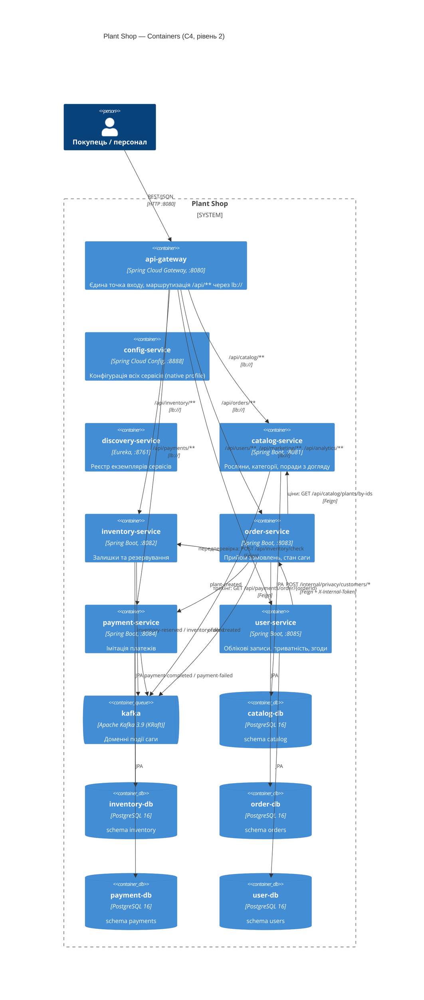

# Лабораторна робота №10. Інженерний аудит документації, архітектурний паспорт (SDD, ISD, ADR) і Handover

**Об'єкт:** Plant Shop — мікросервісний інтернет-магазин рослин (8 Spring-сервісів, бібліотека
`secure-logging`, 5 PostgreSQL, Kafka). **Гілка:** `lab/Lab_10`. **Теорія для захисту:** [`lab-10.md`](lab-10.md).
**Сирі дані та логи:** `docs/lab-10/`. **Дата аудиту (reference date):** 2026-11-14.

## Зміст

- [0. Інструментарій і карта комітів](#0-інструментарій-і-карта-комітів)
- [1. Інвентаризаційний реєстр документації](#1-інвентаризаційний-реєстр-документації)
- [2. Логи метрик актуальності, діагноз антипатернів і матриця вердиктів](#2-логи-метрик-актуальності-діагноз-антипатернів-і-матриця-вердиктів)
- [3. Архітектурний паспорт системи: SDD, ISD, ADR](#3-архітектурний-паспорт-системи-sdd-isd-adr)
- [4. Матриця покриття аудиторій і доопрацьований README](#4-матриця-покриття-аудиторій-і-доопрацьований-readme)
- [5. Регламент підтримки документації](#5-регламент-підтримки-документації)
- [6. Протокол краш-тесту Documentation Decay (FAIL → PASS)](#6-протокол-краш-тесту-documentation-decay-fail--pass)
- [7. Handover-пакет і декларація Bus Factor](#7-handover-пакет-і-декларація-bus-factor)
- [8. Лог валідації ШІ-Техліда](#8-лог-валідації-ші-техліда)
- [Список скріншотів](#список-скріншотів)

---

## 0. Інструментарій і карта комітів

| Інструмент | Для чого | Де |
|---|---|---|
| Git CLI (`git log`, `git shortlog`, `git grep`) | метрики актуальності, авторство, посилання | `scripts/doc-currency.sh`, `docs/lab-10/git-metrics-baseline.txt` |
| `scripts/doc-currency.sh` (новий) | вік, lag «код після документа», вхідні посилання, зміни за 30 днів для кожного документа з `docs/lab-10/doc-map.txt` | `docs/lab-10/currency-*.md` |
| `scripts/doc-drift-check.sh` (новий) | правило «зміна коду = зміна документації»: ендпоінти контролерів ↔ SDD і README; `depends_on` у `docker compose config` ↔ таблиця запуску ISD | `docs/lab-10/drift-check-*.txt`, CI `docs-currency.yml` |
| Mermaid | C4 Context, C4 Container, sequence, ER, flowchart | `docs/sdd.md`, `docs/isd.md` |
| Markdown (Obsidian / GitHub) | Documentation as Code | `docs/` |

| Коміт | Повідомлення | Завдання |
|---|---|---|
| `852f73b` | `docs(audit): inventory and currency audit of project documentation` | 1 |
| `c24ee0f` | `docs(architecture): deliver design and infrastructure passport` | 2 (+ виконання вердиктів завдання 1) |
| `82b8742` | `docs(maintenance): documentation maintenance regime and drift check in CI` | 3.1 |
| `aef1513` | `docs(audit): simulate documentation decay, FAIL` | 3.2 |
| `7e82c94` | `docs(maintenance): restore documentation currency, PASS` | 3.3 |
| `20b6d83` | `docs(handover): handover package with bus factor declaration` (разом зі звітом і теорією) | 3.4, звіт |
| останній | `docs(audit): lab 10 git history log` | `docs/lab-10/git-log.txt` |

Повний граф — `docs/lab-10/git-log.txt`.

---

## 1. Інвентаризаційний реєстр документації

Облік зроблено за всіма носіями знань: файли репозиторію (`git ls-files`), коментарі в коді, тести як
специфікація, Swagger, повідомлення комітів і опис задач. Тип — за життєвим циклом: **продукт** («живий»,
має змінюватися разом із системою) або **процес** («історичний» запис факту в часі). Категорія: **Т** —
технічна (що система робить), **А** — архітектурна (як влаштована), **Е** — експлуатаційна (як запускати й
супроводжувати). Аудиторії: Р — розробники, QA, D — DevOps, Б — бізнес. Власник усіх артефактів один —
VladdHoryn (`git shortlog -sn --all` → 1 автор, `docs/lab-10/git-metrics-baseline.txt`).

| № | Назва документа | Розташування | Тип | Категорія | Аудиторія | Чиї потреби не покриває |
|---|---|---|---|---|---|---|
| 1 | README | `README.md` | продукт | Е + Т | Р, D, новачок | Б (призначення системи), QA (контракти поведінки; 9 з 27 публічних ендпоінтів) |
| 2 | Інструкції для розробника / ШІ | `CLAUDE.md` | продукт | Е | Р | Б, QA, D (розгортання — лише посилання) |
| 3 | Конфігурація запуску з коментарями | `docker-compose.yml` | продукт | Е | D, Р | Б, QA |
| 4 | Збірка образів | `Dockerfile` | продукт | Е | D | Б, QA, Р |
| 5 | Маніфести Kubernetes | `k8s/*.yaml` | продукт | Е | D | усі: немає user-service і user-db (decay) |
| 6 | Helm-чарт, `values*.yaml`, `NOTES.txt` | `helm/plantshop/` | продукт | Е | D | те саме, що №5 |
| 7 | CI: quality gate | `.github/workflows/quality-gate.yml` | продукт | Е | D, QA | Б, новачок |
| 8 | CI: метрики коду | `.github/workflows/code-metrics.yml` | продукт | Е | D, QA | Б |
| 9 | Pre-commit hook і скрипти | `scripts/git-hooks/pre-commit`, заголовки `scripts/*.sh` | продукт | Е | Р | Б, QA |
| 10 | Налаштування SonarQube | `sonar-project.properties` | продукт | Е | D | Б |
| 11 | HTTP-сценарії приватності | `user-service/privacy-demo.http` | продукт | Т | QA, Р | Б, D |
| 12 | Swagger UI (springdoc) | runtime `/swagger-ui.html` | продукт (генерується) | Т | Р, QA | Б, D; не описує події Kafka |
| 13 | Міграції Flyway | `*/db/migration/V*.sql` | продукт | А (модель даних) | Р | Б, QA (немає ER-огляду) |
| 14 | YAML config-service з коментарями | `config-service/.../configurations/*.yml` | продукт | Е | Р, D | Б |
| 15 | Javadoc і коментарі | `*/src/main/java` (160 блоків `/**` у 212 файлах) | продукт | Т | Р | усі інші |
| 16 | Тести як специфікація | `*/src/test/java` (25 класів) | продукт | Т | Р, QA | Б, D |
| 17 | Звіт про приватність | `docs/privacy-report.md` | процес | А + Т | Р, викладач | D; знання про правила стирання є **лише тут** |
| 18 | Транскрипт демо приватності | `docs/privacy-demo.md` | процес | Е | QA | Б |
| 19 | Звіт про метрики (GQM, Goodhart, надійність) | `docs/metrics-report.md` + `gqm-metrics.md`, `goodhart-demo.md`, `reliability-report.md`, `stability-report.md` | процес | Т | QA | Б, новачок |
| 20 | Звіт про складність | `docs/complexity-report.md`, `docs/complexity/` | процес | Т | Р | Б, D |
| 21 | Звіт Kubernetes | `docs/k8s-report.md` | процес | Е | D | поточна топологія (знімок 2026-10-15) |
| 22 | Звіт Helm | `docs/helm-report.md` | процес | Е | D | усі: транскрипт обірваний після кроку 1c |
| 23 | Тексти завдань (замість трекера задач) | `docs/lab-07.md`, `lab-08.md`, `lab-09.md` | процес | — | студент, викладач | — |
| 24 | Звіти лабораторних 7–9 | `docs/reports/lab-07-report.md`, `docs/lab-08-report.md`, `docs/lab-9.md`, `FINANCIAL_LEDGER.md`, сирі логи `docs/lab-0*/` | процес | Т | викладач, Б (`FINANCIAL_LEDGER.md`) | `docs/lab-9.md` не має жодного вхідного посилання |
| 25 | Повідомлення комітів | `git log` (28 комітів) | процес | Т | Р | 9 з 28 без змісту («Finish Testting Qual Lab_4») |
| 26 | Трекер задач (GitHub Issues) | — | — | — | — | **відсутній**: роль виконують №23 і повідомлення комітів |
| 27 | SDD, ISD, ADR, регламент | `docs/sdd.md`, `docs/isd.md`, `docs/architecture/adr/`, `docs/maintenance.md` | продукт | А, Е | — | **відсутні** на момент аудиту (MISSING у `currency-baseline.md`) |

Розподіл: продукт — 16 артефактів (№1–16), процес — 9 (№17–25); архітектурна документація продукту до
паспорта існувала лише у вигляді SQL-міграцій (№13) — жодного опису «як влаштовано» для людини.

---

## 2. Логи метрик актуальності, діагноз антипатернів і матриця вердиктів

### 2.1. Команди Git CLI

Повний вивід кожної команди — `docs/lab-10/git-metrics-baseline.txt`; таблиця по всіх документах —
`docs/lab-10/currency-baseline.md` (ревізія `69df71c`, до будь-яких змін Lab 10).

```bash
git log -1 --format=%cs -- README.md                     # Last Updated Age: дата останнього коміту
git log --oneline -- order-service/src | wc -l           # Code-Doc Change Ratio: коміти коду компонента
git log --oneline -- README.md | wc -l                   #                       коміти документа
git log --oneline $(git log -1 --format=%H -- README.md)..HEAD -- '*/src/main/*' | wc -l   # lag
git grep -l -F helm-report.md                            # Access Evidence: хто посилається
git log --since='2026-10-15 00:00' --oneline -- docs/helm-report.md                         # зміни за 30 днів
./scripts/doc-currency.sh 2026-11-14                     # усе разом для docs/lab-10/doc-map.txt
```

Вік рахується як `2026-11-14 − дата останнього коміту`. Приклад для README:
`git log -1 --format=%cs -- README.md` → `2026-10-25`; 2026-11-14 − 2026-10-25 = 6 (жовтень) + 14 = **20 днів**.

### 2.2. Метрики документів продукту (baseline)

| Документ | Останнє оновлення | Вік, д | Комітів документа | Комітів коду, який він описує | Lag: комітів коду після документа | Вхідні посилання | Сигнал |
|---|---|---|---|---|---|---|---|
| `README.md` | 2026-10-25 | 20 | 6 | 15 | **7** | 4 | behind |
| `CLAUDE.md` | 2026-11-07 | 7 | 2 | 23 | **8** | 4 | behind |
| `docker-compose.yml` | 2026-10-25 | 20 | 2 | 4 | 1 | 6 | behind |
| `Dockerfile` | 2026-10-25 | 20 | 3 | 5 | 2 | 12 | behind |
| `quality-gate.yml` | 2026-10-25 | 20 | 1 | 3 | 0 | 5 | OK |
| `code-metrics.yml` | 2026-11-01 | 13 | 1 | 2 | 0 | 1 | OK |
| `helm/.../NOTES.txt` | 2026-10-15 | 30 | 1 | 1 | 0 | 3 | OK |
| `privacy-demo.http` | 2026-10-25 | 20 | 1 | 5 | 4 | 3 | behind |
| `sonar-project.properties` | 2026-11-07 | 7 | 1 | 5 | 0 | 5 | OK |
| `pre-commit` | 2026-10-25 | 20 | 2 | 4 | 0 | 11 | OK |
| SDD, ISD, ADR, регламент | — | — | 0 | — | — | — | **MISSING** |

Документи процесу (звіти) мають вік 0–30 днів, а lag для них не рахується (`n/a`): звіт — історичний запис і
не зобов'язаний іти за кодом. Єдиний документ без вхідних посилань — `docs/lab-9.md` (0).

### 2.3. Code-Doc Change Ratio по компонентах

`docs/lab-10/code-doc-ratio.txt`, ревізія `69df71c`; README мав 6 комітів, останній — `8008696` (2026-10-25).

| Компонент | Комітів коду `git log --oneline -- <м>/src \| wc -l` | Після останнього оновлення README | Співвідношення код : README |
|---|---|---|---|
| catalog-service | 6 | 3 | 6 : 6 = 1,0 |
| user-service | 5 | 4 | 5 : 6 ≈ 0,83 |
| config-service | 4 | 0 | 4 : 6 ≈ 0,67 |
| payment-service | 4 | 0 | 4 : 6 ≈ 0,67 |
| order-service | 3 | 0 | 3 : 6 = 0,5 |
| inventory-service | 2 | 0 | 0,33 |
| secure-logging | 2 | 0 | 0,33 |
| api-gateway, discovery-service | 1 | 0 | 0,17 |

### 2.4. Чесний висновок щодо порогів

Пороги завдання (вік > 90 / > 180 днів, > 20 змін коду без оновлення документа) **не спрацювали жодного разу**:
репозиторію 31 день (перший коміт `0207223` — 2026-10-14), максимальний вік — 30 днів, максимальний lag — 8.
Пороги я не змінював. Тому Git-метрики використано як **ранній сигнал**, а наявність decay доведено
**звіркою тверджень документів з кодом** (`docs/lab-10/claim-verification.txt`). Результат звірки збігся з
сигналом: обидва документи з найбільшим lag (README — 7, CLAUDE.md — 8) містили застарілі твердження, а
документи з lag = 0 — ні.

### 2.5. Діагноз антипатернів

**Documentation Decay** (документ описує систему, якої вже немає):

| ID | Документ | Що стверджує | Що насправді (доказ) |
|---|---|---|---|
| D1 | README, таблиця сервісів | order-service — «saga orchestration» | 8 `@KafkaListener` у трьох сервісах, payment сам слухає `inventory-reserved`: це хореографія, оркестратора немає |
| D2 | README, розділ Kubernetes; `k8s/`, `helm/` | `<service>-db ×4`, «same 32 objects» = вся система | user-service і user-db додані 2026-10-25 (`52895d1`) після k8s (2026-10-15, `6e42c77`); у `k8s/` і `helm/` їх 0, а gateway маршрутизує `/api/users/**` на `lb://user-service` |
| D3 | README, розділ Tests | unit-тести «catalog, inventory, order and payment» | у user-service 6 unit-тестів, у catalog — `CareGuideTest` (додані в Lab 7–8) |
| D4 | README → `docs/helm-report.md` | скрипт «записує кожну команду» 7 етапів | файл 43 рядки, лише кроки 1a–1c, обривається на середині команди |
| D5 | `CLAUDE.md` | «Current lab: Lab 8» | історія містить Lab 9, гілка `lab/Lab_10` |
| D6 | Javadoc 5 класів | «Lab 8, task 3: ...», «Since Lab 8 (FAIL commit)...» | історія процесу всередині документації продукту: читачеві коду коміти Lab 8 нічого не кажуть |

**Dead Documentation** (документ існує, але не має споживача):

| ID | Документ | Доказ відсутності споживача |
|---|---|---|
| X1 | `docs/helm-report.md` | обірваний транскрипт пролежав 30 днів без жодної зміни і без жодного звернення: якби його хтось читав, обрив помітили б одразу |
| X2 | `docs/lab-9.md` | `git grep -l -F lab-9.md` → 0 файлів: до документа неможливо дійти з README чи інших документів |
| X3 | `docs/k8s-report.md` | знімок топології 2026-10-15; 0 змін за 30 днів; як інструкцію розгортання його ніхто не використовує (є README) |
| X4 | 9 повідомлень комітів без змісту | «Finish Testting Qual Lab_4» ×2, «lab_4 commit», «Change task»: з них неможливо дізнатися, що змінено; 19 з 28 = 67,9 % комітів у форматі Conventional Commits |

Access Evidence: трекера задач і командного чату в проєкті немає (один розробник), тому свідченням використання
вважалися вхідні посилання (`git grep`) і зміни за останні 30 днів; це обмеження методики.

### 2.6. Матриця вердиктів

| Артефакт | Діагноз | Вердикт | Виконання |
|---|---|---|---|
| `README.md` | D1, D3, D4, прогалини аудиторій | **оновити** | коміт `c24ee0f`: призначення, швидкий старт, онбординг, карта документів, API at a glance, виправлені D1/D3/D4, примітка про D2 |
| `CLAUDE.md` | D5 | **оновити** | коміт `82b8742`: розділ «Current lab: Lab 10», Lab 8 — completed |
| Javadoc з історією лабораторних | D6 | **оновити** (залишити обґрунтування дизайну, прибрати посилання на лабораторні) | `c24ee0f`: 5 класів |
| Javadoc `PlantCareGuide.wateringInterval` «Since Lab 8 (FAIL commit)...» | D6, чиста історія | **видалити** | `c24ee0f` |
| `docs/helm-report.md` | D4, X1 | **deprecated** | `c24ee0f`: банер із посиланням на ISD; зміст не змінювався |
| `docs/k8s-report.md` | X3, D2 | **deprecated** | `c24ee0f`: банер із посиланням на ISD |
| `docs/lab-9.md` | X2 | **оновити** (зробити досяжним) | README посилається на нього (`c24ee0f`) |
| `k8s/`, `helm/` | D2 | **оновити** — заплановано | розрив задокументовано: README, ISD ризик R1, handover план №6 |
| Відсутні SDD, ISD, ADR, регламент | прогалина | **створити** | завдання 2 і 3 |
| `docs/privacy-report.md` | темна зона (знання продукту лише в звіті процесу) | залишити як запис процесу; знання винести в документ продукту | handover план №2 |
| Повідомлення комітів без змісту | X4 | залишити (історію не переписуємо: `rebase` заборонено) | правило Conventional Commits для нових комітів |
| `docker-compose.yml`, `Dockerfile`, workflows, hook, `privacy-demo.http`, `sonar-project.properties` | lag ≤ 4, твердження перевірені | залишити (актуальні) | — |
| Інші звіти процесу (№18–20, 23–24) | записи факту | залишити як архів | — |

Перевірка після виконання вердиктів: `git grep -nE '(//|\*).*\bLab ?[0-9]' -- '*/src/main/*.java'` → 0 рядків.

---

## 3. Архітектурний паспорт системи: SDD, ISD, ADR

Паспорт — три документи, що посилаються один на одного: **SDD** — як система влаштована всередині,
**ISD** — де і на чому працює, **ADR** — чому так. Кожен компонент SDD має посилання на свій рядок
у [ISD, розділ 3](isd.md#3-компоненти-та-їх-розгортання), кожен рядок ISD — на опис у SDD.

### 3.1. SDD — `docs/sdd.md`

Структура: 1 — призначення і C4 Context; 2 — **C4 Container** + sequence-діаграма саги; 3 — 9 компонентів
(відповідальність, залежності з посиланнями, публікує/слухає, розгортання → ISD); 4 — ER-модель і таблиця
схем/міграцій; 5 — API-контракти: 28 REST через gateway, 2 внутрішні, 6 топіків Kafka; 6 — наскрізні рішення.

Лістинг C4-діаграми контейнерів (стан після PASS, з новою стрілкою трекінгу):



Фрагмент опису компонента (як компоненти посилаються один на одного):

```markdown
### 3.6. order-service

- **Відповідальність:** прийом замовлення: ціни з [catalog-service](#34-catalog-service), передперевірка складу
  в [inventory-service](#35-inventory-service) (обидва — Feign, синхронно), збереження `PENDING`, подія
  `order-created`. Фінальний стан `CONFIRMED`/`CANCELLED` — за подіями саги. ...
- **Слухає:** `payment-completed`, `payment-failed`, `inventory-failed`.
- **Трекінг замовлення** (компонент `OrderTrackingController` → `OrderTrackingService`): ...
```

Модель даних — Mermaid `erDiagram` з 11 сутностями п'яти схем; міжсервісні зв'язки (`plant_id`, `order_id`)
позначені як логічні, без FK (ADR-0001).

### 3.2. ISD — `docs/isd.md`

| Розділ | Зміст |
|---|---|
| 1. Топологія | IDE / Docker Compose (основний, 15 контейнерів) / Kubernetes + Helm (неповний: R1) / хмара — не використовується; Mermaid-схема хоста |
| 2–3. Збірка і компоненти | один `Dockerfile`; таблиця «компонент → контейнер і порт, k8s-об'єкти, репліки dev/prod, health check», з посиланням назад на SDD |
| 4. Середовища і змінні | dev (Compose / values-dev), test (GitHub Actions + Testcontainers), prod-like (values-prod); 13 змінних, секрети позначені без значень |
| 5. Порядок запуску | таблиця `depends_on` по хвилях — перевіряється скриптом проти `docker compose config` |
| 6. CI/CD | pre-commit, `quality-gate.yml` (3 jobs), `code-metrics.yml`, `docs-currency.yml`; тригери, quality gates, що блокує |
| 7. Реліз і відкат | Compose, `kubectl rollout undo`, `helm rollback` + hook; обмеження Flyway «лише вперед» |
| 8–9. Сховища, моніторинг | томи/PVC, Kafka без тому в Compose; Actuator health, логи з маскуванням і correlation id; відсутні метрики/алерти |
| 10. Backup і RTO/RPO | таблиця нижче, команди `pg_dump`/`pg_restore`, перевірене тренування |
| 11. Ризики | R1–R5 |

Лістинг таблиці RTO/RPO з ISD:

| Сховище | Критичність | Метод | Частота | Цільовий RPO | Цільовий RTO |
|---|---|---|---|---|---|
| `order-db`, `payment-db` | висока (гроші, замовлення) | `pg_dump -Fc` | щоденно + перед кожним релізом | 24 год | 1 год |
| `user-db` | висока (персональні дані) | `pg_dump -Fc` | щоденно | 24 год | 1 год |
| `catalog-db`, `inventory-db` | середня | `pg_dump -Fc` | щоденно | 24 год | 2 год |
| Kafka | низька: стан у БД | не копіюється | — | події в дорозі | 15 хв |
| Конфігурація, схема, інфраструктура | — | Git | кожен коміт | 0 | ~2–3 хв |

Процедуру відновлення перевірено на тимчасовому контейнері `postgres:16-alpine` з міграціями catalog-service
(`docs/lab-10/backup-drill.txt`): 10 рослин → `pg_dump` 0,486 с → `DROP SCHEMA catalog CASCADE` (0 таблиць) →
`pg_restore` 0,419 с → 10 рослин. Томи проєкту не зачіпались. Чесно зазначено, що розкладу копіювання ще немає
(ризик R2).

Під час опису CI знайдено реальну ваду інфраструктури (R5): `scripts/quality-gate.sh` записаний у Git з режимом
`100644`, а workflow викликає його як `./scripts/quality-gate.sh` — на Linux-раннері це `Permission denied`.
Перевірка підтвердила ваду і показала більшу: `mvnw` теж мав `100644`, тож jobs `balanced-gate` та `integration-tests`
падали б одразу на `./mvnw` (`docs/lab-10/ci-exec-bit-before.txt`: обидва виклики — `Permission denied`, exit 126).
Через GitHub API видно, що workflows ще не запускались жодного разу (`"total_count": 0`): каталогу `.github/` немає
в `origin/master`, гілки лабораторних 7–10 не запушені, тому вада лишалась непоміченою. Виправлення: режим `100755` для
`mvnw` і 14 скриптів `scripts/*.sh`. Job `balanced-gate` повторено в Linux-контейнері `maven:3.9.9-eclipse-temurin-21`
з виправленого дерева (`docs/lab-10/ci-exec-bit-after.txt`): `BUILD SUCCESS`; gate secure-logging — покриття 100 %,
mutation score 96 % → PASS; решта модулів (лише звіт) — 50,9 % / 37 %, як і передбачає `continue-on-error`.

### 3.3. Кущ ADR — `docs/architecture/adr/`

| ADR | Рішення | Розглянуті альтернативи | Ключові наслідки |
|---|---|---|---|
| [0001](architecture/adr/0001-database-per-service-postgresql-flyway.md) | окрема PostgreSQL на сервіс, схема лише через Flyway, `ddl-auto: validate` | спільна БД; одна БД зі схемами; NoSQL для каталогу; `ddl-auto: update` / init SQL | незалежні зміни схем, ізоляція персональних даних; але 5 БД і неможливість транзакцій між сервісами → потрібна сага |
| [0002](architecture/adr/0002-kafka-choreography-saga.md) | сага-хореографія на Kafka; Feign лише для перевірок перед прийняттям | синхронний REST-ланцюжок; 2PC/XA; сага-оркестрація; RabbitMQ | 202 одразу, стійкість до недоступності учасника; кінцева узгодженість, процес «розмазаний» → SDD 2.1 обов'язковий |
| [0003](architecture/adr/0003-synchronous-payment-read-for-tracking.md) (з'явився в PASS) | синхронне читання платежу для трекінгу | два запити на клієнті; копія статусу з подій; агрегація в gateway | один запит для клієнта; нова залежність order → payment і змінений порядок запуску |

Незмінність ADR показана на практиці: рішення ADR-0003 не переписало ADR-0002, а лише доповнило — у ADR-0002
змінено тільки рядок статусу (`Accepted (доповнено ADR-0003)`), контекст і рішення лишилися як були.

---

## 4. Матриця покриття аудиторій і доопрацьований README

Повна матриця — `docs/architecture/audience-coverage.md`. Скорочено:

| Аудиторія | Ключові питання | Документ-відповідь | До паспорта | Після |
|---|---|---|---|---|
| Новачок | Як запустити проєкт локально? З чого почати? | README → Quick start, Onboarding path, Documentation map | частково / прогалина | покрито |
| Розробник | З якими компонентами взаємодіє мій модуль? Чому сага? | SDD 2–3, ADR-0001/0002 | прогалина | покрито |
| QA | Де описані контракти поведінки для перевірок? Які gates блокують злиття? | SDD 5, ISD 6, Swagger | прогалина / частково | покрито |
| DevOps | Як розгорнути і відкотити реліз? Як відновити дані, RTO/RPO? | ISD 7, ISD 10 | частково / прогалина | покрито |
| Бізнес | Що система робить і для кого? Які обмеження? | README → What it does; ISD 11; handover | прогалина | покрито |

Підсумок по 15 питаннях: до паспорта — покрито 1, частково 7, прогалин 7; після паспорта — покрито 14,
частково 1 (ризики знань), після handover-пакета — 15 з 15.

Доопрацювання README (коміт `c24ee0f`, `git diff 852f73b c24ee0f -- README.md`):

| Розділ README | Аудиторія | Що закриває |
|---|---|---|
| What it does and for whom | бізнес, новачок | призначення, ролі (покупець, персонал, privacy officer, маркетинг), життєвий цикл замовлення |
| Quick start (about 5 minutes) | новачок | 3 команди: clone, `docker compose up -d --build`, `curl` перевірки |
| Onboarding path for a new developer | новачок, розробник | 5 кроків від README до тестів і hook |
| Documentation map | усі | який документ на яке питання відповідає |
| API at a glance | бізнес, QA | 27 публічних ендпоінтів (було 9 у прикладах `curl`) |
| виправлення D1, D3, D4; примітка D2 | розробник, DevOps | усунення decay |

Автоматична перевірка: `docs/lab-10/drift-check-baseline.txt` (до паспорта) — 29 ендпоінтів без опису в SDD,
18 публічних без опису в README, 15 контейнерів без таблиці запуску → після паспорта `RESULT: PASS`.

---

## 5. Регламент підтримки документації

Документ — [`docs/maintenance.md`](maintenance.md). Головне правило: **«зміна коду = зміна документації»** —
злиття в `master` не проходить, якщо змінено поведінку, контракт, компонент або розгортання, а зачеплені документи
не оновлено в тому самому PR. Забезпечення: CI job `doc-drift` (`.github/workflows/docs-currency.yml`),
звіт актуальності в Step Summary, чекліст `.github/pull_request_template.md`, таблиця «змінено в коді → що
оновити».

| Документ | Власник | Цикл перегляду | Дата останнього перегляду |
|---|---|---|---|
| `README.md` | VladdHoryn | 90 днів (експлуатаційна) | 2026-11-14 |
| `docs/sdd.md` | VladdHoryn | 180 днів (архітектурна) | 2026-11-14 |
| `docs/isd.md` | VladdHoryn | 90 днів (експлуатаційна) | 2026-11-14 |
| `docs/architecture/adr/0001…0003` | VladdHoryn | 180 днів (перевірка статусу) | 2026-11-14 |
| `docs/architecture/audience-coverage.md` | VladdHoryn | 180 днів | 2026-11-14 |
| `docs/maintenance.md` | VladdHoryn | 90 днів | 2026-11-14 |
| `CLAUDE.md` | VladdHoryn | 90 днів і на початку кожної лабораторної | 2026-11-14 |

Наступні перегляди: 2026-11-14 + 90 днів = 2027-02-12 (16 днів листопада + 31 + 31 + 12 = 90);
2026-11-14 + 180 днів = 2027-05-13 (2027-02-12 + 16 + 31 + 30 + 13 = 90 днів). Заступник власника — вакантно
(див. розділ 7).

---

## 6. Протокол краш-тесту Documentation Decay (FAIL → PASS)

### 6.1. Контрольована зміна (FAIL, коміт `aef1513`)

Зміна поведінки без жодного рядка документації (`docs/lab-10/fail-commit.diff`):

| Файл | Зміна |
|---|---|
| `order-service/.../controller/OrderTrackingController.java` | **новий ендпоінт** `GET /api/orders/{id}/tracking` |
| `order-service/.../service/OrderTrackingService.java` | новий компонент: статус замовлення + статус платежу, наступний крок |
| `order-service/.../client/PaymentClient.java` | **нова синхронна залежність** order → payment (Feign) |
| `order-service/.../dto/OrderTrackingResponse.java` | новий формат відповіді |
| `docker-compose.yml` | payment-service отримав healthcheck; order-service тепер чекає `payment-service: service_healthy` — **порядок запуску змінено** |
| `OrderTrackingServiceTest.java` | 4 модульні тести (Mockito) |

```diff
--- a/docker-compose.yml
+++ b/docker-compose.yml
@@ -217,6 +217,9 @@ services:
       <<: *business-deps
       order-db:
         condition: service_healthy
+      # GET /api/orders/{id}/tracking reads the payment synchronously (Feign)
+      payment-service:
+        condition: service_healthy
```

Ключовий результат: **збірка і тести зелені** (`docs/lab-10/fail-order-service-tests.txt`: 12 тестів
order-service, у т.ч. 4 нові, `BUILD SUCCESS`; pre-commit: CC ≤ 4). Звичайні quality gates дрейфу документації
не бачать.

### 6.2. Доказ дрейфу для кожної аудиторії

Автоматично (`docs/lab-10/drift-check-fail.txt`):

```text
== 1. Controllers vs. docs/sdd.md (API contracts)
  MISSING in docs/sdd.md: GET /api/orders/{id}/tracking
  endpoints in code: 30, undocumented in SDD: 1
== 2. Public endpoints (/api/**) vs. README.md
  MISSING in README.md: GET /api/orders/{id}/tracking
  public endpoints: 28, not in README: 1
== 3. docker-compose.yml depends_on vs. docs/isd.md (startup order)
  MISMATCH in docs/isd.md: order-service waits for: config-service, discovery-service, kafka, order-db, payment-service
  containers: 15, startup rows that differ from ISD: 1
RESULT: FAIL - the documentation does not describe the current system
exit code: 1
```

Ручні докази (`docs/lab-10/drift-evidence-fail.txt`):

| Аудиторія | Документ | Що «бреше» | Доказ |
|---|---|---|---|
| Новачок і бізнес | README | «щоб побачити результат замовлення... **two separate requests**» — а є один запит; про трекінг 0 згадок | `grep -n 'two separate requests' README.md` → рядок 17; `grep -c tracking README.md` → 0 |
| Розробники і QA | SDD | C4 не має стрілки order → payment; компонента трекінгу немає; контракту `/tracking` немає (structure drift) | `grep -cE 'OrderTracking\|PaymentClient\|tracking' docs/sdd.md` → 0; у коді — 4 нові файли |
| DevOps | ISD | таблиця запуску: order-service чекає 4 залежності, хвиля 3; фактично 5, включно з payment-service; у payment-service в Compose з'явився healthcheck, ISD про нього не знає | `docker compose config` → `payment-service:` у `depends_on` order-service; ISD рядок 127 |

### 6.3. Деградація метрик актуальності

Повторний аудит (`docs/lab-10/currency-before-fail.md` → `currency-after-fail.md`):

| Документ | Lag до FAIL (`82b8742`) | Lag після FAIL (`aef1513`) | Комітів коду order-service після останнього коміту SDD |
|---|---|---|---|
| `README.md` | 0 | **1** (behind) | — |
| `docs/sdd.md` | 0 | **1** (behind) | 0 → **1** (`code-doc-ratio.txt`) |
| `docs/isd.md` | 0 | **1** (behind) | — |
| `docs/architecture/adr/0001` | 0 | 1 (зачеплено `docker-compose.yml`; при перегляді ADR-0001 лишився чинним) | — |

Last Updated Age не зріс (0 днів): FAIL і PASS зроблено в один день, а вік — запізнілий індикатор, що росте
лише з часом. Тому кількісним доказом decay є lag і `doc-drift-check` (exit 1).

### 6.4. Відновлення (PASS, коміт `7e82c94`)

Оновлені фрагменти (`docs/lab-10/pass-commit-docs.diff`):

```diff
--- README.md
-To see the result of an order, the client reads the order (`GET /api/orders/{id}`) and, for payment details, the
-payment of that order (`GET /api/payments/order/{orderId}`): two separate requests.
+To follow an order, one request is enough: `GET /api/orders/{id}/tracking` returns the order status, the payment
+status (`NOT_STARTED` until the saga reaches the payment step, then `COMPLETED` or `FAILED`), the transaction id,
+the failure reason and the next step in plain words.
```

```diff
--- docs/sdd.md (C4)
   Rel(ord, inv, "передперевірка: POST /api/inventory/check", "Feign")
+  Rel(ord, pay, "трекінг: GET /api/payments/order/{orderId}", "Feign")
--- docs/sdd.md (контракти)
+| `GET /api/orders/{id}/tracking` | order | клієнт | `orderStatus`, `paymentStatus` (`NOT_STARTED` / `COMPLETED` / `FAILED`), `transactionId`, `failureReason`, `nextStep`; 404 — немає замовлення; 503 — payment-service недоступний |
```

```diff
--- docs/isd.md
-| `order-service` | config-service, discovery-service, kafka, order-db | 3 |
+| `order-service` | config-service, discovery-service, kafka, order-db, payment-service | 4 |
```

Також: README «API at a glance» і «Try it», SDD 3.6/3.7 (компонент трекінгу і новий споживач payment API),
ISD 3 (healthcheck payment-service), новий ADR-0003, статус ADR-0002, регламент (рядок ADR-0003).

Повторний аудит після PASS:

| Перевірка | FAIL | PASS |
|---|---|---|
| `doc-drift-check.sh` | `RESULT: FAIL`, 3 розбіжності | `RESULT: PASS` (`drift-check-pass.txt`) |
| Lag README / SDD / ISD | 1 / 1 / 1 | 0 / 0 / 0 (`currency-after-pass.md`) |
| Комітів order-service після SDD | 1 | 0 |
| Матриця аудиторій | 3 питання з хибною відповіддю (новачок, розробник/QA, DevOps) | без прогалин |

---

## 7. Handover-пакет і декларація Bus Factor

Документ — [`docs/handover.md`](handover.md): реєстр документів паспорта з власниками і статусом актуальності,
онбординг у 5 кроків з перевіркою кожного кроку, декларація Bus Factor, план усунення single points of knowledge,
вердикт.

**Bus Factor = 1** (`docs/lab-10/bus-factor.txt`): у кожному з 14 модулів і каталогів — 1 автор; 33 коміти
гілки — один автор. Найвищі ризики втрати знань (P × I, шкала 1–3):

| Знання | P | I | Ризик | Зв'язок з аудитом завдання 1 |
|---|---|---|---|---|
| Правила експорту і стирання user-service (3 279 рядків, найбільший модуль) | 3 | 3 | 9 | знання продукту живе лише у звіті процесу `privacy-report.md` |
| Конвеєр якості (закріплені аналізатори, пороги, hook) | 3 | 2 | 6 | описаний у звітах Lab 4–9, не в документації продукту |
| Kafka-події і type mappings у 4 сервісах | 2 | 3 | 6 | закрито SDD 5.3 і ADR-0002 у Lab 10 |
| Резервне копіювання | 2 | 3 | 6 | ISD 10, ручна процедура |

План: парне володіння (заступник для кожного документа і для user-service), документування темних зон
(`docs/privacy-rules.md`, `docs/quality-pipeline.md`), автоматизація backup, сесія передачі знань, user-service у
k8s.

**Вердикт:** «Ready to Handover with conditions» — документи актуальні, відповідність коду перевіряється
автоматично, онбординг відтворюваний; але **не «Always Ready to Handover»**, бо Bus Factor = 1 і дві темні зони
ще не перенесені в документацію продукту.

Перевірка шляху онбордингу наживо — розділ 7.1 нижче.

### 7.1. Перевірка онбордингу

Кроки 3–4 онбордингу виконано наживо на коміті `7e82c94` (`docs/lab-10/onboarding-check.txt`):

| Крок | Очікування з `docs/handover.md` | Факт |
|---|---|---|
| `docker compose up -d --build` | 15 контейнерів | 15 контейнерів, перша збірка 5 хв 41 с |
| `GET /api/catalog/plants` | 10 рослин | `"totalElements":10` |
| `POST /api/orders` | 202, `PENDING` | `HTTP 202`, `"status":"PENDING"` |
| `GET /api/orders/1/tracking` через 5 с | `CONFIRMED` / `COMPLETED` | `"orderStatus":"CONFIRMED","paymentStatus":"COMPLETED"`, `"nextStep":"Paid, being prepared for shipment"` |
| `GET /api/orders/999999/tracking` | 404 | `HTTP 404`, ProblemDetail |
| Eureka | 6 сервісів | 6: API-GATEWAY, CATALOG, INVENTORY, ORDER, PAYMENT, USER (order-service з'явився в реєстрі останнім) |
| Новий порядок запуску (ISD 5, хвиля 4) | order-service після healthy payment-service | payment-service стартував 17:18:19, order-service — 17:18:49 (на 30 с пізніше, після healthcheck), catalog-service — 17:18:18 |

Отже, ISD після PASS описує фактичну поведінку `docker compose`, а інструкція онбордингу відтворюється без
автора. Після перевірки стек зупинено `docker compose down` (томи збережено).

---

## 8. Лог валідації ШІ-Техліда

TODO: протокол проходження краш-тесту згідно з інструкцією викладача (буде додано після отримання інструкції).

---

## Список скріншотів

| № | Що зняти |
|---|---|
| 1 | `docs/sdd.md` у GitHub або Obsidian з відрендереною C4-діаграмою контейнерів (розділ 2) |
| 2 | GitHub Actions, workflow `docs-currency` на коміті `aef1513` — червоний job `doc-drift` (якщо гілку буде запушено) |
| 3 | Термінал з виводом `./scripts/doc-drift-check.sh` після PASS (`RESULT: PASS`) |
| 4 | `git log --oneline --graph` гілки `lab/Lab_10` з комітами FAIL і PASS (`docs/lab-10/git-log.txt`) |
