# Граф знань бази документації

Згенеровано `./scripts/doc-link-graph.sh`: вузли — документи продукту, ребра — відносні Markdown-посилання
та include (ті самі зв'язки, які показує граф Obsidian).

```mermaid
graph LR
  README_md["README.md"]
  CHANGELOG_md["CHANGELOG.md"]
  docs_api_index_md["api/index.md"]
  docs_api_javadoc_md["api/javadoc.md"]
  docs_api_privacy_md["api/privacy.md"]
  docs_api_reference_md["api/reference.md"]
  docs_architecture_adr_0001_database_per_service_postgresql_flyway_md["architecture/adr/0001-database-per-service-postgresql-flyway.md"]
  docs_architecture_adr_0002_kafka_choreography_saga_md["architecture/adr/0002-kafka-choreography-saga.md"]
  docs_architecture_adr_0003_synchronous_payment_read_for_tracking_md["architecture/adr/0003-synchronous-payment-read-for-tracking.md"]
  docs_architecture_adr_0004_documentation_as_code_mkdocs_md["architecture/adr/0004-documentation-as-code-mkdocs.md"]
  docs_architecture_adr_0005_api_first_openapi_contract_md["architecture/adr/0005-api-first-openapi-contract.md"]
  docs_architecture_adr_0006_uniform_problem_detail_errors_md["architecture/adr/0006-uniform-problem-detail-errors.md"]
  docs_architecture_adr_README_md["architecture/adr/README.md"]
  docs_architecture_audience_coverage_md["architecture/audience-coverage.md"]
  docs_architecture_deployment_md["architecture/deployment.md"]
  docs_architecture_isd_md["architecture/isd.md"]
  docs_architecture_sdd_md["architecture/sdd.md"]
  docs_developer_CONTRIBUTING_md["developer/CONTRIBUTING.md"]
  docs_developer_changelog_md["developer/changelog.md"]
  docs_developer_coding_standards_md["developer/coding-standards.md"]
  docs_developer_handover_md["developer/handover.md"]
  docs_developer_local_setup_md["developer/local-setup.md"]
  docs_developer_maintenance_md["developer/maintenance.md"]
  docs_handover_md["handover.md"]
  docs_index_md["index.md"]
  docs_isd_md["isd.md"]
  docs_maintenance_md["maintenance.md"]
  docs_sdd_md["sdd.md"]
  docs_tags_md["tags.md"]
  README_md --> docs_api_index_md
  README_md --> docs_architecture_adr_README_md
  README_md --> docs_architecture_sdd_md
  README_md --> docs_developer_CONTRIBUTING_md
  docs_api_index_md --> docs_api_javadoc_md
  docs_api_index_md --> docs_api_privacy_md
  docs_api_index_md --> docs_api_reference_md
  docs_api_index_md --> docs_architecture_adr_0005_api_first_openapi_contract_md
  docs_api_index_md --> docs_architecture_adr_0006_uniform_problem_detail_errors_md
  docs_api_index_md --> docs_architecture_sdd_md
  docs_api_index_md --> docs_developer_changelog_md
  docs_api_javadoc_md --> docs_api_reference_md
  docs_api_privacy_md --> docs_architecture_sdd_md
  docs_architecture_adr_0001_database_per_service_postgresql_flyway_md --> docs_architecture_isd_md
  docs_architecture_adr_0001_database_per_service_postgresql_flyway_md --> docs_architecture_sdd_md
  docs_architecture_adr_0002_kafka_choreography_saga_md --> docs_architecture_adr_0001_database_per_service_postgresql_flyway_md
  docs_architecture_adr_0002_kafka_choreography_saga_md --> docs_architecture_adr_0003_synchronous_payment_read_for_tracking_md
  docs_architecture_adr_0002_kafka_choreography_saga_md --> docs_architecture_sdd_md
  docs_architecture_adr_0003_synchronous_payment_read_for_tracking_md --> docs_architecture_adr_0002_kafka_choreography_saga_md
  docs_architecture_adr_0003_synchronous_payment_read_for_tracking_md --> docs_architecture_isd_md
  docs_architecture_adr_0003_synchronous_payment_read_for_tracking_md --> docs_architecture_sdd_md
  docs_architecture_adr_0004_documentation_as_code_mkdocs_md --> docs_architecture_adr_0005_api_first_openapi_contract_md
  docs_architecture_adr_0005_api_first_openapi_contract_md --> docs_architecture_adr_0003_synchronous_payment_read_for_tracking_md
  docs_architecture_adr_0005_api_first_openapi_contract_md --> docs_architecture_adr_0004_documentation_as_code_mkdocs_md
  docs_architecture_adr_0006_uniform_problem_detail_errors_md --> docs_architecture_adr_0005_api_first_openapi_contract_md
  docs_architecture_adr_README_md --> docs_architecture_adr_0001_database_per_service_postgresql_flyway_md
  docs_architecture_adr_README_md --> docs_architecture_adr_0002_kafka_choreography_saga_md
  docs_architecture_adr_README_md --> docs_architecture_adr_0003_synchronous_payment_read_for_tracking_md
  docs_architecture_adr_README_md --> docs_architecture_adr_0004_documentation_as_code_mkdocs_md
  docs_architecture_adr_README_md --> docs_architecture_adr_0005_api_first_openapi_contract_md
  docs_architecture_adr_README_md --> docs_architecture_adr_0006_uniform_problem_detail_errors_md
  docs_architecture_audience_coverage_md --> docs_api_index_md
  docs_architecture_audience_coverage_md --> docs_architecture_deployment_md
  docs_architecture_audience_coverage_md --> docs_architecture_isd_md
  docs_architecture_audience_coverage_md --> docs_architecture_sdd_md
  docs_architecture_audience_coverage_md --> docs_developer_handover_md
  docs_architecture_audience_coverage_md --> docs_developer_local_setup_md
  docs_architecture_audience_coverage_md --> docs_index_md
  docs_architecture_deployment_md --> docs_architecture_isd_md
  docs_architecture_isd_md --> docs_architecture_sdd_md
  docs_architecture_isd_md --> docs_developer_maintenance_md
  docs_architecture_isd_md --> docs_index_md
  docs_architecture_sdd_md --> docs_api_index_md
  docs_architecture_sdd_md --> docs_api_reference_md
  docs_architecture_sdd_md --> docs_architecture_adr_0001_database_per_service_postgresql_flyway_md
  docs_architecture_sdd_md --> docs_architecture_adr_0002_kafka_choreography_saga_md
  docs_architecture_sdd_md --> docs_architecture_adr_0003_synchronous_payment_read_for_tracking_md
  docs_architecture_sdd_md --> docs_architecture_adr_0005_api_first_openapi_contract_md
  docs_architecture_sdd_md --> docs_architecture_adr_README_md
  docs_architecture_sdd_md --> docs_architecture_isd_md
  docs_architecture_sdd_md --> docs_developer_maintenance_md
  docs_architecture_sdd_md --> docs_index_md
  docs_developer_CONTRIBUTING_md --> docs_architecture_sdd_md
  docs_developer_CONTRIBUTING_md --> docs_developer_changelog_md
  docs_developer_CONTRIBUTING_md --> docs_developer_coding_standards_md
  docs_developer_CONTRIBUTING_md --> docs_developer_local_setup_md
  docs_developer_CONTRIBUTING_md --> docs_developer_maintenance_md
  docs_developer_changelog_md --> CHANGELOG_md
  docs_developer_local_setup_md --> docs_api_reference_md
  docs_developer_local_setup_md --> docs_architecture_adr_0001_database_per_service_postgresql_flyway_md
  docs_developer_local_setup_md --> docs_architecture_deployment_md
  docs_developer_local_setup_md --> docs_architecture_isd_md
  docs_developer_local_setup_md --> docs_architecture_sdd_md
  docs_developer_local_setup_md --> docs_developer_coding_standards_md
  docs_developer_maintenance_md --> docs_developer_CONTRIBUTING_md
  docs_developer_maintenance_md --> docs_developer_handover_md
  docs_handover_md --> docs_developer_handover_md
  docs_index_md --> README_md
  docs_isd_md --> docs_architecture_isd_md
  docs_maintenance_md --> docs_developer_maintenance_md
  docs_sdd_md --> docs_architecture_sdd_md
  docs_tags_md --> docs_developer_maintenance_md
```

| Документ | Зв'язків (вхідні + вихідні) | Теги |
|---|---|---|
| `README.md` | 7 | #overview  |
| `CHANGELOG.md` | 1 | #developer  |
| `docs/api/index.md` | 11 | #api  |
| `docs/api/javadoc.md` | 2 | #api #developer  |
| `docs/api/privacy.md` | 3 | #api  |
| `docs/api/reference.md` | 4 | #api  |
| `docs/architecture/adr/0001-database-per-service-postgresql-flyway.md` | 7 | #architecture #adr  |
| `docs/architecture/adr/0002-kafka-choreography-saga.md` | 8 | #architecture #adr  |
| `docs/architecture/adr/0003-synchronous-payment-read-for-tracking.md` | 8 | #architecture #adr #api  |
| `docs/architecture/adr/0004-documentation-as-code-mkdocs.md` | 3 | #architecture #adr #ops  |
| `docs/architecture/adr/0005-api-first-openapi-contract.md` | 7 | #architecture #adr #api  |
| `docs/architecture/adr/0006-uniform-problem-detail-errors.md` | 3 | #architecture #adr #api  |
| `docs/architecture/adr/README.md` | 8 | #architecture #adr  |
| `docs/architecture/audience-coverage.md` | 7 | #architecture  |
| `docs/architecture/deployment.md` | 4 | #architecture #ops  |
| `docs/architecture/isd.md` | 18 | #architecture #ops  |
| `docs/architecture/sdd.md` | 33 | #architecture #api  |
| `docs/developer/CONTRIBUTING.md` | 8 | #developer  |
| `docs/developer/changelog.md` | 3 | #developer  |
| `docs/developer/coding-standards.md` | 2 | #developer  |
| `docs/developer/handover.md` | 3 | #developer #ops  |
| `docs/developer/local-setup.md` | 8 | #developer #ops  |
| `docs/developer/maintenance.md` | 7 | #developer #ops  |
| `docs/handover.md` | 1 | #archive  |
| `docs/index.md` | 4 | #overview  |
| `docs/isd.md` | 1 | #archive  |
| `docs/maintenance.md` | 1 | #archive  |
| `docs/sdd.md` | 1 | #archive  |
| `docs/tags.md` | 1 | - |

Documents: 29, edges: 72, islands (no links at all): 0
RESULT: PASS - the knowledge base is connected
