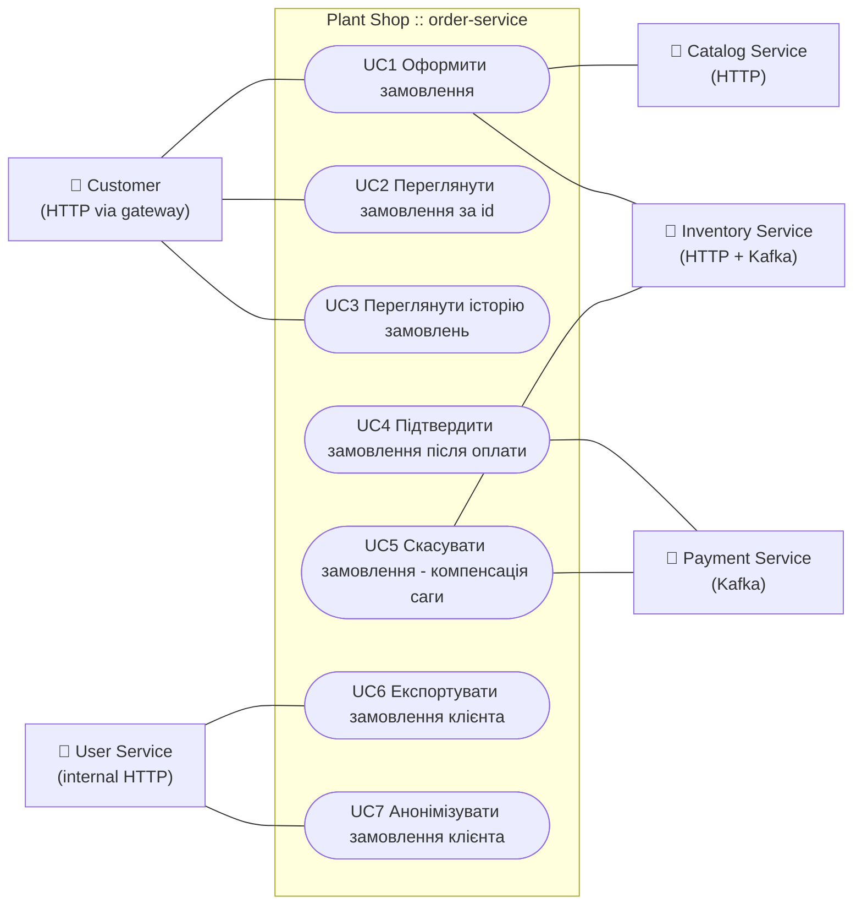

# Лабораторна робота №9. SQALE, фінансова капіталізація технічного боргу, FPA та UCP

**Тема:** математичне моделювання SQALE, Software Economics (Cost of Delay, NPV) та функціональне вимірювання
розміру системи (FPA & UCP).
**Гілка:** `lab/Lab_9`. **Текст завдання:** `docs/lab-09.md`. **Сирі дані та логи:** `docs/lab-09/`.

## Зміст

- [0. Вибір об'єктів і карта артефактів](#0-вибір-обєктів-і-карта-артефактів)
- [Теоретичні основи (для захисту)](#теоретичні-основи-для-захисту)
- [1. Картка об'єкта Forensic-аудиту](#1-картка-обєкта-forensic-аудиту)
- [2. Протокол хмарного REST-виклику](#2-протокол-хмарного-rest-виклику)
- [3. Паспорт технічного боргу (SQALE Audit Ledger)](#3-паспорт-технічного-боргу-sqale-audit-ledger)
- [4. Економіка рефакторингу (Financial Quality Ledger)](#4-економіка-рефакторингу-financial-quality-ledger)
- [5. Специфікація реверс-інжинірингу початкових даних](#5-специфікація-реверс-інжинірингу-початкових-даних)
- [6. FPA калькулятор (IFPUG Ledger)](#6-fpa-калькулятор-ifpug-ledger)
- [7. UCP матриця Карнера](#7-ucp-матриця-карнера)
- [8. Звіт про зворотне калібрування](#8-звіт-про-зворотне-калібрування)
- [9. Лог валідації ШІ-Техліда](#9-лог-валідації-ші-техліда)
- [Шпаргалка для Live Demo](#шпаргалка-для-live-demo)
- [Питання та відповіді для захисту](#питання-та-відповіді-для-захисту)
- [Список скріншотів](#список-скріншотів)

---

## 0. Вибір об'єктів і карта артефактів

| Завдання | Об'єкт | Чому саме він |
|---|---|---|
| 1. SQALE-аудит | **Apache Fineract** на SonarCloud (`apache_fineract`) | Завдання вимагає OSS-проєкт на SonarCloud з `ncloc ≥ 50 000` під наш стек (Java). Fineract: 381 233 ncloc, Java/Spring/JPA. Наш Plant Shop на SonarCloud не опублікований і значно менший за 50 000 рядків, тому для завдання 1 він не підходить |
| 2. Software Economics | Той самий `report.json` Fineract | Скрипт за умовою читає файл, збережений у завданні 1 |
| 3. FPA + UCP | Модуль **`order-service`** нашого Plant Shop | Рішення погоджене з викладачем-замовником (мною): маємо доступ до коду, ORM-сутностей, міграцій і git-історії модуля, тож усі початкові дані перевіряються. Це свідоме відхилення від формулювання «модуль із проєкту завдання 1» |

| Артефакт | Файл |
|---|---|
| Сира відповідь API (вхід скрипта) | `docs/lab-09/report.json` |
| Протокол запиту (час, HTTP-код, URL) | `docs/lab-09/sonarcloud-request.log` |
| Метадані проєкту (organization, дата аналізу) | `docs/lab-09/sonarcloud-component.json`, `docs/lab-09/sonarcloud-last-analysis.json` |
| Контрольний запит (`sqale_debt_ratio`, `development_cost`) | `docs/lab-09/sonarcloud-crosscheck.json` |
| Фінансовий симулятор | `scripts/financial_ledger.py`, обгортка `scripts/financial-ledger.sh` |
| Unit-тести симулятора | `scripts/test_financial_ledger.py`, результат `docs/lab-09/financial-ledger-tests.txt` |
| Згенерований ledger | `FINANCIAL_LEDGER.md` (корінь репозиторію) |
| Консольний запуск | `docs/lab-09/financial-ledger-run.txt` |
| FPA/UCP вхідні дані (імпортуються в Google Sheets) | `docs/lab-09/fpa-functions.csv`, `ucp-actors.csv`, `ucp-use-cases.csv` |
| FPA/UCP калькулятор | `scripts/fpa_ucp.py`, результат `docs/lab-09/fpa-ucp-ledger.md`, `docs/lab-09/fpa-ucp-run.txt` |
| UML Use Case (Draw.io) | `docs/lab-09/order-service-use-cases.drawio` |
| Розмір модуля (Lizard 1.24.3) | `docs/lab-09/lizard-order-service-main.txt`, `docs/lab-09/lizard-order-service-test.txt` |
| Git-історія модуля | `docs/lab-09/git-log-order-service.txt` |

---

## Теоретичні основи (для захисту)

### Т1. Технічний борг і модель SQALE

**Технічний борг** (Ward Cunningham, 1992) — метафора: швидке, але неякісне рішення схоже на кредит. Є **тіло
боргу (principal)** — робота, потрібна, щоб виправити код, і **відсотки (interest)** — додаткові витрати, які
команда несе щомісяця, поки борг не виправлено (повільніші зміни, регресії, довше онбординг).

**SQALE** (Software Quality Assessment based on Lifecycle Expectations, Jean-Louis Letouzey, 2010) — метод оцінки
якості коду через **вартість виправлення (remediation cost)**:

1. Кожне правило аналізатора має «ціну» виправлення в хвилинах (наприклад, «метод занадто складний» — 30 хв).
2. Сума цін усіх порушень — **SQALE Index** (`sqale_index` у SonarQube), у хвилинах.
3. Щоб порівнювати системи різного розміру, борг ділять на **вартість розробки** системи з нуля. За замовчуванням
   SonarQube рахує її як **30 хвилин на рядок коду**: `development_cost = ncloc × 30 хв`.
4. Частка боргу — **Technical Debt Density / Debt Ratio (TDD)**:

```text
TDD = (sqale_index / 60) / (ncloc × 0.5) × 100 %  =  sqale_index / (ncloc × 30) × 100 %
```

5. Літерний **рейтинг супроводжуваності** (`sqale_rating`) — це просто шкала над TDD. SonarCloud повертає його
   числом: `1.0 = A`, `2.0 = B`, `3.0 = C`, `4.0 = D`, `5.0 = E`.

| Рейтинг | TDD (SonarQube/SonarCloud за замовчуванням) | Шкала з методички |
|---|---|---|
| A | ≤ 5 % | ≤ 5 % |
| B | 5–10 % | 6–10 % |
| C | 10–20 % | 11–20 % |
| D | 20–50 % | — |
| E | > 50 % | — |

**Ключові терміни:** `ncloc` — рядки коду без коментарів і порожніх рядків; людино-день = 8 годин.

### Т2. Software Economics: Principal, Cost of Delay, дисконтування, NPV

- **Тіло боргу (Principal, Remediation Cost)** — гроші, щоб виправити весь борг зараз:
  `Principal = sqale_index / 60 × HOURLY_RATE × OVERLOAD_COEFF`. **OVERLOAD_COEFF** (1.3) — накладні витрати
  компанії понад «чисту» ставку: податки, менеджмент, інфраструктура, простої.
- **Cost of Delay (CoD, вартість затримки)** — скільки бізнес **втрачає щомісяця, поки нічого не робить** (це і є
  «відсотки» за боргом). Термін з Lean/Agile (Don Reinertsen): «скільки коштує нам кожен місяць відкладання».
  У лабораторній прийнято промислове правило: **1 інженерна година на місяць на кожні 100 ncloc** йде на боротьбу з
  регресіями: `CoD = ncloc / 100 × HOURLY_RATE`.
  **Економічний зміст:** CoD показує, що бездіяльність не безкоштовна; рефакторинг — це інвестиція, а щомісячна
  «економія» після нього дорівнює CoD, від якого ми позбулися.
- **Вартість грошей у часі.** Долар через місяць коштує менше, ніж сьогодні (інфляція, альтернативні інвестиції).
  Тому майбутній потік приводять до сьогоднішньої вартості **коефіцієнтом дисконтування** `1 / (1 + r)^k`, де
  `r = DISCOUNT_RATE` (1 % на місяць), `k` — номер місяця.
- **NPV (Net Present Value, чиста приведена вартість)** — сума дисконтованих майбутніх вигод мінус початкова
  інвестиція:

```text
NPV_t = Σ (k = 1..t) CoD / (1 + r)^k − Principal
```

- **Payback Period (точка окупності)** — перший місяць `t`, коли `NPV_t > 0`. Якщо в межах горизонту (6 місяців)
  NPV не став додатним, рефакторинг цілком не окупається → **FAIL**.

**Важливий висновок, який легко показати на захисті:** якщо поділити Principal на CoD, ставка скорочується:

```text
Principal / CoD = (sqale_index / 60 × R × k) / (ncloc / 100 × R)
                = (100 / 60) × k × sqale_index / ncloc
                = (5/3) × k × (30 × TDD)          // бо TDD = sqale_index / (30 × ncloc)
                = 50 × k × TDD
```

При `k = 1.3`: **Principal = 65 × TDD × CoD**. Тобто швидкість окупності залежить **лише від TDD** (і `k`, `r`),
а не від погодинної ставки чи абсолютного розміру. Окупність за 6 місяців можлива, коли
`65 × TDD < Σ 1/1.01^k (k = 1..6) = 5.7955`, тобто **TDD < 8.92 %**: усі системи з рейтингом A і «кращі» B.

### Т3. Function Point Analysis (FPA, IFPUG)

FPA (Allan Albrecht, IBM, 1979; стандарт IFPUG CPM, ISO/IEC 20926) вимірює **функціональний розмір з погляду
користувача**: скільки даних система зберігає/читає і скільки елементарних процесів обміну даними вона виконує.
Від мови програмування не залежить.

**Межа застосунку (boundary)** — у нашому випадку межа `order-service`. Все, що за нею (catalog, inventory,
payment, user-service), — зовнішнє.

| Категорія | Що це | У нашому модулі |
|---|---|---|
| **ILF** (Internal Logical File) | Логічна група даних, яку модуль **сам підтримує** (створює/змінює) | `Order` + `OrderItem` |
| **EIF** (External Interface File) | Дані **іншої** системи, які модуль лише **читає** для довідки | Рослини catalog-service, залишки inventory-service |
| **EI** (External Input) | Елементарний процес, що приймає дані ззовні й **змінює ILF** | Створення, підтвердження, скасування, анонімізація |
| **EO** (External Output) | Вихід із **обчисленими/похідними** даними (розрахунок, звіт) | Перегляд замовлення з `lineTotal = unitPrice × quantity` |
| **EQ** (External Inquiry) | Просте читання **без обчислень** і без зміни ILF | Експорт замовлень для GDPR |

**Параметри складності:**

- **DET** (Data Element Type) — унікальне поле, яке бачить користувач.
- **RET** (Record Element Type) — підгрупа записів усередині ILF/EIF (наприклад, «замовлення» і «позиції»).
- **FTR** (File Type Referenced) — скільки ILF/EIF читає або змінює транзакція.

**Матриці складності IFPUG:**

ILF/EIF (рядки — RET, стовпці — DET):

| RET \ DET | 1–19 | 20–50 | 51+ |
|---|---|---|---|
| 1 | Low | Low | Average |
| 2–5 | Low | Average | High |
| 6+ | Average | High | High |

EI (рядки — FTR, стовпці — DET):

| FTR \ DET | 1–4 | 5–15 | 16+ |
|---|---|---|---|
| 0–1 | Low | Low | Average |
| 2 | Low | Average | High |
| 3+ | Average | High | High |

EO/EQ (рядки — FTR, стовпці — DET):

| FTR \ DET | 1–5 | 6–19 | 20+ |
|---|---|---|---|
| 0–1 | Low | Low | Average |
| 2–3 | Low | Average | High |
| 4+ | Average | High | High |

**Ваги (Low / Average / High):** ILF 7/10/15, EIF 5/7/10, EI 3/4/6, EO 4/5/7, EQ 3/4/6.

`UFP = Σ ваг` (Unadjusted FP). Далі можна застосувати VAF (14 загальних характеристик системи, кожна 0–5):
`VAF = 0.65 + 0.01 × TDI`, `AFP = UFP × VAF`. У роботі VAF = 1.0 (TDI = 35, усі характеристики «середні»), так само
як TCF/ECF = 1.0 в UCP.

**Правило унікальності елементарного процесу:** два процеси вважаються одним, якщо в них ті самі DET, ті самі FTR
і та сама логіка обробки. Тому скасування за `inventory-failed` і за `payment-failed` — **одна** EI.

### Т4. Use Case Points (UCP, Gustav Karner, 1993)

UCP оцінює розмір через **поведінку системи**: хто з нею взаємодіє (актори) і скільки кроків (транзакцій) у
кожному прецеденті.

1. **UAW** (Unadjusted Actor Weight): простий актор (інша система через API/CLI) = 1, середній (система через
   протокол TCP/HTTP або людина через текстовий інтерфейс) = 2, складний (людина через GUI) = 3.
2. **UUCW** (Unadjusted Use Case Weight): простий UC (≤ 3 транзакції) = 5, середній (4–7) = 10, складний (> 7) = 15.
3. `UUCP = UAW + UUCW`.
4. `UCP = UUCP × TCF × ECF`. Повна модель: `TCF = 0.6 + 0.01 × Σ(13 технічних факторів × вага)`,
   `ECF = 1.4 − 0.03 × Σ(8 факторів середовища × вага)`. За умовою обидва = 1.0.
5. **Productivity Factor (PF)** — людино-години на одну UCP. Karner пропонував 20 год/UCP; Schneider & Winters —
   20 або 28 залежно від факторів середовища. Найточніше — **відкалібрувати PF на власній історії** команди.

### Т5. FPA vs UCP — в чому різниця (за плутанину на захисті −2 бали)

| Критерій | FPA (Function Points) | UCP (Use Case Points) |
|---|---|---|
| Що міряє | Дані та рух даних через межу системи | Поведінку: актори й кроки сценаріїв |
| Одиниця | Функціональна точка FP | Точка прецеденту UCP |
| Джерело | Модель даних (ILF/EIF) + транзакції (EI/EO/EQ) | UML Use Case діаграма + сценарії |
| Стандарт | IFPUG CPM, ISO/IEC 20926 | Не стандартизований (метод Karner) |
| Коли застосовують | Коли відомі дані та інтерфейси; добре для контрактів, бенчмарків | Рано, з вимог у вигляді прецедентів |
| Чутливість | Мало помічає складну внутрішню логіку | Помічає складність сценарію (кроки, гілки) |
| Залежність від мови | Ні | Ні |

Коротко: **FP — «скільки даних і операцій над ними», UCP — «скільки поведінки бачать актори»**.

### Т6. Зворотне калібрування

**Пряма оцінка:** розмір × PF = трудовитрати. **Зворотне калібрування:** беремо вже виконаний модуль із
відомими трудовитратами, міряємо його розмір і обчислюємо PF:

```text
PF = Реальні трудовитрати (людино-години) / Розмір (UCP)
```

Потім цей PF множать на розмір **нових** вимог (Change Requests), щоб оцінити їх до написання коду.

---

## 1. Картка об'єкта Forensic-аудиту

| Поле | Значення | Джерело |
|---|---|---|
| Назва | **Apache Fineract** | `sonarcloud-component.json` |
| Призначення | Відкрита core-banking платформа для мікрофінансування та цифрових банків: клієнти, кредити, депозити, облік, REST API | Опис проєкту Apache |
| Репозиторій | https://github.com/apache/fineract | — |
| Дашборд SonarCloud | https://sonarcloud.io/project/overview?id=apache_fineract | — |
| Organization key | `apache` | `sonarcloud-component.json` → `"organization":"apache"` |
| Project key | `apache_fineract` | `report.json` → `"key":"apache_fineract"` |
| Версія / дата аналізу | `1.17.0-SNAPSHOT`, 2026-11-13T11:56:29+0000, ревізія `4ffa6cda5cc7538318941b67e0782a9794bd22ca` | `sonarcloud-last-analysis.json` |
| Масштаб | **381 233 ncloc** (≥ 50 000 ✔), з них Java 377 143 | `report.json`, `sonarcloud-crosscheck.json` |

> 📸 SCREENSHOT: дашборд SonarCloud проєкту apache_fineract (Overview з Maintainability A та Lines of Code)

## 2. Протокол хмарного REST-виклику

Для публічних проєктів API SonarCloud відкрите, токен не потрібен.

**HTTP-запит:**

```http
GET https://sonarcloud.io/api/measures/component?component=apache_fineract&metricKeys=sqale_index,ncloc,sqale_rating
Accept: application/json
```

**Те саме через curl** (виконано 2026-11-14 16:23:17 UTC, протокол — `docs/lab-09/sonarcloud-request.log`):

```bash
curl -s -G "https://sonarcloud.io/api/measures/component" \
  --data-urlencode "component=apache_fineract" \
  --data-urlencode "metricKeys=sqale_index,ncloc,sqale_rating" \
  -o docs/lab-09/report.json
```

```text
# HTTP 200, 315 bytes, 0.303558s
# effective URL: https://sonarcloud.io/api/measures/component?component=apache_fineract&metricKeys=sqale_index%2cncloc%2csqale_rating
```

**Сира відповідь сервера (`docs/lab-09/report.json`, без змін):**

```json
{"component":{"id":"AW8EG4-3sAQR2DA_j1HN","key":"apache_fineract","name":"fineract","description":"Run as:\ngradle clean bootRun","qualifier":"TRK","measures":[{"metric":"ncloc","value":"381233"},{"metric":"sqale_index","value":"171031","bestValue":false},{"metric":"sqale_rating","value":"1.0","bestValue":true}]}}
```

**Ті самі дані у форматованому вигляді (ключі метрик позначено коментарями):**

```jsonc
{
  "component": {
    "key": "apache_fineract",
    "name": "fineract",
    "qualifier": "TRK",                                           // TRK = project
    "measures": [
      { "metric": "ncloc",        "value": "381233" },            // <-- розмір: рядки коду
      { "metric": "sqale_index",  "value": "171031" },            // <-- борг: хвилини виправлення
      { "metric": "sqale_rating", "value": "1.0" }                // <-- рейтинг: 1.0 = A
    ]
  }
}
```

**Контрольний запит** (`docs/lab-09/sonarcloud-crosscheck.json`) для перевірки нашої математики:

```bash
curl -s -G "https://sonarcloud.io/api/measures/component" \
  --data-urlencode "component=apache_fineract" \
  --data-urlencode "metricKeys=sqale_debt_ratio,development_cost,ncloc_language_distribution"
```

```json
{"metric":"development_cost","value":"11436990"}, {"metric":"sqale_debt_ratio","value":"1.5"}
```

> 📸 SCREENSHOT: Postman (або термінал з curl) з GET-запитом до api/measures/component та JSON-відповіддю

## 3. Паспорт технічного боргу (SQALE Audit Ledger)

**Крок 1. Борг у людино-годинах і людино-днях**

```text
Борг (год)  = sqale_index / 60 = 171 031 / 60 = 2 850.52 год
Борг (днів) = 2 850.52 / 8     = 356.31 людино-дня
```

**Крок 2. Вартість написання системи з нуля (SQALE: 30 хв на рядок)**

```text
Обсяг системи (год) = ncloc × 30 / 60 = ncloc × 0.5 = 381 233 × 0.5 = 190 616.5 год
```

Перевірка з API: `development_cost = 11 436 990 хв = 381 233 × 30` ✔ (SonarCloud використовує ту саму норму).

**Крок 3. Індекс щільності боргу TDD**

```text
TDD = 2 850.52 / 190 616.5 × 100 % = 1.4954 % ≈ 1.50 %
(те саме: 171 031 / 11 436 990 × 100 % = 1.4954 %)
```

**Крок 4. Верифікація рейтингу**

TDD = 1.50 % ≤ 5 % → за шкалою SQALE рейтинг **A**. Сервер повернув `sqale_rating = 1.0`, тобто **A**, а
`sqale_debt_ratio = 1.5` збігається з нашим TDD до другого знака. **Хмарний розрахунок підтверджено.**

| Масштаб проєкту (ncloc) | Обсяг боргу (людино-годин / робочих днів) | Розрахунковий TDD (%) | Хмарний рейтинг (sqale_rating) | Збіг |
|---|---|---|---|---|
| 381 233 | 2 850.52 год / 356.31 дн | 1.50 % | 1.0 = **A** | ✔ (A ↔ ≤ 5 %) |

**Експертний висновок.** Fineract має значний абсолютний борг (≈ 356 людино-днів, тобто приблизно 1.6 людино-року),
але відносно розміру він малий: 1.5 % від вартості створення. Це типова картина для зрілого Apache-проєкту з
обов'язковим code review і статичним аналізом у CI. Ризик не в щільності, а в абсолютному обсязі: на великих
системах навіть 1.5 % — сотні днів роботи, тому борг треба гасити поступово, по модулях.

## 4. Економіка рефакторингу (Financial Quality Ledger)

### 4.1. Параметри та розрахунок (перевірка вручну)

| Змінна | Значення | Обґрунтування |
|---|---|---|
| `HOURLY_RATE` | $40/год | Середина дозволеного діапазону $35–$50 |
| `OVERLOAD_COEFF` | 1.3 | Задано умовою |
| `DISCOUNT_RATE` | 0.01 | 1 % на місяць, задано умовою |

```text
Principal = 171 031 / 60 × 40 × 1.3 = 2 850.5167 × 52 = $148 226.87
CoD       = 381 233 / 100 × 40      = 3 812.33 × 40   = $152 493.20 / міс
NPV_1     = 152 493.20 / 1.01 − 148 226.87 = 150 983.37 − 148 226.87 = +$2 756.50  > 0  → окупність на 1-му місяці
Перевірка через формулу Т2: Principal / CoD = 65 × 0.014954 = 0.972 < 1/1.01 = 0.990 → окупність у 1-й місяць ✔
```

### 4.2. Алгоритм скрипта

1. Прочитати `report.json` (шлях — аргумент), знайти в масиві `measures` ключі `ncloc`, `sqale_index`,
   `sqale_rating`. Якщо JSON містить `errors` або метрики немає — завершитися з кодом 1 (жодних «вшитих» значень).
2. Прочитати змінні оточення `HOURLY_RATE` (перевірка діапазону 35–50), `OVERLOAD_COEFF`, `DISCOUNT_RATE`.
3. Обчислити Principal і Cost of Delay.
4. Цикл `for t in 1..6`: коефіцієнт `1/(1+r)^t`, дисконтований прибуток, кумулятивна сума, `NPV_t`.
5. Перший `t` з `NPV_t > 0` — Payback Period. PASS, якщо він є, інакше FAIL з архітектурним попередженням.
6. Записати `FINANCIAL_LEDGER.md` у корінь репозиторію та вивести підсумок у консоль. Код виходу: 0 = PASS,
   2 = FAIL, 1 = помилка вхідних даних (зручно для CI quality gate).

Додатково скрипт рахує **граничний TDD** (за якого окупність ще вкладається в 6 місяців) — 8.92 %.

### 4.3. Повний текст скрипта `scripts/financial_ledger.py`

```python
#!/usr/bin/env python3
"""Software Economics simulator (Lab 9, task 2).

Reads the raw SonarCloud response saved in task 1 (``api/measures/component`` with ``sqale_index``, ``ncloc``,
``sqale_rating``) and turns technical debt into money:

* Principal (remediation cost)  = sqale_index / 60 * HOURLY_RATE * OVERLOAD_COEFF
* Cost of Delay (per month)     = ncloc / 100 * HOURLY_RATE
* NPV_t = sum_{k=1..t} CoD / (1 + DISCOUNT_RATE)^k - Principal,   t = 1..HORIZON

The payback month is the first t with NPV_t > 0. The result is written to FINANCIAL_LEDGER.md; the quality gate
is PASS when NPV becomes positive within the horizon (6 months), otherwise FAIL.

Usage:
    HOURLY_RATE=40 OVERLOAD_COEFF=1.3 DISCOUNT_RATE=0.01 python scripts/financial_ledger.py docs/lab-09/report.json

Only the standard library is used. Exit code: 0 = PASS, 2 = FAIL, 1 = bad input.
"""

from __future__ import annotations

import json
import os
import sys
from dataclasses import dataclass
from datetime import datetime, timezone
from pathlib import Path

HORIZON_MONTHS = 6
MINUTES_PER_HOUR = 60
LINES_PER_LOST_HOUR = 100          # every 100 ncloc cost 1 engineer-hour per month of regression fighting
HOURLY_RATE_RANGE = (35.0, 50.0)   # range required by the assignment
SQALE_RATING_LETTERS = {1: "A", 2: "B", 3: "C", 4: "D", 5: "E"}
DEFAULT_REPORT = Path("docs/lab-09/report.json")
DEFAULT_OUTPUT = Path("FINANCIAL_LEDGER.md")


class LedgerInputError(Exception):
    """Raised when the JSON report or an environment variable cannot be used."""


@dataclass(frozen=True)
class Baseline:
    project_key: str
    project_name: str
    ncloc: int
    sqale_index: int
    sqale_rating: str


@dataclass(frozen=True)
class Config:
    hourly_rate: float
    overload_coeff: float
    discount_rate: float


@dataclass(frozen=True)
class MonthRow:
    month: int
    discount_factor: float
    nominal_benefit: float
    discounted_benefit: float
    cumulative_discounted: float
    npv: float


# ---------------------------------------------------------------- input

def load_baseline(report_path: Path) -> Baseline:
    """Parses the SonarCloud measures response; every number comes from the JSON, nothing is hard-coded."""
    try:
        payload = json.loads(report_path.read_text(encoding="utf-8"))
    except FileNotFoundError as exc:
        raise LedgerInputError(f"report not found: {report_path}") from exc
    except json.JSONDecodeError as exc:
        raise LedgerInputError(f"report is not valid JSON: {exc}") from exc

    if "errors" in payload:
        raise LedgerInputError(f"SonarCloud returned an error: {payload['errors']}")
    component = payload.get("component")
    if not isinstance(component, dict):
        raise LedgerInputError("JSON has no 'component' object (expected api/measures/component response)")

    measures = {m.get("metric"): m.get("value") for m in component.get("measures", [])}
    missing = [key for key in ("ncloc", "sqale_index", "sqale_rating") if key not in measures]
    if missing:
        raise LedgerInputError(f"metrics missing in JSON: {', '.join(missing)}")

    ncloc = _to_int(measures["ncloc"], "ncloc")
    if ncloc <= 0:
        raise LedgerInputError("ncloc must be positive")
    return Baseline(
        project_key=component.get("key", "?"),
        project_name=component.get("name", "?"),
        ncloc=ncloc,
        sqale_index=_to_int(measures["sqale_index"], "sqale_index"),
        sqale_rating=_rating_letter(measures["sqale_rating"]),
    )


def _to_int(raw: object, name: str) -> int:
    try:
        value = int(float(str(raw)))
    except ValueError as exc:
        raise LedgerInputError(f"{name} is not a number: {raw!r}") from exc
    if value < 0:
        raise LedgerInputError(f"{name} must not be negative: {value}")
    return value


def _rating_letter(raw: object) -> str:
    """SonarCloud encodes ratings as 1.0..5.0 (A..E)."""
    try:
        return SQALE_RATING_LETTERS[int(float(str(raw)))]
    except (ValueError, KeyError) as exc:
        raise LedgerInputError(f"unknown sqale_rating: {raw!r}") from exc


def load_config(env: dict[str, str]) -> Config:
    hourly_rate = _env_float(env, "HOURLY_RATE")
    low, high = HOURLY_RATE_RANGE
    if not low <= hourly_rate <= high:
        raise LedgerInputError(f"HOURLY_RATE must be within ${low:.0f}-${high:.0f}/h, got {hourly_rate}")
    overload = _env_float(env, "OVERLOAD_COEFF")
    discount = _env_float(env, "DISCOUNT_RATE")
    if overload <= 0 or discount < 0:
        raise LedgerInputError("OVERLOAD_COEFF must be > 0 and DISCOUNT_RATE >= 0")
    return Config(hourly_rate, overload, discount)


def _env_float(env: dict[str, str], name: str) -> float:
    raw = env.get(name)
    if raw is None or raw.strip() == "":
        raise LedgerInputError(f"environment variable {name} is not set")
    try:
        return float(raw)
    except ValueError as exc:
        raise LedgerInputError(f"{name} is not a number: {raw!r}") from exc


# ---------------------------------------------------------------- economics

def debt_hours(baseline: Baseline) -> float:
    return baseline.sqale_index / MINUTES_PER_HOUR


def principal(baseline: Baseline, config: Config) -> float:
    """Remediation cost of the whole debt today: sqale_index / 60 * rate * overload."""
    return debt_hours(baseline) * config.hourly_rate * config.overload_coeff


def cost_of_delay(baseline: Baseline, config: Config) -> float:
    """Monthly loss while the debt stays: 1 engineer-hour per 100 ncloc per month."""
    return baseline.ncloc / LINES_PER_LOST_HOUR * config.hourly_rate


def simulate_npv(monthly_benefit: float, investment: float, discount_rate: float,
                 months: int = HORIZON_MONTHS) -> list[MonthRow]:
    """Cumulative discounted NPV for t = 1..months (benefit arrives at the end of each month)."""
    rows = []
    cumulative = 0.0
    for t in range(1, months + 1):
        factor = 1 / (1 + discount_rate) ** t
        discounted = monthly_benefit * factor
        cumulative += discounted
        rows.append(MonthRow(t, factor, monthly_benefit, discounted, cumulative, cumulative - investment))
    return rows


def payback_month(rows: list[MonthRow]) -> int | None:
    for row in rows:
        if row.npv > 0:
            return row.month
    return None


def tdd_percent(baseline: Baseline) -> float:
    """SQALE technical debt density: debt hours / (ncloc * 0.5 h) * 100 %."""
    return debt_hours(baseline) / (baseline.ncloc * 0.5) * 100


def break_even_tdd_percent(config: Config, months: int = HORIZON_MONTHS) -> float:
    """Largest TDD for which NPV still turns positive within the horizon.

    Principal / CoD = (sqale_index/60 * k) / (ncloc/100) = 50 * k * TDD, so payback within ``months`` needs
    50 * k * TDD < sum 1/(1+r)^t  ->  TDD_max = annuity / (50 * k). The hourly rate cancels out.
    """
    annuity = sum(1 / (1 + config.discount_rate) ** t for t in range(1, months + 1))
    return annuity / (50 * config.overload_coeff) * 100


# ---------------------------------------------------------------- output

def money(value: float) -> str:
    sign = "-" if value < 0 else ""
    return f"{sign}${abs(value):,.2f}"


def render_ledger(baseline: Baseline, config: Config, rows: list[MonthRow], generated_at: str) -> str:
    debt = principal(baseline, config)
    cod = cost_of_delay(baseline, config)
    payback = payback_month(rows)
    gate = "PASS" if payback is not None else "FAIL"
    hours = debt_hours(baseline)
    lines = [
        "# SOFTWARE ECONOMICS & FINANCIAL QUALITY LEDGER",
        "",
        f"> Згенеровано автоматично скриптом `scripts/financial_ledger.py` ({generated_at}).",
        "> Усі вхідні метрики прочитано з JSON-відповіді SonarCloud API, нічого не введено вручну.",
        "",
        "## 1. Вхідні параметри аудиту (System Baseline)",
        "",
        "| Параметр | Значення |",
        "|---|---|",
        f"| Проєкт (key) | `{baseline.project_key}` ({baseline.project_name}) |",
        f"| Масштаб системи (ncloc) | {baseline.ncloc:,} |",
        f"| Початковий технічний борг (sqale_index) | {baseline.sqale_index:,} хв = {hours:,.2f} год |",
        f"| Рейтинг супроводжуваності (sqale_rating) | {baseline.sqale_rating} |",
        f"| Щільність боргу TDD | {tdd_percent(baseline):.2f}% |",
        f"| HOURLY_RATE | ${config.hourly_rate:,.2f}/год |",
        f"| OVERLOAD_COEFF | {config.overload_coeff} |",
        f"| DISCOUNT_RATE | {config.discount_rate} ({config.discount_rate * 100:.2f}% на місяць) |",
        "",
        "## 2. Капіталізація інвестиційних маркерів",
        "",
        "| Маркер | Формула | Значення |",
        "|---|---|---|",
        f"| Тіло боргу (Principal, вартість рефакторингу) | {baseline.sqale_index:,} / 60 × "
        f"{config.hourly_rate:g} × {config.overload_coeff:g} | {money(debt)} |",
        f"| Щомісячні збитки від бездіяльності (Cost of Delay) | {baseline.ncloc:,} / 100 × "
        f"{config.hourly_rate:g} | {money(cod)} / міс |",
        "",
        f"## 3. Динаміка окупності інвестицій ({len(rows)} ітерацій розробки)",
        "",
        "| Місяць t | Коефіцієнт дисконтування 1/(1+r)^t | Щомісячний прибуток (CoD) | "
        "Дисконтований прибуток | Кумулятивний дисконтований прибуток | Кумулятивний NPV_t | Стан |",
        "|---|---|---|---|---|---|---|",
    ]
    for row in rows:
        state = "в плюсі" if row.npv > 0 else "в мінусі"
        lines.append(f"| {row.month} | {row.discount_factor:.6f} | {money(row.nominal_benefit)} | "
                     f"{money(row.discounted_benefit)} | {money(row.cumulative_discounted)} | "
                     f"{money(row.npv)} | {state} |")
    lines += ["", "## 4. Фінальний інженерно-економічний вердикт", ""]
    if payback is not None:
        lines.append(f"Точка виходу в нуль (Payback Period): окупність настає на **{payback}-му місяці** "
                     f"після рефакторингу (NPV_{payback} = {money(rows[payback - 1].npv)}).")
    else:
        lines.append(f"Окупність за {len(rows)} місяців **не досягнута** (NPV_{len(rows)} = "
                     f"{money(rows[-1].npv)}).")
    lines.append(f"NPV наприкінці горизонту: {money(rows[-1].npv)}. Межа окупності за {len(rows)} міс.: "
                 f"TDD < {break_even_tdd_percent(config, len(rows)):.2f}% (межа не залежить від HOURLY_RATE).")
    lines += ["", "## 5. СТАТУС ВОРІТ ЯКОСТІ (Quality Gate)", "", f"**{gate}**", ""]
    if gate == "FAIL":
        lines += ["> ⚠️ Архітектурне попередження: борг занадто великий відносно розміру системи; повний "
                  "рефакторинг не окупається за 6 місяців. Потрібне поетапне погашення боргу (за модулями з "
                  "найвищим TDD) або перегляд архітектури.", ""]
    return "\n".join(lines)


def main(argv: list[str]) -> int:
    if hasattr(sys.stdout, "reconfigure"):
        sys.stdout.reconfigure(encoding="utf-8")
    report_path = Path(argv[1]) if len(argv) > 1 else DEFAULT_REPORT
    output_path = Path(os.environ.get("LEDGER_OUTPUT", str(DEFAULT_OUTPUT)))
    try:
        baseline = load_baseline(report_path)
        config = load_config(dict(os.environ))
    except LedgerInputError as exc:
        print(f"[ERROR] {exc}", file=sys.stderr)
        return 1

    rows = simulate_npv(cost_of_delay(baseline, config), principal(baseline, config), config.discount_rate)
    payback = payback_month(rows)
    generated_at = datetime.now(timezone.utc).strftime("%Y-%m-%d %H:%M UTC")
    output_path.write_text(render_ledger(baseline, config, rows, generated_at) + "\n", encoding="utf-8",
                           newline="\n")

    print(f"Project      : {baseline.project_key} (ncloc={baseline.ncloc:,}, sqale_index={baseline.sqale_index:,} min,"
          f" rating={baseline.sqale_rating})")
    print(f"Principal    : {money(principal(baseline, config))}")
    print(f"Cost of Delay: {money(cost_of_delay(baseline, config))} / month")
    for row in rows:
        print(f"  t={row.month}  factor={row.discount_factor:.6f}  cumulative={money(row.cumulative_discounted):>16}"
              f"  NPV={money(row.npv):>16}")
    if payback is not None:
        print(f"Payback      : month {payback}")
    print(f"Quality gate : {'PASS' if payback is not None else 'FAIL'}")
    print(f"[OK] Financial ledger written to {output_path.resolve()}")
    return 0 if payback is not None else 2


if __name__ == "__main__":
    sys.exit(main(sys.argv))
```

Обгортка для запуску з параметрами завдання (`scripts/financial-ledger.sh`):

```bash
#!/usr/bin/env bash
# Lab 9, task 2: runs scripts/financial_ledger.py with the assignment's parameters and writes FINANCIAL_LEDGER.md
# into the repository root. Override any value from the environment, e.g. HOURLY_RATE=50 ./scripts/financial-ledger.sh
# Uses a local Python 3 (py launcher / python3) or, if none, the python:3.12-slim Docker image.
set -euo pipefail
cd "$(dirname "$0")/.."

REPORT="${1:-docs/lab-09/report.json}"
export HOURLY_RATE="${HOURLY_RATE:-40}"
export OVERLOAD_COEFF="${OVERLOAD_COEFF:-1.3}"
export DISCOUNT_RATE="${DISCOUNT_RATE:-0.01}"
export PYTHONIOENCODING=utf-8

if command -v py >/dev/null 2>&1 && py -3 --version >/dev/null 2>&1; then
    exec py -3 scripts/financial_ledger.py "$REPORT"
elif command -v python3 >/dev/null 2>&1 && python3 --version >/dev/null 2>&1; then
    exec python3 scripts/financial_ledger.py "$REPORT"
else
    exec docker run --rm -v "$PWD:/work" -w /work \
        -e HOURLY_RATE -e OVERLOAD_COEFF -e DISCOUNT_RATE -e PYTHONIOENCODING \
        python:3.12-slim python scripts/financial_ledger.py "$REPORT"
fi
```

### 4.4. Unit-тести скрипта

`scripts/test_financial_ledger.py` перевіряє: парсинг JSON, відмову на відсутній метриці та на `errors` від
SonarCloud, діапазон ставки, формули Principal/CoD, кумулятивне дисконтування, суворе `NPV > 0`, гілку FAIL і
збіг аналітичної межі TDD із симуляцією.

```text
test_break_even_tdd_matches_simulation (test_financial_ledger.EconomicsTest.test_break_even_tdd_matches_simulation) ... ok
test_heavy_debt_fails_gate (test_financial_ledger.EconomicsTest.test_heavy_debt_fails_gate) ... ok
test_npv_is_cumulative_and_discounted (test_financial_ledger.EconomicsTest.test_npv_is_cumulative_and_discounted) ... ok
test_payback_needs_strictly_positive_npv (test_financial_ledger.EconomicsTest.test_payback_needs_strictly_positive_npv) ... ok
test_principal_and_cost_of_delay (test_financial_ledger.EconomicsTest.test_principal_and_cost_of_delay) ... ok
test_missing_metric_is_rejected (test_financial_ledger.LoadBaselineTest.test_missing_metric_is_rejected) ... ok
test_reads_metrics_from_json (test_financial_ledger.LoadBaselineTest.test_reads_metrics_from_json) ... ok
test_sonar_error_response_is_rejected (test_financial_ledger.LoadBaselineTest.test_sonar_error_response_is_rejected) ... ok
test_missing_variable_is_rejected (test_financial_ledger.LoadConfigTest.test_missing_variable_is_rejected) ... ok
test_rate_outside_range_is_rejected (test_financial_ledger.LoadConfigTest.test_rate_outside_range_is_rejected) ... ok

----------------------------------------------------------------------
Ran 10 tests in 0.006s

OK
```

### 4.5. Консольний запуск

```bash
./scripts/financial-ledger.sh                     # HOURLY_RATE=40 OVERLOAD_COEFF=1.3 DISCOUNT_RATE=0.01
# або напряму:
HOURLY_RATE=40 OVERLOAD_COEFF=1.3 DISCOUNT_RATE=0.01 py -3 scripts/financial_ledger.py docs/lab-09/report.json
```

```text
Project      : apache_fineract (ncloc=381,233, sqale_index=171,031 min, rating=A)
Principal    : $148,226.87
Cost of Delay: $152,493.20 / month
  t=1  factor=0.990099  cumulative=     $150,983.37  NPV=       $2,756.50
  t=2  factor=0.980296  cumulative=     $300,471.85  NPV=     $152,244.98
  t=3  factor=0.970590  cumulative=     $448,480.25  NPV=     $300,253.38
  t=4  factor=0.960980  cumulative=     $595,023.21  NPV=     $446,796.35
  t=5  factor=0.951466  cumulative=     $740,115.26  NPV=     $591,888.39
  t=6  factor=0.942045  cumulative=     $883,770.75  NPV=     $735,543.89
Payback      : month 1
Quality gate : PASS
[OK] Financial ledger written to D:\Projects\Course_4\Claude_test_projects\ClaudeTestProject\FINANCIAL_LEDGER.md
exit=0
```

> 📸 SCREENSHOT: термінал Git Bash з запуском ./scripts/financial-ledger.sh, таблицею NPV, "Quality gate : PASS" та повідомленням "[OK] Financial ledger written to ..."

### 4.6. Згенерований `FINANCIAL_LEDGER.md` (лістинг)

```markdown
# SOFTWARE ECONOMICS & FINANCIAL QUALITY LEDGER

> Згенеровано автоматично скриптом `scripts/financial_ledger.py` (2026-11-14 16:32 UTC).
> Усі вхідні метрики прочитано з JSON-відповіді SonarCloud API, нічого не введено вручну.

## 1. Вхідні параметри аудиту (System Baseline)

| Параметр | Значення |
|---|---|
| Проєкт (key) | `apache_fineract` (fineract) |
| Масштаб системи (ncloc) | 381,233 |
| Початковий технічний борг (sqale_index) | 171,031 хв = 2,850.52 год |
| Рейтинг супроводжуваності (sqale_rating) | A |
| Щільність боргу TDD | 1.50% |
| HOURLY_RATE | $40.00/год |
| OVERLOAD_COEFF | 1.3 |
| DISCOUNT_RATE | 0.01 (1.00% на місяць) |

## 2. Капіталізація інвестиційних маркерів

| Маркер | Формула | Значення |
|---|---|---|
| Тіло боргу (Principal, вартість рефакторингу) | 171,031 / 60 × 40 × 1.3 | $148,226.87 |
| Щомісячні збитки від бездіяльності (Cost of Delay) | 381,233 / 100 × 40 | $152,493.20 / міс |

## 3. Динаміка окупності інвестицій (6 ітерацій розробки)

| Місяць t | Коефіцієнт дисконтування 1/(1+r)^t | Щомісячний прибуток (CoD) | Дисконтований прибуток | Кумулятивний дисконтований прибуток | Кумулятивний NPV_t | Стан |
|---|---|---|---|---|---|---|
| 1 | 0.990099 | $152,493.20 | $150,983.37 | $150,983.37 | $2,756.50 | в плюсі |
| 2 | 0.980296 | $152,493.20 | $149,488.48 | $300,471.85 | $152,244.98 | в плюсі |
| 3 | 0.970590 | $152,493.20 | $148,008.40 | $448,480.25 | $300,253.38 | в плюсі |
| 4 | 0.960980 | $152,493.20 | $146,542.97 | $595,023.21 | $446,796.35 | в плюсі |
| 5 | 0.951466 | $152,493.20 | $145,092.05 | $740,115.26 | $591,888.39 | в плюсі |
| 6 | 0.942045 | $152,493.20 | $143,655.49 | $883,770.75 | $735,543.89 | в плюсі |

## 4. Фінальний інженерно-економічний вердикт

Точка виходу в нуль (Payback Period): окупність настає на **1-му місяці** після рефакторингу (NPV_1 = $2,756.50).
NPV наприкінці горизонту: $735,543.89. Межа окупності за 6 міс.: TDD < 8.92% (межа не залежить від HOURLY_RATE).

## 5. СТАТУС ВОРІТ ЯКОСТІ (Quality Gate)

**PASS**
```

> 📸 SCREENSHOT: FINANCIAL_LEDGER.md, відкритий у Obsidian/IDE (рендер таблиці та статусу PASS)

### 4.7. Аналітичний висновок щодо Software Economics

1. **Масштаб (ncloc) задає «відсотки».** CoD росте лінійно з ncloc: для Fineract $152 493 щомісяця. Що більша
   система, то дорожче коштує кожен місяць бездіяльності.
2. **SQALE Index задає «тіло».** Principal росте лінійно з `sqale_index`: $148 227.
3. **Швидкість окупності залежить тільки від їхнього співвідношення, тобто від TDD:** `Principal = 65 × TDD × CoD`.
   Ставка розробника скорочується. Fineract (TDD 1.5 %) окупається вже на **1-му місяці**, NPV через 6 місяців
   становить **+$735 544**. Межа окупності за 6 місяців — TDD < 8.92 %: системи з рейтингом A окупаються завжди,
   B — частково, C і гірше — ні (FAIL). Для них потрібне поетапне погашення боргу.
4. **Масштаб впливає на абсолютний ефект, а не на швидкість:** дві системи з однаковим TDD окупаються в той самий
   місяць, але великий Enterprise-проєкт дає в рази більший NPV. Тому в Enterprise рефакторинг з низьким TDD — одна
   з найвигідніших інвестицій.
5. **Обмеження моделі** (варто назвати самому): правило «1 год / 100 ncloc» лінійне й однакове для всіх
   модулів; модель вважає, що рефакторинг миттєвий і прибирає весь CoD. Насправді 356 людино-днів — це кілька
   місяців роботи команди, тож вигода приходить поступово і реальна окупність пізніша.

---

## 5. Специфікація реверс-інжинірингу початкових даних

**Підмодуль:** `order-service` Plant Shop. Це оформлення замовлення та хореографічна сага через Kafka. Ядро —
5 взаємопов'язаних класів: `OrderController`, `OrderService`, `Order`/`OrderItem`, `OrderEventListener`,
`CustomerDataService` (+ `InternalPrivacyController`).

### 5.1. Дані (ORM-сутності та схема БД) → ILF/EIF

`order-service/src/main/resources/db/migration/V1__create_order_tables.sql`:

```sql
CREATE TABLE orders (
    id BIGSERIAL PRIMARY KEY, customer_email VARCHAR(255) NOT NULL, shipping_address VARCHAR(500) NOT NULL,
    payment_method VARCHAR(30) NOT NULL, status VARCHAR(20) NOT NULL,
    total_amount NUMERIC(12, 2) NOT NULL CHECK (total_amount >= 0), failure_reason VARCHAR(500),
    created_at TIMESTAMPTZ NOT NULL DEFAULT NOW(), updated_at TIMESTAMPTZ NOT NULL DEFAULT NOW());
CREATE TABLE order_items (
    id BIGSERIAL PRIMARY KEY, order_id BIGINT NOT NULL REFERENCES orders (id) ON DELETE CASCADE,
    plant_id BIGINT NOT NULL, plant_name VARCHAR(150) NOT NULL,
    quantity INTEGER NOT NULL CHECK (quantity > 0), unit_price NUMERIC(10, 2) NOT NULL CHECK (unit_price >= 0));
```

| Сутність / контракт | Клас | Поля | Роль у FPA |
|---|---|---|---|
| `Order` (`@Entity`, таблиця `orders`) | `entity/Order.java` | id, customerEmail, shippingAddress, paymentMethod, status, totalAmount, failureReason, items, createdAt, updatedAt | ILF, RET 1 |
| `OrderItem` (`@Entity`, `order_items`) | `entity/OrderItem.java` | id, order, plantId, plantName, quantity, unitPrice; `getLineTotal()` | ILF, RET 2 (дочірня група) |
| `PlantDto` | `client/CatalogClient.java` | id, name, price, active | EIF (дані catalog-service) |
| `StockCheckRequest/Response` | `client/InventoryClient.java` | plantId, quantity / requested, available, inStock | EIF (дані inventory-service) |

### 5.2. Транзакції та актори (публічні методи, REST-ендпоінти, Kafka) → EI/EO/EQ, UC

| Вхід | Сигнатура | Ініціатор |
|---|---|---|
| `POST /api/orders` → 202 | `OrderResponse OrderController.create(@Valid CreateOrderRequest)` → `OrderService.create(CreateOrderRequest)` | Customer |
| `GET /api/orders/{id}` | `OrderResponse OrderController.findById(Long)` → `OrderService.findById(Long)` | Customer |
| `GET /api/orders?email=` | `List<OrderResponse> OrderController.findByCustomer(String)` → `OrderService.findByCustomer(String)` | Customer |
| Kafka `payment-completed` | `void OrderEventListener.onPaymentCompleted(PaymentCompletedEvent)` → `OrderService.confirm(Long)` | Payment Service |
| Kafka `inventory-failed` | `void OrderEventListener.onInventoryFailed(InventoryFailedEvent)` → `OrderService.cancel(Long, String)` | Inventory Service |
| Kafka `payment-failed` | `void OrderEventListener.onPaymentFailed(PaymentFailedEvent)` → `OrderService.cancel(Long, String)` | Payment Service |
| `POST /internal/privacy/customers/orders` | `List<CustomerOrderExport> InternalPrivacyController.findOrders(CustomerRef)` → `CustomerDataService.findOrders(String)` | User Service |
| `POST /internal/privacy/customers/anonymize` | `AnonymizationResult InternalPrivacyController.anonymize(CustomerRef)` → `CustomerDataService.anonymizeOrders(String)` | User Service |
| Вихідні виклики | `List<PlantDto> CatalogClient.findByIds(Collection<Long>)`, `List<StockCheckResponse> InventoryClient.check(List<StockCheckRequest>)` | → Catalog, Inventory |
| Вихідна подія | `void OrderEventPublisher.onOrderCreated(OrderCreatedEvent)` (`@TransactionalEventListener` → Kafka `order-created`) | → Inventory |
| Репозиторій | `Optional<Order> findWithItemsById(Long)`, `List<Order> findByCustomerEmailIgnoreCaseOrderByCreatedAtDesc(String)`, `int anonymizeCustomer(String, String, String, Instant)` | — |

### 5.3. UML Use Case діаграма

Файл для Draw.io: `docs/lab-09/order-service-use-cases.drawio` (відкривається на app.diagrams.net). Та сама
діаграма у Mermaid:



> 📸 SCREENSHOT: UML Use Case діаграма order-service у Draw.io (файл docs/lab-09/order-service-use-cases.drawio)

### 5.4. Трудовитрати з git-історії

`docs/lab-09/git-log-order-service.txt`:

```text
52895d1 2026-10-25 15:46:31 +0200 VladdHoryn Finish Testting Qual Lab_4
9713832 2026-10-25 15:46:20 +0200 VladdHoryn Finish Testting Qual Lab_4
0207223 2026-10-14 18:05:32 +0300 VladdHoryn Firs working version of the program
authors: 3 VladdHoryn
lines added: src/main/java 862, src/test 275, whole module 1274 (deleted 4)
```

| Метод оцінки трудовитрат | Розрахунок | Результат | Використано? |
|---|---|---|---|
| «git-hours» (сесія = коміти з інтервалом < 2 год, кожна сесія + 2 год) | 2 сесії (14.10 і 25.10, коміти 25.10 з різницею 11 с) × 2 год | ≈ 4 год | **Ні**: перший коміт — це увесь модуль одразу (squash «першої робочої версії»), тож час між комітами не відображає роботу. PF ≈ 0.05 год/UCP — фізично неможливо |
| Умовний час за обсягом коду (норма SQALE 30 хв на рядок, та сама, що в завданні 1) | NLOC продакшн-коду × 0.5 год = 679 × 0.5 | **339.5 людино-годин** | **Так** |

NLOC узято з Lizard 1.24.3 (закріплений образ `tools/lizard`), рядок `Total nloc 679` у
`docs/lab-09/lizard-order-service-main.txt` (тести — 209 NLOC окремо, в оцінку не входять, як і в SQALE
`development_cost`). Автор модуля один (`VladdHoryn`), кількість комітів — 3.

## 6. FPA калькулятор (IFPUG Ledger)

Розрахунок виконує `scripts/fpa_ucp.py`: складність **виводиться з матриць IFPUG** за DET і RET/FTR з
`docs/lab-09/fpa-functions.csv`, а не вибирається вручну. CSV-файли імпортуються в Google Sheets
(File → Import) як калькулятор.

| ID | Тип | Функція | Джерело в коді | DET | RET/FTR | Складність | FP |
|---|---|---|---|---|---|---|---|
| ILF1 | ILF | Order (orders + order_items) | `Order`, `OrderItem`, `V1__create_order_tables.sql` | 13 | 2 RET | Low | 7 |
| EIF1 | EIF | Plant (catalog-service) | `CatalogClient.PlantDto` | 4 | 1 RET | Low | 5 |
| EIF2 | EIF | Stock (inventory-service) | `InventoryClient.StockCheck*` | 4 | 1 RET | Low | 5 |
| EI1 | EI | Створити замовлення | `POST /api/orders` | 7 | 3 FTR | High | 6 |
| EI2 | EI | Підтвердити замовлення | Kafka `payment-completed` | 3 | 1 FTR | Low | 3 |
| EI3 | EI | Скасувати замовлення | Kafka `inventory-failed` / `payment-failed` | 2 | 1 FTR | Low | 3 |
| EI4 | EI | Анонімізувати замовлення | `POST /internal/.../anonymize` | 3 | 1 FTR | Low | 3 |
| EO1 | EO | Замовлення за id | `GET /api/orders/{id}` | 14 | 1 FTR | Low | 4 |
| EO2 | EO | Історія замовлень клієнта | `GET /api/orders?email=` | 13 | 1 FTR | Low | 4 |
| EQ1 | EQ | Експорт замовлень (GDPR) | `POST /internal/.../orders` | 11 | 1 FTR | Low | 3 |

**Обґрунтування спірних рішень:**

- **ILF1** — `orders` і `order_items` складають **одну** логічну групу: позиція не існує без замовлення
  (`ON DELETE CASCADE`). Тому це один ILF з 2 RET. DET: 9 полів `orders` + 4 поля `order_items`; сурогатні `id`
  позиції та FK `order_id` не рахуються, бо користувач їх не бачить.
- **EI1** — FTR = 3: пише `Order`, читає `Plant` і `Stock`. DET: 5 вхідних полів (`customerEmail`,
  `shippingAddress`, `paymentMethod`, `plantId`, `quantity`) + повідомлення про помилку + відповідь 202. Навіть
  якщо рахувати всі поля відповіді (DET ≥ 16), складність лишається High (FTR 3+).
- **EI3** — скасування з двох топіків рахується один раз (ті самі DET/FTR і та сама логіка `OrderService.cancel`).
- **EO1/EO2** — це **EO, а не EQ**, бо відповідь містить похідне поле `lineTotal = unitPrice × quantity`
  (`OrderItem.getLineTotal()`). За IFPUG вихід з обчисленими даними — EO.
- **EQ1** — експорт для GDPR віддає лише збережені поля без обчислень (`CustomerOrderExport`) → EQ.
- **Не рахуються:** публікація `order-created` (частина елементарного процесу EI1), `InternalApiTokenFilter`,
  `GlobalExceptionHandler`, health-ендпоінти — це технічні, а не бізнес-функції.

**Підсумок:**

```text
UFP = ILF (7) + EIF (5 + 5) + EI (6 + 3 + 3 + 3) + EO (4 + 4) + EQ (3)
    = 7 + 10 + 15 + 8 + 3 = 43 FP
AFP = UFP × VAF = 43 × 1.00 = 43 FP
```

> 📸 SCREENSHOT: Google Sheets з FPA-калькулятором (імпорт docs/lab-09/fpa-functions.csv + стовпці складності та FP)

## 7. UCP матриця Карнера

### 7.1. Актори (UAW)

| ID | Актор | Інтерфейс | Категорія | Вага |
|---|---|---|---|---|
| A1 | Customer (покупець) | REST/HTTP через api-gateway. GUI в проєкті немає | Середній | 2 |
| A2 | Catalog Service | HTTP REST через Feign | Середній | 2 |
| A3 | Inventory Service | HTTP REST через Feign + Kafka | Середній | 2 |
| A4 | Payment Service | Лише Kafka-події (типізований message API) | Простий | 1 |
| A5 | User Service (privacy) | HTTP `POST /internal/**` з `X-Internal-Token` | Середній | 2 |

```text
UAW = 2 + 2 + 2 + 1 + 2 = 9
```

Customer — людина, але в Plant Shop немає GUI: клієнт працює через HTTP REST API. За шкалою завдання
(«людина через GUI = 3», «протоколи TCP/HTTP = 2») це **2**. Kafka — не актор, а транспорт. Payment Service
спілкується з модулем лише через події брокера, тобто через API → **1**.

### 7.2. Прецеденти (UUCW)

Транзакція = окремий спостережуваний крок логіки в методі: валідація, звернення до даних, виклик зовнішньої
системи, гілка рішення, зміна стану, подія або відповідь.

| ID | Use Case | Кроки (з коду) | Транзакцій | Категорія | Вага |
|---|---|---|---|---|---|
| UC1 | Оформити замовлення | валідація запиту; злиття дублів; запит рослин у catalog; відмова для неактивної рослини; перевірка залишків; відмова «немає на складі»; побудова замовлення зі знімком ціни й сумою; збереження PENDING у транзакції; `order-created` після commit; відповідь 202 | 10 | Складний | 15 |
| UC2 | Переглянути замовлення за id | прийом id; завантаження з позиціями; 404 для невідомого id; розрахунок `lineTotal` і відповідь | 4 | Середній | 10 |
| UC3 | Переглянути історію | прийом email; запит без урахування регістру, сортування за датою; мапінг і відповідь | 3 | Простий | 5 |
| UC4 | Підтвердити після оплати | прийом `payment-completed`; завантаження; невідоме замовлення → warn; захист від повторної доставки (тільки PENDING); CONFIRMED | 5 | Середній | 10 |
| UC5 | Скасувати (компенсація саги) | прийом `inventory-failed`/`payment-failed`; завантаження; невідоме → warn; захист від повторної доставки; CANCELLED + причина | 5 | Середній | 10 |
| UC6 | Експортувати замовлення | перевірка `X-Internal-Token` (401); валідація email; запит; мапінг без внутрішніх деталей | 4 | Середній | 10 |
| UC7 | Анонімізувати замовлення | перевірка токена; валідація email; вже анонімізований email → 0 (ідемпотентність); масовий update заглушками; повернення кількості | 5 | Середній | 10 |

```text
UUCW = 15 + 10 + 5 + 10 + 10 + 10 + 10 = 70
UUCP = UAW + UUCW = 9 + 70 = 79
UCP  = UUCP × TCF × ECF = 79 × 1.0 × 1.0 = 79
```

> 📸 SCREENSHOT: Google Sheets з UCP-матрицею (імпорт docs/lab-09/ucp-actors.csv та ucp-use-cases.csv)

### 7.3. Вивід калькулятора

`docs/lab-09/fpa-ucp-run.txt` (запуск `py -3 scripts/fpa_ucp.py`):

```text
totals: ufp=43, afp=43, uaw=9, uucw=70, uucp=79, ucp=79, nloc=679, effort=339.5, pf=4.29747
[OK] written docs\lab-09\fpa-ucp-ledger.md
```

## 8. Звіт про зворотне калібрування

```text
Трудовитрати = NLOC × 0.5 год = 679 × 0.5 = 339.5 людино-годин
PF  = 339.5 / 79 UCP = 4.30 людино-годин на 1 UCP
(для порівняння: 339.5 / 43 FP = 7.90 людино-годин на 1 FP)
```

| Показник | Значення | Джерело |
|---|---|---|
| Розмір FPA | 43 FP | розділ 6 |
| Розмір UCP | 79 UCP | розділ 7 |
| Трудовитрати | 339.5 люд.-год | Lizard NLOC × норма SQALE |
| **PF** | **4.30 люд.-год / UCP** | 339.5 / 79 |
| Год / FP | 7.90 люд.-год / FP | 339.5 / 43 |
| Еталон Karner | 20 люд.-год / UCP | література |

**Чому PF (4.3) у ~4.6 раза менший за еталон Karner (20):** еталон Karner охоплює **весь життєвий цикл**
(аналіз, проєктування, тестування, документацію, менеджмент). Наша норма 30 хв/рядок — це лише створення
продакшн-коду, без тестів (ще 209 NLOC) та інфраструктури. Крім того, Spring Boot, Lombok і Spring Data
генерують багато поведінки без рукописного коду (наприклад, `JpaRepository`, похідні запити), тому на одну
UCP припадає мало рядків. Висновок: PF = 4.3 — коефіцієнт для **фази кодування** цієї команди на цьому стеку.
Для повного бюджету його треба помножити на частку кодування в життєвому циклі або перекалібрувати на реальних
таймшитах.

**Приклад оцінки Change Request до написання коду.** Замовник просить: «покупець може сам скасувати своє
замовлення, поки воно PENDING».

| Модель | Нова функціональність | Приріст розміру | Оцінка трудовитрат |
|---|---|---|---|
| UCP | UC8 «Скасувати замовлення покупцем»: прийом `DELETE`; перевірка власника; завантаження; 404; захист PENDING; CANCELLED; подія `order-cancelled` для звільнення резерву; відповідь = 8 транзакцій → Складний | +15 UCP (актор Customer уже врахований) | 15 × 4.30 = **64.5 год** → 64.5 × $40 × 1.3 = **$3 354** |
| FPA | Нова EI: DET (orderId, повідомлення, відповідь) = 3, FTR = 1 → Low | +3 FP | 3 × 7.90 = **23.7 год** → **$1 232** |

Розбіжність показова: UCP вважає CR важким, бо в сценарії багато кроків і є компенсація в сазі. FPA бачить лише
один простий потік даних. Тому для бізнесу варто давати **діапазон** (23.7–64.5 год), а ризиковані CR, що
зачіпають сагу, оцінювати за UCP.

**Висновок Lead Engineer щодо управління ризиками Change Requests:**

1. Відкалібрований PF перетворює вимогу на гроші **до першого рядка коду**: аналітик малює прецедент, рахує
   транзакції, множить UCP на PF і на ставку. Бюджет CR стає вимірюваним, а не «на око».
2. Дві незалежні моделі (FPA і UCP) — це контроль: велика розбіжність між ними означає, що CR містить складну
   поведінку (сага, ідемпотентність, безпека), яку треба окремо обговорити із замовником.
3. PF треба **перекалібровувати** після кожного релізу на фактичних даних: зараз база калібрування — один модуль,
   один автор і стиснута git-історія. Тому похибка висока. Рекомендація: фіксувати час у таймшитах або дрібних
   комітах і вести реєстр PF за модулями.
4. CR, у яких оцінка перевищує поріг (наприклад, > 10 UCP), треба ділити на менші прецеденти. Так зменшується
   ризик помилки оцінки й Cost of Delay від довгих релізів.

## 9. Лог валідації ШІ-Техліда

> TODO: заповнити після отримання інструкції до краш-тесту.

---

## Шпаргалка для Live Demo

```bash
# 1. Свіжий виклик API (за потреби оновити report.json)
curl -s -G "https://sonarcloud.io/api/measures/component" \
  --data-urlencode "component=apache_fineract" \
  --data-urlencode "metricKeys=sqale_index,ncloc,sqale_rating"
```

```bash
# 2. Тести симулятора
py -3 -m unittest discover -s scripts -p "test_financial_ledger.py" -v
```

```bash
# 3. Запуск симулятора (генерує FINANCIAL_LEDGER.md)
./scripts/financial-ledger.sh
```

```bash
# 4. Показати, що ставка не впливає на місяць окупності (той самий PASS на 1-му місяці)
HOURLY_RATE=50 LEDGER_OUTPUT=ledger-rate50.md ./scripts/financial-ledger.sh   # потім видалити ledger-rate50.md
```

```bash
# 5. Показати обробку помилки (неіснуючий файл -> exit 1)
HOURLY_RATE=40 OVERLOAD_COEFF=1.3 DISCOUNT_RATE=0.01 py -3 scripts/financial_ledger.py missing.json
```

```bash
# 6. FPA/UCP калькулятор
py -3 scripts/fpa_ucp.py
```

## Питання та відповіді для захисту

**1. Що таке Cost of Delay і в чому його економічний зміст?**
Це щомісячні втрати бізнесу від того, що борг не виправлено. У моделі — 1 год на 100 ncloc на місяць, що для
Fineract дає $152 493/міс. Зміст: бездіяльність має ціну, а рефакторинг — інвестиція, яка «купує» зникнення цих
щомісячних втрат. CoD — це «відсотки» за технічним боргом, а Principal — «тіло».

**2. Чому дисконтуємо?** Гроші сьогодні цінніші, ніж у майбутньому. Економія через 6 місяців варта менше, ніж
вкладення сьогодні. Без дисконтування окупність виглядала б оптимістичнішою, ніж є.

**3. Чим NPV відрізняється від простої суми економії?** NPV — це сума **дисконтованих** вигод мінус інвестиція.
Знак NPV відповідає на питання, чи вигідна інвестиція з урахуванням вартості грошей у часі.

**4. Чому окупність Fineract — 1-й місяць, а не пізніше?** `Principal / CoD = 65 × TDD = 0.97`, тобто тіло боргу
менше за один місяць втрат. Після дисконтування перший місяць дає 0.990 × CoD > Principal.

**5. Чи впливає HOURLY_RATE на точку окупності?** Ні: ставка входить і в Principal, і в CoD, і скорочується. Вона
впливає лише на абсолютні суми.

**6. Чому TDD = 1.5 % — рейтинг A?** Шкала SQALE: A ≤ 5 %. SonarCloud повернув `sqale_rating = 1.0` (= A) і
`sqale_debt_ratio = 1.5`, що збігається з ручним розрахунком.

**7. Звідки 30 хвилин на рядок?** Це параметр SQALE/SonarQube за замовчуванням («development cost per line»).
API підтверджує: `development_cost = ncloc × 30`.

**8. Різниця FPA і UCP?** FPA рахує **дані та рух даних** через межу (ILF/EIF/EI/EO/EQ, стандарт IFPUG). UCP рахує
**поведінку**: акторів і транзакції прецедентів (метод Karner). FP і UCP — різні одиниці, напряму їх не
порівнюють. Порівнюють оцінки трудовитрат через відкалібровані коефіцієнти.

**9. Чим EO відрізняється від EQ?** EO містить обчислені/похідні дані або змінює поведінку системи. EQ — просте
читання збережених даних без обчислень. Тому перегляд замовлення з `lineTotal` — EO, а GDPR-експорт — EQ.

**10. Чим ILF відрізняється від EIF?** ILF модуль підтримує сам (пише в нього). EIF належить іншій системі,
модуль лише читає з нього.

**11. Що таке DET, RET, FTR?** DET — поле, яке бачить користувач. RET — підгрупа записів у файлі даних. FTR —
файл даних (ILF/EIF), до якого звертається транзакція.

**12. Чому Customer має вагу 2, а не 3?** Вага 3 — для людини через GUI. У Plant Shop GUI немає: клієнт
звертається через HTTP REST API, тому за шкалою завдання це вага 2.

**13. Що таке PF і навіщо зворотне калібрування?** PF — людино-години на одну UCP. Зворотне калібрування бере вже
зроблений модуль із відомими трудовитратами, щоб отримати PF саме цієї команди. Потім PF × UCP нового CR = оцінка.

**14. Чому трудовитрати не з git-hours?** Модуль закомічено майже одним комітом: час між комітами показує ≈ 4 год,
а це фізично неможливо для 679 рядків. Тому використано прозору норму SQALE 30 хв/рядок за NLOC з Lizard. Обмеження
названо у звіті.

**15. Чому PF (4.3) менший за 20 у Karner?** Наша норма покриває лише кодування продакшн-коду. Karner — увесь
життєвий цикл. Плюс фреймворк генерує частину поведінки.

**16. Що буде, якщо TDD = 15 % (рейтинг C)?** `Principal = 65 × 0.15 × CoD = 9.75 × CoD`, а за 6 місяців
дисконтована вигода лише `5.80 × CoD` → NPV_6 < 0 → FAIL. Скрипт видасть архітектурне попередження (перевірено
тестом `test_heavy_debt_fails_gate`).

## Список скріншотів

1. > 📸 SCREENSHOT: дашборд SonarCloud проєкту apache_fineract (Overview з Maintainability A та Lines of Code)
2. > 📸 SCREENSHOT: Postman (або термінал з curl) з GET-запитом до api/measures/component та JSON-відповіддю
3. > 📸 SCREENSHOT: термінал Git Bash з запуском ./scripts/financial-ledger.sh, таблицею NPV, "Quality gate : PASS" та повідомленням "[OK] Financial ledger written to ..."
4. > 📸 SCREENSHOT: FINANCIAL_LEDGER.md, відкритий у Obsidian/IDE (рендер таблиці та статусу PASS)
5. > 📸 SCREENSHOT: UML Use Case діаграма order-service у Draw.io (файл docs/lab-09/order-service-use-cases.drawio)
6. > 📸 SCREENSHOT: Google Sheets з FPA-калькулятором (імпорт docs/lab-09/fpa-functions.csv + стовпці складності та FP)
7. > 📸 SCREENSHOT: Google Sheets з UCP-матрицею (імпорт docs/lab-09/ucp-actors.csv та ucp-use-cases.csv)
