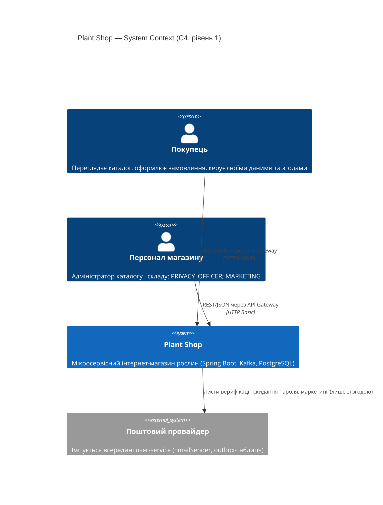
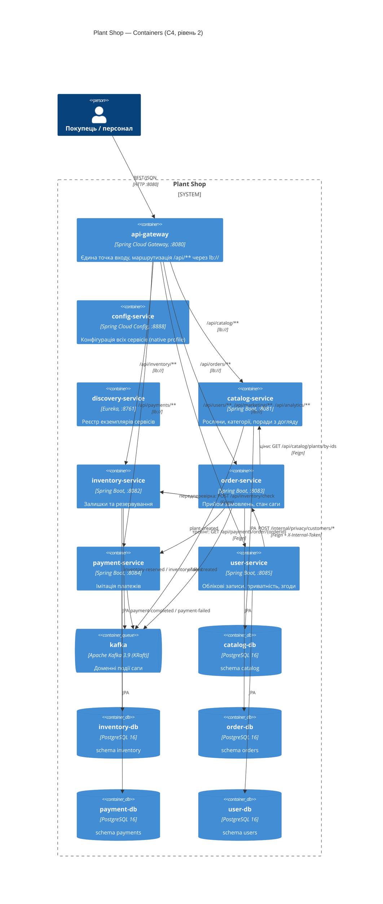
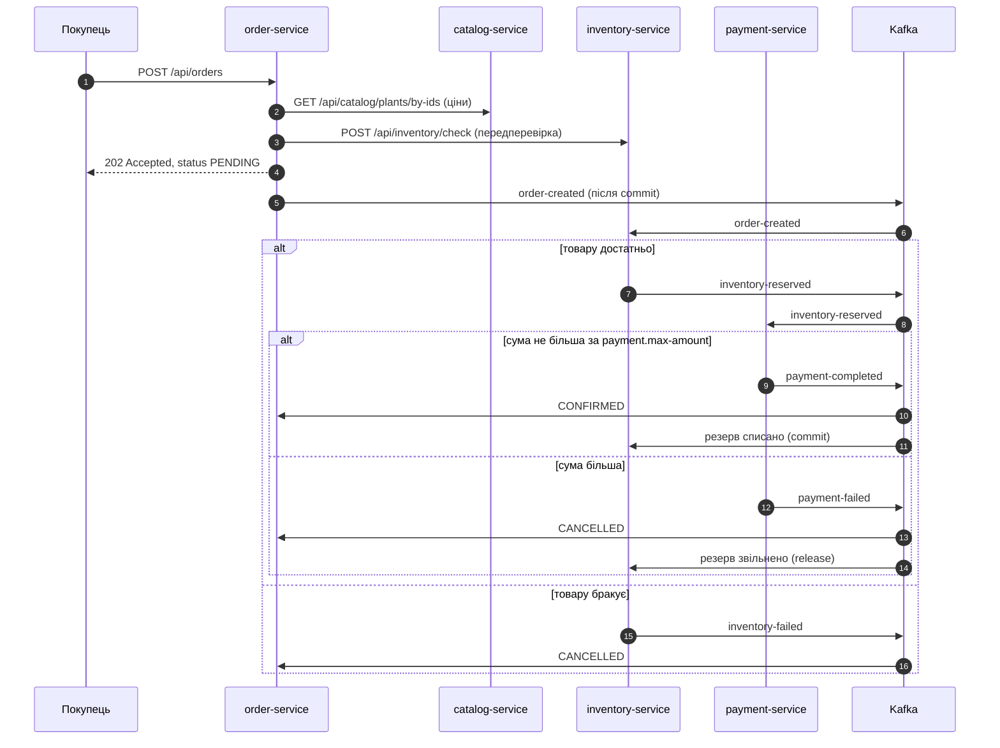
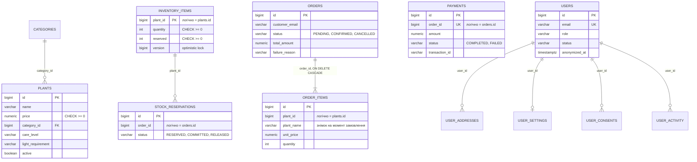

# SDD — System Design Document: Plant Shop

| Поле | Значення |
|---|---|
| Тип документа | документація продукту, архітектурна |
| Аудиторія | розробники, QA (контракти), DevOps (через посилання на ISD) |
| Власник | VladdHoryn (архітектор / мейнтейнер) |
| Цикл перегляду | 180 днів або при кожній зміні контракту, компонента чи моделі даних (див. [`maintenance.md`](maintenance.md)) |
| Останній перегляд | 2026-11-14 |
| Пов'язані документи | [`isd.md`](isd.md) — де і як компоненти розгорнуто; [`architecture/adr/`](architecture/adr) — чому так; [`README.md`](../README.md) — швидкий старт |

> Документ описує **як система влаштована всередині**. Де вона працює (контейнери, середовища, CI/CD,
> резервне копіювання) — у [ISD](isd.md). Відповідність цього документа коду перевіряє
> `./scripts/doc-drift-check.sh`: кожен REST-ендпоінт контролерів має бути в розділі 5.

## 1. Призначення і контекст системи

Plant Shop — інтернет-магазин рослин. Покупець переглядає каталог (фільтр за категорією, складністю догляду,
ціною), оформлює замовлення; система резервує товар на складі, імітує оплату і підтверджує або скасовує
замовлення. Окремий контур — приватність персональних даних: експорт даних, право на забуття, керування
згодами (GDPR-подібні вимоги).

## 2. C4 — діаграма контейнерів (рівень 2)

Не показано на діаграмі, щоб не перевантажувати її: **кожен** Spring-сервіс при старті читає конфігурацію з
config-service і реєструється в discovery-service; gateway і Feign-клієнти знаходять екземпляри через Eureka.
`kafka-ui` (:8090) — допоміжний інструмент розробника, не частина продукту. `secure-logging` — бібліотека,
а не контейнер: вона вбудована в кожен сервіс (розділ 3.9).

### 2.1. Потік замовлення (сага-хореографія, [ADR-0002](architecture/adr/0002-kafka-choreography-saga.md))

## 3. Компоненти

Шар кожного бізнес-сервісу: `controller` → `service` → `repository` (Spring Data JPA), плюс `entity`, `dto`
(records), `mapper` (статичні методи), `exception` (`GlobalExceptionHandler`), `event` (Kafka). Розгортання
кожного компонента — у [ISD, розділ 3](isd.md#3-компоненти-та-їх-розгортання).

### 3.1. api-gateway

- **Відповідальність:** єдина точка входу для клієнтів; маршрути `/api/<service>/**` → `lb://<service>`;
  CORS; повтор GET-запитів на інший екземпляр при 5xx/IOException (rolling update).
- **Залежності:** [discovery-service](#33-discovery-service) (пошук екземплярів), [config-service](#32-config-service)
  (маршрути в `configurations/api-gateway.yml`).
- **Не маршрутизує** `/internal/**` — внутрішні ендпоінти order-service недоступні ззовні.
- Розгортання: [ISD → api-gateway](isd.md#3-компоненти-та-їх-розгортання).

### 3.2. config-service

- **Відповідальність:** Spring Cloud Config server (`native`), віддає YAML з
  `config-service/src/main/resources/configurations/`. Сервіси мають у своєму `application.yml` лише ім'я та
  `spring.config.import: configserver:`.
- **Залежності:** немає (стартує першим). Ті самі YAML-файли імпортують інтеграційні тести.

### 3.3. discovery-service

- **Відповідальність:** реєстр Eureka (standalone, 1 репліка).
- **Залежності:** [config-service](#32-config-service).

### 3.4. catalog-service

- **Відповідальність:** рослини і категорії: пошук із фільтрами та пагінацією (`PlantSpecifications`), CRUD,
  планувальник поливу (`WateringPlanner`, lookup table), поради з догляду (`care/*CareGuide`, композиція
  замість успадкування), `GET /api/catalog/info` (версія, pod, значення ConfigMap).
- **Публікує:** `plant-created` → [inventory-service](#35-inventory-service).
- **Споживачі API:** [order-service](#36-order-service) (`GET /api/catalog/plants/by-ids`), клієнти через gateway.
- **Дані:** `catalog-db`, схема `catalog` (розділ 4).

### 3.5. inventory-service

- **Відповідальність:** залишки (`quantity`, `reserved`, оптимістичне блокування `version`), резервування під
  замовлення (`stock_reservations`: RESERVED → COMMITTED / RELEASED), передперевірка наявності.
- **Слухає:** `plant-created` (створює рядок залишку), `order-created` (резервує), `payment-completed`
  (списує), `payment-failed` (звільняє резерв).
- **Публікує:** `inventory-reserved` → [payment-service](#37-payment-service); `inventory-failed` →
  [order-service](#36-order-service).
- **Споживачі API:** [order-service](#36-order-service) (`POST /api/inventory/check`).

### 3.6. order-service

- **Відповідальність:** прийом замовлення: ціни з [catalog-service](#34-catalog-service), передперевірка складу
  в [inventory-service](#35-inventory-service) (обидва — Feign, синхронно), збереження `PENDING`, подія
  `order-created`. Фінальний стан `CONFIRMED`/`CANCELLED` — за подіями саги. Внутрішній API приватності для
  [user-service](#38-user-service) (експорт і анонімізація замовлень клієнта, токен `INTERNAL_API_TOKEN`).
- **Слухає:** `payment-completed`, `payment-failed`, `inventory-failed`.
- **Трекінг замовлення** (компонент `OrderTrackingController` → `OrderTrackingService`): `GET /api/orders/{id}/tracking`
  повертає статус замовлення разом зі статусом платежу, який читається синхронно з
  [payment-service](#37-payment-service) через Feign-клієнт `PaymentClient`. 404 від payment-service означає, що
  сага ще не дійшла до оплати (`NOT_STARTED`); інша помилка payment-service → 503. Це запит на читання, а не
  крок саги ([ADR-0003](architecture/adr/0003-synchronous-payment-read-for-tracking.md)).
- **Важливо:** order-service **не керує** сагою командами (це не оркестрація): кожен учасник сам реагує на
  події ([ADR-0002](architecture/adr/0002-kafka-choreography-saga.md)).

### 3.7. payment-service

- **Відповідальність:** імітація платіжного провайдера: оплачує зарезервоване замовлення; відхиляє суму, більшу
  за `payment.max-amount` (`PAYMENT_MAX_AMOUNT`, типово 10 000); правила методів оплати (lookup table у `PaymentService`).
- **Слухає:** `inventory-reserved`. **Публікує:** `payment-completed`, `payment-failed`.
- **API:** лише читання платежів (`GET /api/payments/...`). Споживачі: клієнти через gateway і
  [order-service](#36-order-service) (трекінг замовлення, `GET /api/payments/order/{orderId}`).

### 3.8. user-service

- **Відповідальність:** реєстрація (верифікація e-mail), скидання пароля, HTTP Basic (e-mail як логін), ролі
  CUSTOMER / PRIVACY_OFFICER / MARKETING; право доступу (версійований експорт `PersonalDataExport` з усіх
  джерел через порти `service/export/*`), право на забуття (видалити / анонімізувати / зберегти за правилом
  `ErasureRule`), згоди (`MARKETING_EMAIL`, `OPTIONAL_ANALYTICS`) та «ворота» `ConsentPolicyGate` для
  маркетингу й аналітики; журнал `privacy_audit_events`.
- **Залежності:** [order-service](#36-order-service) `/internal/privacy/customers/*` (Feign
  `OrderPrivacyClient`, заголовок з `INTERNAL_API_TOKEN`).
- **Політика доступу:** чужий `id` повертає такий самий 404, як неіснуючий (не розкриває існування облікового
  запису). Деталі — `docs/privacy-report.md`.

### 3.9. secure-logging (бібліотека)

- **Відповідальність:** автоконфігурація (`SecureLoggingAutoConfiguration`), `logback-spring.xml` з
  `MaskingEncoder` / `PiiMasker` — маскує персональні дані і секрети в кожному рядку журналу;
  `CorrelationIdFilter` додає `X-Correlation-Id`.
- **Використовують:** усі сервіси (Maven-залежність; тому збірка з `-am`). Критичний модуль quality gate
  (покриття ≥ 80 %, mutation score ≥ 65 %).

## 4. Модель даних

Database-per-service ([ADR-0001](architecture/adr/0001-database-per-service-postgresql-flyway.md)): зв'язки між
сервісами — лише логічні ідентифікатори (`plant_id`, `order_id`), без зовнішніх ключів між базами. Схему
створюють тільки міграції Flyway `<service>/src/main/resources/db/migration`; Hibernate — `ddl-auto: validate`.

| Сервіс | Схема | Таблиці | Міграції |
|---|---|---|---|
| catalog-service | `catalog` | `categories`, `plants` | `V1__create_catalog_tables.sql`, `V2__seed_catalog.sql` |
| inventory-service | `inventory` | `inventory_items`, `stock_reservations` | `V1__create_inventory_tables.sql`, `V2__seed_inventory.sql` |
| order-service | `orders` | `orders`, `order_items` | `V1__create_order_tables.sql` |
| payment-service | `payments` | `payments` | `V1__create_payment_tables.sql` |
| user-service | `users` | `users`, `user_addresses`, `user_settings`, `user_activity`, `user_consents`, `consent_history`, `email_outbox`, `analytics_events`, `privacy_audit_events` | `V1__create_user_tables.sql`, `V2__seed_demo_users.sql` |

## 5. API-контракти

Повні схеми запитів/відповідей — Swagger UI кожного бізнес-сервісу: `http://localhost:<port>/swagger-ui.html`
(springdoc, генерується з коду, тому завжди актуальний). Нижче — перелік контрактів, на які покладаються
інші компоненти та тести QA. Формат: JSON; помилки — `GlobalExceptionHandler` (400 валідація, 404 не знайдено,
409 конфлікт).

### 5.1. Синхронні REST-контракти (через gateway, якщо не вказано інше)

| Ендпоінт | Сервіс | Хто викликає | Контракт поведінки |
|---|---|---|---|
| `GET /api/catalog/plants` | catalog | клієнт | фільтри `name`, `categoryId`, `careLevel`, `maxPrice`, пагінація `page`, `size` |
| `GET /api/catalog/plants/{id}` | catalog | клієнт | 404, якщо немає |
| `GET /api/catalog/plants/by-ids` | catalog | order-service (Feign) | `ids` — список; повертає `id, name, price, active` |
| `POST /api/catalog/plants` | catalog | адміністратор | створює рослину, публікує `plant-created` |
| `PUT /api/catalog/plants/{id}` | catalog | адміністратор | оновлення |
| `DELETE /api/catalog/plants/{id}` | catalog | адміністратор | видалення |
| `GET /api/catalog/categories` | catalog | клієнт | список категорій |
| `POST /api/catalog/categories` | catalog | адміністратор | 409 на дубль назви |
| `GET /api/catalog/info` | catalog | DevOps / helm test | версія застосунку, pod, значення ConfigMap |
| `GET /api/inventory` | inventory | адміністратор | усі залишки |
| `GET /api/inventory/{plantId}` | inventory | клієнт | `quantity`, `reserved`, доступно |
| `PUT /api/inventory/{plantId}` | inventory | адміністратор | `{"quantity": n}`, n ≥ 0 |
| `POST /api/inventory/check` | inventory | order-service (Feign) | список `{plantId, quantity}` → `{plantId, requested, available, inStock}` |
| `POST /api/orders` | order | клієнт | **202 Accepted**, `status: PENDING`; 400 — невалідний запит, 409 — нестача товару, 503 — catalog/inventory недоступні |
| `GET /api/orders/{id}` | order | клієнт | поточний статус замовлення |
| `GET /api/orders/{id}/tracking` | order | клієнт | `orderStatus`, `paymentStatus` (`NOT_STARTED` / `COMPLETED` / `FAILED`), `transactionId`, `failureReason`, `nextStep`; 404 — немає замовлення; 503 — payment-service недоступний |
| `GET /api/orders` | order | клієнт | `?email=` — замовлення покупця |
| `GET /api/payments/{id}` | payment | клієнт | платіж за id |
| `GET /api/payments/order/{orderId}` | payment | клієнт, order-service (Feign, трекінг) | платіж замовлення: `COMPLETED` або `FAILED` + причина; 404, поки платежу немає |
| `POST /api/users` | user | анонім | реєстрація, лист верифікації |
| `POST /api/users/password-reset` | user | анонім | однакова відповідь незалежно від існування облікового запису |
| `GET /api/users/{id}/personal-data` | user | власник, PRIVACY_OFFICER | версійований експорт усіх персональних даних |
| `POST /api/users/{id}/anonymize` | user | власник, PRIVACY_OFFICER | право на забуття, включно із замовленнями |
| `GET /api/users/{id}/consents` | user | власник | стан згод та історія |
| `POST /api/users/{id}/consents/{purpose}/grant` | user | власник | надати згоду |
| `POST /api/users/{id}/consents/{purpose}/revoke` | user | власник | відкликати згоду |
| `POST /api/marketing/emails` | user | MARKETING | надсилається лише якщо `ConsentPolicyGate` дозволяє |
| `POST /api/analytics/events` | user | власник | записується лише зі згодою `OPTIONAL_ANALYTICS` |

### 5.2. Внутрішні контракти (не маршрутизуються gateway)

| Ендпоінт | Сервіс | Хто викликає | Контракт |
|---|---|---|---|
| `POST /internal/privacy/customers/orders` | order | user-service (Feign) | замовлення клієнта для експорту; потрібен `INTERNAL_API_TOKEN` |
| `POST /internal/privacy/customers/anonymize` | order | user-service (Feign) | анонімізація замовлень; ідемпотентно |

### 5.3. Асинхронні контракти (Kafka)

Ключ повідомлення — `orderId` (або `plantId` для `plant-created`), значення — JSON. Типи зіставляються псевдонімами
`spring.json.type.mapping` у YAML config-service; кожен сервіс має власну копію record-класів подій (спільного
модуля подій немає), тому перейменування події змінює всі копії та всі mapping-и.

| Топік | Продюсер | Споживачі | Зміст (record) |
|---|---|---|---|
| `plant-created` | catalog-service | inventory-service | `PlantCreatedEvent` |
| `order-created` | order-service | inventory-service | `OrderCreatedEvent` (позиції, сума, метод оплати) |
| `inventory-reserved` | inventory-service | payment-service | `InventoryReservedEvent` |
| `inventory-failed` | inventory-service | order-service | `InventoryFailedEvent` (причина) |
| `payment-completed` | payment-service | order-service, inventory-service | `PaymentCompletedEvent` |
| `payment-failed` | payment-service | order-service, inventory-service | `PaymentFailedEvent` (причина) |

Гарантії: подія публікується лише після commit транзакції БД (`@TransactionalEventListener`); споживачі
ідемпотентні (повторна доставка ігнорується).

## 6. Наскрізні рішення

| Тема | Рішення | Де деталі |
|---|---|---|
| Сховище даних | PostgreSQL на сервіс + Flyway | [ADR-0001](architecture/adr/0001-database-per-service-postgresql-flyway.md) |
| Інтеграція | синхронно Feign для перевірок і читання стану (трекінг), асинхронно Kafka для саги | [ADR-0002](architecture/adr/0002-kafka-choreography-saga.md), [ADR-0003](architecture/adr/0003-synchronous-payment-read-for-tracking.md) |
| Конфігурація | централізовано в config-service | [ISD, розділ 4](isd.md#4-середовища-та-змінні-оточення) |
| Безпека | HTTP Basic у user-service; `INTERNAL_API_TOKEN` для `/internal/**`; секрети лише через змінні оточення | `docs/privacy-report.md` |
| Журнали | маскування PII і секретів, correlation id | розділ 3.9 |
| Якість | CC ≤ 10, покриття та mutation score, контракт документації | [ISD, розділ 6](isd.md#6-cicd-конвеєр-і-quality-gates) |
